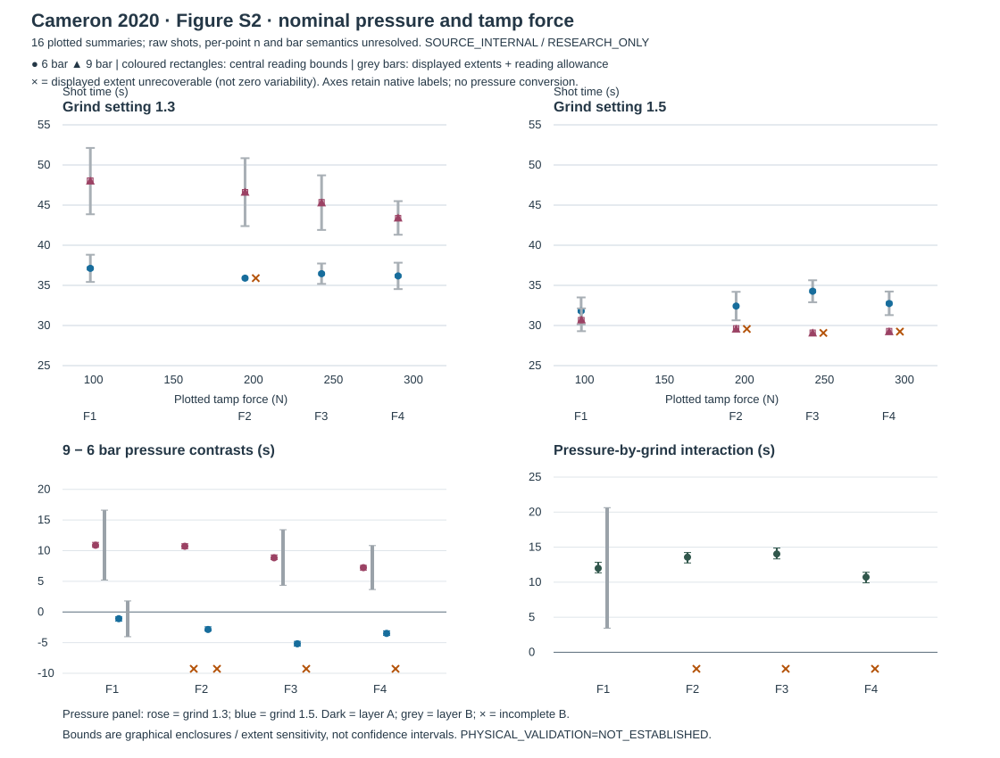

# SCI-MD-CAMERON-PRESSURE-TAMP-001

**The plotted shot-time response to nominal pressure differs between grinds.**
Under the retained central-summary reading bounds, 9 bar is longer than 6 bar at
grind 1.3 and shorter at grind 1.5 at each of the four common nominal force groups.
All four additive pressure-by-grind interactions are positive. The displayed-extent
exercise still supports a positive interaction at the lowest force group, even
though it does not resolve that group's grind 1.5 pressure ordering.

**Tamp endpoint changes are visible in the central summaries, but are not resolved
by the available displayed extents.** From the common lowest to highest force
group, the 9−6-bar contrast decreases at both grinds. This is a conditional
relationship among plotted source summaries, not a population or causal effect.

G1 / NO_GOVERNING_PHYSICS_CHANGE / RESEARCH_ONLY / RETROSPECTIVE /
TARGET_EXPOSED / SOURCE_INTERNAL / NONSCORING. **PHYSICAL_VALIDATION=NOT_ESTABLISHED.**

## Source, data and coverage

[Cameron et al. (2020)](https://doi.org/10.1016/j.matt.2019.12.019), standalone SI
Figure S2, PDF page 7 / printed page 6. The downloaded 8-page SI and 19-page final
main paper match the supplied SHA256 identities; [SOURCE_NOTES.md](SOURCE_NOTES.md)
records URLs, hashes, inspected methods, geometry, uncertainties and rights.
The [plan](PLAN.md) preceded production extraction/calculation but is explicitly
retrospective and target-exposed, with no held-out or preregistration claim.

Stable dataset: **cameron2020/figS2_pressure_tamp**. The qualified
[observations.json](../../../puckworks/data/cameron2020/s2/observations.json)
retains 16 central markers, all 16 native x/y anchors and candidate enclosures,
four authenticated common force groups, 12 recoverable bars (24 outer endpoints),
and four missing bars. The [flat observations](observations.csv) preserve plotted
force/time bounds and available displayed endpoints. These are **not 16 authenticated
shots**; per-point n, summary statistic, bar semantics and clock origin remain unresolved.

Force groups are authenticated by the four recurrent horizontal clusters across
all four labelled series, including common x-reading intersections. Exact nominal
forces are not established: F1–F4 are retained, with actual plotted force values
and uncertainties per marker. No rounded force sequence is substituted. General
Puqpress accuracy ±3 N is separate from graphical x uncertainty; a nominal match
does not prove identical applied forces. F1/F4 are the shared extrema for all
endpoint comparisons.

| Group | Approximate plotted force (N) | 6 bar / grind 1.3 (s) | 9 bar / grind 1.3 (s) | 6 bar / grind 1.5 (s) | 9 bar / grind 1.5 (s) |
|---|---:|---:|---:|---:|---:|
| F1 | 97.2–97.4 | 37.12 | 48.01 | 31.81 | 30.71 |
| F2 | 194.1 | 35.90† | 46.61 | 32.42 | 29.56† |
| F3 | 242.0 | 36.45 | 45.29 | 34.27 | 29.07† |
| F4 | 289.8 | 36.18 | 43.40 | 32.74 | 29.24† |

Nominal readings shown to 0.01 s for convenient identification, not measurement
precision. Full enclosures are in the dataset. † No recoverable bar endpoints;
this does not mean zero variability. Connecting paths corroborate existing
markers; there is no interpolation, pooling or manufactured replication.
Intermediate force observations remain context without a linear/monotone assumption.



## All declared comparisons

[CONTRASTS.md](CONTRASTS.md) lists every numerical row;
[contrasts.json](contrasts.json) and [contrasts.csv](contrasts.csv) retain 18 stable
IDs in **each** layer, signed original observation coefficients, native labels,
nominal values, unrounded and outward-rounded bounds, signs, missing objects and
anchor ambiguities. The 18 contrasts share the same 16 observations and are not 18
independent experiments. I and J are additive differences in seconds.

Layer A encloses the candidate central anchors plus the recorded graphical and
calibration allowances. Layer B uses displayed endpoints plus their endpoint
reading allowances **once**, without adding central uncertainty again. All
contrasts are computed from signed original source coordinates with one shared
negative time-axis scale; the common affine offset cancels. Internal arithmetic
is exact rational; reported interval endpoints round outward to 0.01 s.

| Family | A complete | A signs | B complete | B signs among complete | B incomplete |
|---|---:|---|---:|---|---:|
| Pressure DP | 8/8 | 4 positive, 4 negative | 4/8 | 3 positive, 1 unresolved | 4 |
| Pressure-by-grind I | 4/4 | 4 positive | 1/4 | 1 positive | 3 |
| Tamp endpoint DF | 4/4 | 1 positive, 3 negative | 3/4 | 3 unresolved | 1 |
| Tamp change in pressure contrast J | 2/2 | 2 negative | 1/2 | 1 unresolved | 1 |
| **Total** | **18/18** | **9 positive, 9 negative** | **9/18** | **4 positive, 5 unresolved** | **9** |

1. **Pressure ordering.** At grind 1.3, DP=9−6 bar is positive for F1–F4,
   nominally 10.89, 10.72, 8.84, 7.23 s. At grind 1.5 it is negative,
   nominally−1.10, −2.86, −5.19, −3.50 s. See the complete A bounds in the linked table.
   B supports positive grind 1.3 DP at F1 [5.21, 16.61], F3 [4.35, 13.42] and
   F4 [3.66, 10.83] s. Its grind 1.5/F1 DP is unresolved[−4.04, 1.80] s;
   the other four DP rows lack at least one displayed extent.
2. **Additive interaction.** A supports positive I at all groups:
   F1 [11.34, 12.85], F2 [12.74, 14.24], F3 [13.32, 14.88], F4 [9.90, 11.42] s.
   B supports I-F1 [3.44, 20.64] s; F2–F4 are incomplete. Thus a supported
   interaction does not require every component pressure sign to resolve.
3. **Opposite pressure signs.** A supports opposite ordering at all four groups,
   because both component signs resolve and oppose each other. **B establishes
   no reversal**: its only complete pair includes the unresolved grind 1.5/F1 DP.
   Positive I by itself is not a reversal claim.
4. **Lowest-to-highest tamp changes in shot time.** A DF bounds are
   6 bar / grind 1.3 [−1.16, −0.72], 6 bar / grind 1.5 [0.69, 1.20],
   9 bar / grind 1.3 [−5.17, −4.20], 9 bar / grind 1.5 [−1.83, −0.91] s.
   B leaves its three complete DF rows unresolved; 9 bar / grind 1.5 is incomplete.
   No zero or practically negligible tamp effect is established.
5. **Lowest-to-highest tamp change in pressure contrast.** A J is negative:
   grind 1.3 [−4.43, −3.06] s, grind 1.5 [−3.03, −1.60] s. This directly supports
   an endpoint change in the plotted pressure response under layer A, rather
   than inferring dependence from one resolved and one unresolved DP.
   B J-grind 1.3 is unresolved[−12.90, 5.55] s; J-grind 1.5 is incomplete.
   Neither proves force independence. Endpoint J does not exclude intermediate
   nonmonotonicity, and no constancy of I across forces is claimed.
6. **What survives the displayed extents.** Three positive grind 1.3 pressure
   comparisons and one positive interaction survive. Tamp endpoint signs and
   reversal do not resolve in B; missing endpoints limit nine B rows. Valid A
   comparisons remain available when B is incomplete.

B is **sensitivity to the displayed extents**, not a confidence interval for a
contrast, significance/equivalence test, individual-shot range or population
guarantee. Unknown bar statistics/correlation are not resolved by interval
arithmetic. Overlap does not establish no effect; separation is not statistical
significance. A's graphical bounds likewise are not standard errors or sampling
uncertainty. Source coordinate precision does not authenticate measurement precision.

## Development implication and limits

A future model specifically reproducing this source experiment's plotted central
summaries would need a grind-dependent nominal-pressure endpoint response with
opposite signs at these grinds and a reduced 9−6-bar contrast from F1 to F4 under
the retained A reading contract. At the more permissive displayed-extent layer,
the directly supported constraint is positive grind 1.3 pressure response at three
groups and positive pressure-by-grind interaction at F1. The unresolved B tamp
contrasts remain bounds, not evidence of independence or equivalence.

Physical interpretation would require source-specific pressure node/reference
and actual pressure histories, applied-force records and preparation protocol,
per-cell dose/beverage/temperature, shot-clock start/stop definition, replicate
identities/central statistic/bar definition and covariance, plus synchronized
mass/flow and bed-state observations. General 20-g/40-g/92°C methods context and
tamper accuracy do not fill those point-specific gaps.

This does not establish measured puck pressure-drop/flow, intrinsic permeability
or its evolution, compaction, erosion, fines migration, channels, choking or a
population effect. No 40-g/time instantaneous-flow or permeability conversion,
cross-coffee force-to-porosity transfer, Figure5 repair or physical model fit is
performed. Native 6/9-bar labels remain unresolved as pressure boundaries; no
MachineState conversion is made. Table S5's model-scaled fluxes are excluded.

## Reproduction and verification

```bash
python -m puckworks.analysis.cameron2020_pressure_tamp --output /tmp/cameron-s2
python -m pytest -q tests/test_cameron2020_pressure_tamp.py
```

The numerical analysis requires only committed qualified observations and the
standard library. [SOURCE_NOTES.md](SOURCE_NOTES.md) gives the additional private-PDF
re-extraction command. [REVIEW.md](REVIEW.md) records one substantive independent
source/arithmetic/claims review; [VERIFICATION.md](VERIFICATION.md) records relevant
checks and hosted CI separately.

Actual base: `72769feddee3fc38a4f716643bca9c567a595919`. Final submitted/tested head
is recorded in the PR closeout (avoiding a self-referential commit hash).
Smrke S1/Figure3, Cameron Figure5/source audit/numerical evidence, the consolidated
permeability comparison and historical scientific receipts remain unchanged.
EWP remains unchanged at reference main `f44c33dbb9b4fb80143e360e6f4a90f8ac0aa516`.
No production/default/lock/CI/threshold change, merge, auto-merge or successor study.
