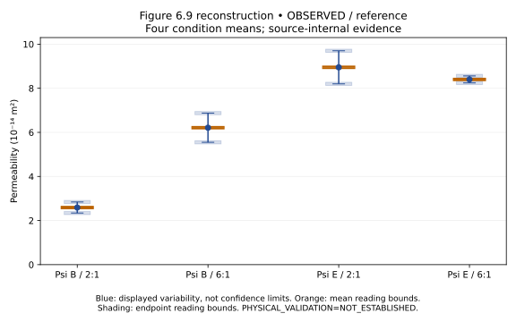

# SCI-MD-CORROCHANO-ASPECT-RATIO-CONSOLIDATION-001

**The fixed consolidation calculation overpredicts the fine-grind chamber
contrast on both declared material-input routes.** Figure 6.9 supports a ratio
of about **2.398**, versus fixed predictions **9.580** (adopted-average particle
porosity) and **5.557** (grind-specific porosity). Required conditional residual
prefactor ratios are **0.2503** and **0.4314**. For coarse, the recovered ratio
**0.9385** differs from the nominal equal-consolidation prediction **1** under
the declared graphic-reading bounds. These numerical mismatches do not reject
consolidation generally or identify a physical mechanism.

G1 / NO_GOVERNING_PHYSICS_CHANGE / RESEARCH_ONLY / RETROSPECTIVE /
TARGET_EXPOSED / SOURCE_INTERNAL. **PHYSICAL_VALIDATION=NOT_ESTABLISHED**.
No fit, parameter tuning, fitted closure implementation, production change,
adoption decision, protected holdout, or automatic successor. The [plan](PLAN.md)
and source-reading contract preceded principal calculation. [Source reconciliation](SOURCE_RECONCILIATION.md)
records facts, assumptions, availability and unresolved joins.

## A. Four recovered condition means

Primary source: [thesis Figure 6.9](https://etheses.bham.ac.uk/7176/2/Roman-Corrochano17EngD.pdf),
printed 236 / PDF 261, SHA256
`f131d9893e2ac78ce0664d5528beac4be51a02cf1ae684e41920fbc6cadc8818`.
All **4/4 means and 8/8 error endpoints** recovered from native vector paths;
repeated graphics are counted once. Conditions: initial 480 kg/m³, nominal 80°C;
Psi_B=journal A, Psi_E=journal D. No paired physical beds are recovered.

Units throughout the following table are **10⁻¹⁴ m²**. Square brackets are
graphic-reading bounds, rounded outward here. Endpoints represent displayed
variability; their own reading bounds are separate from its statistical meaning.

| Condition | Mean [reading bounds] | Lower displayed endpoint [reading bounds] | Upper displayed endpoint [reading bounds] |
|---|---:|---:|---:|
| Psi_B 2:1 | 2.59071 [2.5536, 2.6278] | 2.34235 [2.2687, 2.4160] | 2.84149 [2.7678, 2.9151] |
| Psi_B 6:1 | 6.21134 [6.1742, 6.2484] | 5.54907 [5.4754, 5.6227] | 6.87363 [6.8000, 6.9473] |
| Psi_E 2:1 | 8.95056 [8.9135, 8.9877] | 8.20064 [8.1270, 8.2743] | 9.70051 [9.6269, 9.7742] |
| Psi_E 6:1 | 8.40029 [8.3632, 8.4374] | 8.24202 [8.1684, 8.3157] | 8.56099 [8.4873, 8.6346] |

| Grind | R_kappa = mean(kappa6)/mean(kappa2) | Shared-axis reading bounds | Separate marginal outer enclosure |
|---|---:|---:|---:|
| Psi_B | 2.39754345 | [2.37198, 2.42385] | [2.34965, 2.44683] |
| Psi_E | 0.93852111 | [0.936648, 0.940386] | [0.930531, 0.946577] |

Both bars share one admissible axis calibration. Common multiplicative scale
cancels; uncertain zero does not. Primary bounds are joint graphic-reading
bounds. Marginal intervals form a conservative outer enclosure: some combinations
need not share a permissible calibration. Inclusion of unity in such an outer
enclosure would not prove a physically admissible match. Exact rational bounds
and full numerical presentations are in [RESULT.json](RESULT.json); the
[coordinate/provenance bundle](../../../puckworks/data/romancorrochano2017/fig6_9_aspect_ratio/PROVENANCE.md)
retains axis anchors, original points, path identities and widths.

Generic methods state three samples and use ambiguous “standard deviation … of
the mean” wording. Figure-specific sample identities/error definitions are not
independently recovered. Displayed variability is not used as SEM, a confidence
interval or a hard bound. Reading uncertainty excludes unquantified experimental,
consolidation and calibration uncertainties. Overlapping coarse error bars are
neither equality nor a significance result; no closeness tolerance is invented.



## B–C. Fixed predictions and conditional residuals

Use nominal rho_bulk=480 kg/m³ and registered rho_solid=1337 kg/m³:

    epsilon0 = 1 - rho_bulk / [rho_solid (1-epsilon_particle)]
    epsilon_j = (epsilon0-lambda_j)/(1-lambda_j)
    f(epsilon) = epsilon³/(1-epsilon)²
    R_KC = f(epsilon6)/f(epsilon2)
    F_required = R_kappa/R_KC

| Fixed scenario | epsilon_particle | epsilon0 | epsilon2; epsilon6 | R_KC | F_required [reading bounds only] |
|---|---:|---:|---:|---:|---:|
| A: Psi_B, lambda2=0.13, lambda6=0 | 0.53 adopted average | 0.23614316 | 0.12200363; 0.23614316 | 9.58008426 | 0.25026329 [0.247595, 0.253009] |
| B: Psi_B, same lambdas | 0.50 grind-specific | 0.28197457 | 0.17468341; 0.28197457 | 5.55694774 | 0.43144970 [0.426850, 0.436183] |
| C: Psi_E, lambda2=lambda6=0 | any common admissible value | symbolic | equal | 1 exactly | 0.93852111 [0.936648, 0.940386] |

Every F interval excludes unity **only under its fixed nominal inputs,
representative-state/common-prefactor assumptions and stated graphic-reading
contract**. Disposition: **NOMINAL_READING_MISMATCH**, physically
**UNRESOLVED_UNQUANTIFIED_MEASUREMENT_AND_COHORT_JOINS**. Fine route sensitivity is
substantial, yet neither declared route reproduces the reported contrast.

F_required is a conditional 6:1-to-2:1 residual prefactor ratio; it is not a
measured mean of bed-level prefactors, a fitted parameter, or an identified
mechanism. Effective particle volume is conserved by the calculation. The
prefactor is common within each grind's chamber comparison; fine and coarse need
not share it. Extraction, particle loss, swelling, fragmentation, deformation
and material-property changes are not controlled separately. “None observed”
supports nominal zero only, with no manufactured uncertainty/detection bound.

Consolidation influences both f(epsilon) and the source's length-based kappa
estimator. Their dependence is retained; no per-bed covariance or joint-error
propagation can be inferred from these aggregates. f(mean epsilon) is not
assumed equal to mean f(epsilon). No inherited input-rounding interval is used.

## D. Geometry, length and hydraulic accounting

Keep kappa (m²), **S_geom=A/L (m)**, **C_geom=kappa A/L (m³)**,
**G=C_geom/mu (m³/(Pa s))**, and **R_hyd=1/G (Pa s/m³)** distinct.
C_geom includes permeability; only S_geom is pure geometry.
For L_j=L_j0(1-lambda_j):

    H0 = A6 L20 / (A2 L60)
    H = H0 (1-lambda2)/(1-lambda6)
    G6/G2 = R_kappa × H0 × bed-length adjustment × (mu2/mu6).

| Representation / grind | Permeability ratio | Initial geometry H0 | Length adjustment | H | Total G6/G2, Rhyd2/Rhyd6 [reading bounds] at mu2/mu6=1 |
|---|---:|---:|---:|---:|---:|
| Equal initial volume / fine | 2.39754345 | 4.32674871 | 0.87 | 3.76427138 | 9.02500418 [8.92879, 9.12401] |
| Printed dimensions / fine | 2.39754345 | 4.37837838 | 0.87 | 3.80918919 | 9.13269658 [9.03534, 9.23288] |
| Equal initial volume / coarse | 0.93852111 | 4.32674871 | 1 | 4.32674871 | 4.06074502 [4.05264, 4.06882] |
| Printed dimensions / coarse | 0.93852111 | 4.37837838 | 1 | 4.37837838 | 4.10920055 [4.10099, 4.11737] |

The equal-initial-volume idealization gives H0=(6/2)^(4/3). Printed D/L values
37/18.5 and 54/9 mm give H0=(54/37)²(18.5/9); nominal consolidated fine lengths
are 16.095 and 9 mm. These are separate representations, not uncertainty
endpoints. No mixed geometry, machining tolerances or dose-derived density.
RESULT.json retains each area, initial/consolidated length, S_geom and C_geom.

This is multiplicative accounting, not causal percentage attribution. The
viscosity multiplier is set to 1 only in the explicit common-viscosity scenario.
Actual values multiply the table by mu2/mu6; nominal 80°C alone is insufficient.
Under a supported steady Darcy mapping at common **through-bed** flow, the total
also equals DeltaP2/DeltaP6. Absolute G/R require viscosity; none is invented.
The unknown meter volume reference and reused corrected-pressure calibration
qualify physical interpretation. These totals are representative states, not
reconstructed means of physical-bed conductances.

For an authenticated slope S_QP, kappa=mu(L/A)S_QP implies
kappa A/(mu L)=S_QP. A consistent length reinterpretation cancels at fixed
slope; changing lambda while holding published kappa fixed is a different,
conditional scenario. The former identity supplies no missing bed-level slopes
and does not justify mean(kappa)/mean(L)=mean(kappa/L).

## E. Reporting arithmetic and unresolved measurement joins

- Recovered means times full-chamber H0 give **10.373568** (fine) and
  **4.060745** (coarse), reproducing p.238's **10.37/4.06** at two decimals.
  Those numbers imply permeability ratios 2.39672/0.93835, consistent with the
  recovered figure; they are derived checks, not independent Q/P observations.
- p.235's fine “approximately 3” is a loose prose approximation, outside the
  declared reading range. It does not replace the four means.
- Neither primary fine route reproduces printed theoretical **10.6**.
  Arithmetic reconstruction with epsilon0=0.23 yields **10.58529**, rounding to
  10.6. That does not authenticate the author's intermediate. Registered
  epsilon0=0.23614316 rounds conventionally to **0.24**, not 0.23.
- Source p.219 says consolidated length enters estimated permeability, whereas
  Eqs.6.2–6.5 invoke full chamber length. Fine's nominal 0.87 adjustment explains
  the distinction between this task's 9.025 representative total and the source's
  full-chamber 10.37 arithmetic. The author/bed-level length and aggregation join
  is unresolved; this is not an automatic declaration of source error.
- Narrow bars track journal Table 2's means and variability and are linked
  aggregate presentations, not additional independent observations. Literal
  thesis coarse **9.00** versus journal **8.95** retains a precision discrepancy;
  physical-bed identity is unauthenticated. Source's 6.1b Psi_B citation is
  reconciled through panel **e** and p.230, not panel a's depth-only endpoint.
- Figure 6.8 qualitatively supports higher narrow-chamber resistance for both
  grinds on visible common-flow support. It is an audit of the same presentation,
  not a second digitization/regression or independent validation. Fine common-flow
  support is below the displayed empty-cell calibration observations; wide-cell
  reuse includes chamber-wall losses without new calibration. The printed
  polynomial/curve discrepancy is not repaired.

Unknown sample identities/weights, per-bed slopes/intercepts/lengths, actual
viscosity/extraction state, meter reference and correction implementation prevent
a physical adequacy decision. Generic p.87 and aspect-specific p.234 pressure
ranges remain discrepant; no schedule is assigned by marker index. No unique
attribution to geometry, conditioning, tortuosity, gas, fines or another mechanism.
This task does not explain Figure 6.23 transients or settle EWP #213.

## F. Cross-study synthesis and reproducibility

**Temperature-consolidation cross-study synthesis is UNAVAILABLE.** The actual
reported merged result, qualified inputs and helpers could not be located in
accessible current refs/PRs/tree or bounded local task evidence. Its conclusion
is neither inferred from thesis prose nor rerun. Shared campaign/grind/helper
would not authenticate paired histories or independent corroboration, and no
residual would be transferred. New information here is the chamber/protocol
contrast and separate material/geometry/conditioning accounting at nominal 80°C.

```sh
python -m puckworks.analysis.corrochano2017_aspect_ratio --output /tmp/aspect-ratio --plot
cmp /tmp/aspect-ratio/RESULT.json docs/analysis/sci_md_corrochano_aspect_ratio_consolidation_001/RESULT.json
cmp /tmp/aspect-ratio/readings.csv puckworks/data/romancorrochano2017/fig6_9_aspect_ratio/readings.csv
cmp /tmp/aspect-ratio/reconstruction.svg docs/analysis/sci_md_corrochano_aspect_ratio_consolidation_001/reconstruction.svg
python -m pytest -q tests/test_corrochano2017_aspect_ratio.py
```

Numerical producer uses only local registered inputs; `--plot` uses the existing
optional figures extra. Source extraction is separately documented in provenance.
[Independent review](REVIEW.md) and [verification](VERIFICATION.md) distinguish
science, software and hosted CI. Intake base is `f7bd1686854db990e7c8950ca6e9bd7dd8073bac`;
the draft PR/handoff records the final head without a self-referential commit claim.
EWP remains read-only. Stop here: no rescue fit or successor is authorized.
