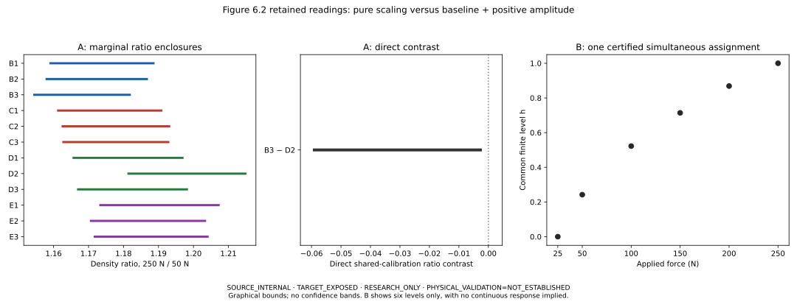

# Finite dry-loading density normalization

**SCI-MD-CORROCHANO-DENSITY-NORMALIZATION-001** — G1 /
NO_GOVERNING_PHYSICS_CHANGE / RESEARCH_ONLY / RETROSPECTIVE / TARGET_EXPOSED /
SOURCE_INTERNAL / NONSCORING. **PHYSICAL_VALIDATION=NOT_ESTABLISHED.**

**A — pure positive scaling:** `EXCLUDED_BY_SAMPLE_RATIO_CONTRAST`, both on the
primary 50→250 N interval (1/66 sample pairs) and across all 15 intervals (1/990).
The sole separation is B3 minus D2 at 50→250 N. No pair separates at 25→250 N.

**B — constant baseline plus positive scaling:**
`FEASIBLE_AT_DECLARED_FORCE_LEVELS_BY_EXPLICIT_WITNESS`. One simultaneous assignment
of all 72 readings is certified using one common nominal calibration, twelve sample
parameter pairs and one six-level vector. Every amplitude and selected density is
positive; all actual source-point and path-order checks pass.

Under the retained graphical-reading contract, positive sample-specific density
scaling alone cannot make the twelve represented samples share one density-at-force
response. However, one simultaneous admissible assignment of the six-force readings
does share a common finite response when each sample receives its own constant
density baseline and positive density amplitude.

These six-force observations therefore do not require different normalized response
shapes beyond sample-specific baseline and amplitude. This finite compatibility does
not establish that the actual material shapes are identical, identify a continuous
law between levels, validate a constitutive model or justify production use.

## Evidence and identities

Actual base: `81cfcebebf0625992fcbb60b93a9c6e965838b36`, current main merging #353;
accepted implementation `dd5375985a18ccf2af25bd3001d0f72ea71e1a38`;
#353 base / merged #352 `e21631e741ff739aaf4a6b9c58e5e11b161436cc`.
Read-only EWP main: `f44c33dbb9b4fb80143e360e6f4a90f8ac0aa516`.
Refreshed 23 October 2026: no intervening main changes or existing normalization
implementation/successor found. The [fixed plan](PLAN.md) and
[calculation contract](calculation_contract.json) were committed before formal
production at `5de7169502871fc599e8502fe60954dd57e7896e`.
Final submitted/tested head and hosted receipts are recorded in the draft PR handoff.

Reused dataset: `romancorrochano2017/fig6_2_dry_compaction`, thesis Figure 6.2,
printed p.223 / PDF p.248 / index247. The accepted PDF identity
`f131d9893e2ac78ce0664d5528beac4be51a02cf1ae684e41920fbc6cadc8818` is inherited;
**no fresh PDF authentication was performed**. Directly inspected retained files:
coordinates.csv (including original decimal operands), paths.json, contract.json,
holdings_checked.json and PROVENANCE.md, plus both predecessor producers/tests and
historical analysis evidence. All 38 protected source/predecessor files authenticate
against accepted hashes and remain byte-for-byte unchanged. Both predecessors'
reading bounds/statuses replay exactly; their outputs are verification only.

The accepted [source reconciliation](../sci_md_corrochano_dry_compaction_001/SOURCE_RECONCILIATION.md)
is reused. Original PDF/artwork and native mechanical records were not opened.
Native records were not recovered in the predecessor's scoped check; this is not
external-holdings exhaustion or universal absence. The 76 unique curve chunks,
repeated-paint deduplication, 64 approved tiny joins, four excluded legend strokes
and continuous paths beneath dash styling are retained. B1–E3 are graphical IDs,
not authenticated instrument-run IDs. Same thesis/journal/Melrose campaign; no new
dataset, loader, cohort or source-acquisition campaign. Source rights are unchanged.

## Exposure and complete coverage

The primary interval and B3/D2 diagnostic were selected after exploration. Proposal
review also inspected all 990 determinants and the complete 72-reading affine
witness. The supplied previews were not inputs, accepted repository results or test
oracles. Reconstruction agrees with their approximate precision; no allowances,
intervals, assignments or construction rules were tuned. This fixed implementation
contract is retrospective and target exposed, not a holdout or preregistration.

All five A reporting sets are retained, including within-grind sample pairs.
Canonical sample order is B1,B2,B3,C1,C2,C3,D1,D2,D3,E1,E2,E3; every pair contrast
is first minus second. Counts are reporting rows, not independent replications.

| Reporting set | Rows | Full support | Ambiguous |
| --- | --- | --- | --- |
| cross grind comparisons | 90 | 90 | 0 |
| density at force coordinates | 72 | 72 | 0 |
| grind ratio envelopes | 60 | 60 | 0 |
| sample density ratios | 180 | 180 | 0 |
| sample pair contrasts | 990 | 990 | 0 |

There are zero numerical unresolved readings. All 60 grind envelopes are complete;
all 90 direct cross-grind comparisons are non-exclusions. Marginal envelope overlap
is recorded separately. A single sample separation establishes no whole-grind order.

## A: shared density calibration and sufficient contradiction

Write upward `z=-y` and `rho=alpha+beta*z=beta*(z+tau)`. The inherited downward
anchors p0=424.861933375 and p1=216.98582035 pt carry r0=300 and r1=650 kg/m³,
with independent e0,e1∈[-1,1] pt. Their separation is d=207.876113025 pt and
`d-2>0`, so `beta=350/(d+e0-e1)` is strictly positive throughout the anchor set.

`tau=[650*(p0+e0)-300*(p1+e1)]/350` is linear in the independent perturbations.
Its exact interval, derived from their four corners, is
**[168091608471/280000000, 169611608471/280000000] pt**, with outward display
**[600.327173, 605.755745] pt**.

The density intercept does not cancel from a ratio. For each sample pair and force
interval, pure positive scaling requires
`C=(z_ib+tau)*(z_ja+tau)-(z_jb+tau)*(z_ia+tau)=0`, using ONE shared tau.
Expanding gives `C=z_ib*z_ja-z_jb*z_ia+tau*(z_ib+z_ja-z_jb-z_ia)`; tau² cancels.
The physical cross-product is beta²*C, with positive beta². No independence
assumption between beta and tau is needed after removing this factor.

C is separately affine in all four endpoint coordinates and tau. Moving each
coordinate in turn to an endpoint proves that the extrema on the conservative
rectangle occur among its 32 corners. The endpoint boxes relax shared force-axis
and path dependencies; some corners may be jointly unattainable. This enlargement
is valid for sufficient exclusion, and is not a joint-feasibility solver.

Every A reading retains the entire inherited force-query strip (shared ±1 pt anchors
and ±1 pt horizontal trace allowance), with full support in the union of explicit
segment projections. All admitted intersections, interior extrema and branches are
retained; the z projection expands by the full ±1 pt vertical trace allowance.
That guard already includes effective stroke. Component unions remain separate
from hulls. No gap is filled as observed, and no smoothing/extrapolation occurs.

All relevant z+tau denominators are strictly positive throughout their enclosures.
For a sample ratio `(z_b+tau)/(z_a+tau)`, the numerator coordinate is monotone and
the denominator-coordinate derivative has constant sign. At fixed endpoints the
tau derivative is `(z_a-z_b)/(z_a+tau)^2`, also constant sign. Endpoint/corner
evaluation therefore bounds each ratio with one tau at both endpoints.

For a direct pair contrast, divide C by a conservative positive enclosure of
`(z_ia+tau)*(z_ja+tau)`, taking minimum/maximum of all four signed endpoint
quotients. The determinant is authoritative; subtraction of marginal ratios loses
shared-calibration dependence and is only diagnostic.

The decisive B3−D2 contrast at 50→250 N is:

- Exact C: **[-34982641761297691243633789/7000000000000000000000, -1051410241132768446007235767226833/4302872119000000000000000000000] pt²**.
- Outward C display: **[-4997.520252, -244.350799] pt²**.
- Exact direct ratio difference: **[-244878492329083838705436523/4147751220988277564523109090, -7359871687929379122050650370587831/2725308181877599711894629736150465000]**.
- Outward direct display: **[-0.059039, -0.002700]**.
- Conservative D2−B3 positive margin: `7359871687929379122050650370587831/2725308181877599711894629736150465000`, approximately 0.002700564925783476.

The exact upper C endpoint is negative. The primary marginal intervals below can
overlap even while this shared-calibration direct contrast separates.

| Sample | 250 N / 50 N, outward ratio interval |
| --- | --- |
| B1 | [1.159121, 1.188570] |
| B2 | [1.158020, 1.186672] |
| B3 | [1.154495, 1.181780] |
| C1 | [1.161316, 1.190811] |
| C2 | [1.162599, 1.193052] |
| C3 | [1.162804, 1.192810] |
| D1 | [1.165729, 1.196859] |
| D2 | [1.181425, 1.214843] |
| D3 | [1.167024, 1.198118] |
| E1 | [1.173379, 1.207180] |
| E2 | [1.170703, 1.203311] |
| E3 | [1.171781, 1.204029] |

| Force interval (N) | Qualified pairs | Strict sample separations |
| --- | --- | --- |
| 25→50 | 66 | 0 |
| 25→100 | 66 | 0 |
| 25→150 | 66 | 0 |
| 25→200 | 66 | 0 |
| 25→250 | 66 | 0 |
| 50→100 | 66 | 0 |
| 50→150 | 66 | 0 |
| 50→200 | 66 | 0 |
| 50→250 | 66 | 1 |
| 100→150 | 66 | 0 |
| 100→200 | 66 | 0 |
| 100→250 | 66 | 0 |
| 150→200 | 66 | 0 |
| 150→250 | 66 | 0 |
| 200→250 | 66 | 0 |

Strict C.lower>0 or C.upper<0 qualifies; exact contact and zero-containing intervals
are NOT_EXCLUDED_BY_THIS_COMPARISON. Missing support, invalid positivity and
arithmetic failures stay explicit. Any qualified separation excludes A for all twelve
samples even if unrelated coverage is incomplete. Without a separation, complete
coverage would yield NOT_EXCLUDED_BY_THE_DECLARED_COMPARISONS; missing coverage
would yield UNRESOLVED_DUE_TO_SUPPORT_OR_READING_LIMITS. Neither is joint feasibility.
Whole-grind ordering requires all nine cross-sample contrasts in one strict direction.

## B: one simultaneous assignment at six force levels

Both axes use their original nominal anchors. Horizontal **and** vertical trace
allowances remain ±1 pt. Each nominal x±1 strip is clipped against every admitted
segment, then projected and expanded in z, retaining component unions and hulls.
For each sample, c is the 25 N hull midpoint and a is the 250 N hull midpoint minus c;
all a>0. Fix h_25=0 and h_250=1, only for B. At each intermediate force, intersect
all twelve [(L-c)/a,(U-c)/a] intervals and choose its midpoint once. All four
intersections are nonempty; the six chosen levels strictly increase.

The one nominal density calibration is
`alpha=1206082917650/1187863503` kg/m³ and
`beta=2000000000/1187863503` kg/m³ per pt.
Select z*=c+a*h, b=alpha+beta*c and s=beta*a. The exact parameter pairs, levels,
intersections and calibration are authoritative in [affine_witness.json](affine_witness.json);
the following decimals are explanatory approximations, not rounded acceptance criteria.

| Sample | b: selected 25 N density (kg/m³) | s: selected increase (kg/m³) |
| --- | --- | --- |
| B1 | 503.549262235208 | 125.053162155239 |
| B2 | 503.867905306418 | 123.265048534836 |
| B3 | 507.255298932131 | 119.266834011624 |
| C1 | 475.401193899460 | 117.337047775393 |
| C2 | 473.288216871236 | 117.797076293154 |
| C3 | 475.127830533236 | 117.813212703172 |
| D1 | 446.359009169257 | 111.125807872204 |
| D2 | 435.343436403661 | 118.838728461204 |
| D3 | 443.873802777317 | 112.414319495456 |
| E1 | 408.888471748282 | 107.347996689592 |
| E2 | 415.037955511796 | 106.432673249818 |
| E3 | 420.551374885541 | 108.425914432575 |

| Force (N) | Common h, approximate |
| --- | --- |
| 25 | 0.000000000000 |
| 50 | 0.242197557698 |
| 100 | 0.522385383871 |
| 150 | 0.713961790585 |
| 200 | 0.868671028139 |
| 250 | 1.000000000000 |

For every selected point, scan segments in retained path order and choose the first
whose feasible t∈[0,1] interval satisfies BOTH |x_source-x_nominal|≤1 and
|z_source-z*|≤1. Choose that interval's midpoint. The certificates retain segment
kind (original or approved join), stable chunk/vertex references, exact endpoints,
t/source point, both displacements, selected coordinate/density, actual component
and support references, and the same parameter pair/shared h used in each identity.

All **72/72** certificates satisfy actual source-segment membership, both displacement
limits, actual expanded component-union membership and ordered segment/parameter
progression through each retained sample path. Sorting rows by force alone is not
this check. This is graphical path order, not authenticated run chronology.
Every identity `rho*=alpha+beta*z*=b+s*h` is exact; all twelve s and all densities
are positive. Exactly twelve parameter pairs, one common six-level vector, four
intersection records and one common calibration are used. There are no per-force
parameters or per-sample h vectors. Hull intersections alone are never the certificate.

A failure would retain NO_CERTIFICATE_FOUND_BY_DECLARED_CONSTRUCTION, with row/reason
and a distinct arithmetic-failure flag; it would not exclude B. No alternate midpoint,
allowance, interval, branch or optimizer was introduced to obtain success.



Original Puckworks comparison from the retained factual coordinates of Roman
Corrochano's Figure 6.2. The local VizSpec separates A's marginal ratios from its
direct contrast; B shows six certified normalized levels without connecting lines,
a fitted continuous response or confidence bands. No source artwork is reproduced.

## Scientific interpretation and limits

The affine family contains both the offset-only family excluded in #353 and pure
scaling excluded here. Separate exclusion of those restricted families does not
exclude their combined family. #352's force-only-offset and #353's density-only-offset
conclusions remain intact. Their exclusions plus A do not exclude unrestricted
simultaneous force-and-density translations. Any inverse-curve connection needs
an appropriate common single-valued branch.

A has a conditional physical bridge: if mass stays fixed within each sample,
`V_b/V_a=rho_a/rho_b`. A shared relative volume-compression response at equal
applied forces therefore requires shared density ratios. With constant cross-sectional
area within each sample, the same ratio applies to relative height. No unloaded
density is invented. Equal force is not authenticated equal material stress; more
general preparation-dependent strain histories, effective stresses and changing
mass or area remain outside this bridge.

For B, b is the selected density at 25 N and s the selected 25-to-250 N density
increase. These finite-gauge witness values are not unloaded densities, moduli,
intrinsic material parameters or unique preparation mechanisms. Selected trace
displacements are admissible graphical choices, not measured instrument errors,
a probabilistic joint-error model or measured preparation parameters.

Graphical bounds do not quantify unreported instrument calibration, force zero,
apparatus compliance, initial states or preparation histories. No population or
significance, independent replication, wet-bed, permeability, causal-mechanism or
EWP-validation claim follows. PHYSICAL_VALIDATION=NOT_ESTABLISHED. EWP, Smrke S1,
production defaults, governing equations, dependency pins and campaign identity
are unchanged. No constitutive implementation or production adoption is proposed.

## Artifacts and reproduction

A: [72 readings](density_at_force_coordinates.csv), [180 ratios](sample_density_ratios.csv),
[990 contrasts](sample_pair_contrasts.csv), [60 envelopes](grind_ratio_envelopes.csv),
[90 grind comparisons](cross_grind_comparisons.csv), [RESULT.json](RESULT.json).
B: [parameters](affine_parameters.csv), [levels](affine_levels.csv),
[intersections](affine_intersections.csv), [nominal readings](affine_readings.csv),
[72 certificates](affine_certificates.csv), [complete witness](affine_witness.json).
Authoritative numeric values are exact rational strings. Displays round outward;
explicit approximate parameter/level displays do not drive classifications.

```sh
python -m puckworks.analysis.corrochano2017_density_normalization --output /tmp/density-normalization --plot
python docs/analysis/sci_md_corrochano_density_normalization_001/review_check.py
python -m pytest -q tests/test_corrochano2017_density_normalization.py tests/test_corrochano2017_density_shift.py tests/test_corrochano2017_dry_compaction.py
```

The independent checker reconstructs raw operands/transforms and all certificate
constraints without calling the new producer's classification/success path or
trusting its bounds/flag. [Scientific review](REVIEW.md), [review receipt](review_receipt.json)
and [normal verification](VERIFICATION.md) are separate. Routine reproduction is
offline, without the PDF; matplotlib is used only for the original comparison figure.
Hosted checks are reported separately in the draft PR and are not inferred from local
success. This bounded task ends with one open draft PR, unmerged, auto-merge disabled.
