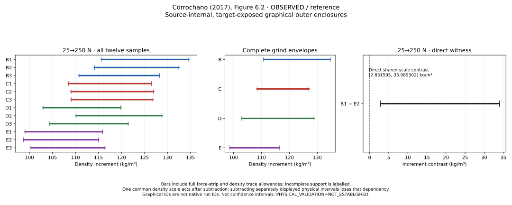

# Calibration-aware dry-loading density-offset comparison

**SCI-MD-CORROCHANO-DENSITY-SHIFT-001** — G1 / NO_GOVERNING_PHYSICS_CHANGE /
RESEARCH_ONLY / RETROSPECTIVE / TARGET_EXPOSED / SOURCE_INTERNAL.
**PHYSICAL_VALIDATION=NOT_ESTABLISHED.**

Primary 25→250 N: **EXCLUDED_BY_SAMPLE_INCREMENT_SEPARATION** (5/66
qualified sample pairs strictly separate). All 15 declared intervals:
**EXCLUDED_BY_SAMPLE_INCREMENT_SEPARATION** (10/990 pairs strictly separate).
These are reporting counts, not independent replications or statistical tests.

Under the retained graphical-reading contract, the twelve represented dry-loading
curves cannot share one density-at-force response whose only sample-specific
freedom is a constant additive density offset. A qualified sample-pair witness
already occurs on the primary interval; the conclusion does not depend on selecting
another interval or requiring separation of complete grind envelopes.

## Evidence, identity and coverage

Actual Puckworks base: `e21631e741ff739aaf4a6b9c58e5e11b161436cc` (#352 merged).
Predecessor tested head: `a0e1adf40b3b3633e433f1c797de084113f522f2`.
Read-only EWP main: `f44c33dbb9b4fb80143e360e6f4a90f8ac0aa516`.
Both live main identities matched intake; no relevant-source reconciliation was
needed. No existing task implementation/branch/PR was found. The committed
[plan](PLAN.md) and [calculation contract](calculation_contract.json) precede formal
production; verification records the commit. Final submitted/tested head and hosted
receipts belong in the PR handoff, avoiding a self-referential commit hash here.

Dataset `romancorrochano2017/fig6_2_dry_compaction` is reused. Figure 6.2 is printed
p. 223 / one-based PDF p. 248 / zero-based index 247. Accepted PDF identity:
`f131d9893e2ac78ce0664d5528beac4be51a02cf1ae684e41920fbc6cadc8818`.
All four input hashes authenticate against #352's RESULT.json; all 22 protected
source/predecessor files remain byte-identical. The 76 unique curve chunks, 152
curve paintings, 64 approved joins and four separate excluded legend strokes
remain unchanged. Graphical IDs B1–E3 are not authenticated native run IDs.
The thesis/journal are the same existing campaign, with no new cohort or loader.

Inspected underlying files: retained coordinates.csv (raw decimal operands and
composed page coordinates), paths.json, contract.json, holdings_checked.json and
PROVENANCE.md; predecessor producer/tests, PLAN, source reconciliation, RESULT,
REVIEW and retained tables. Original PDFs and native mechanical records were not
newly opened. #352's authenticated source audit and reconciliation are reused.
Native mechanical records were not recovered in its scoped check; this does not
establish that all possible records are absent. No broad external search or new
PDF extraction was performed. No PDF or source artwork is redistributed.

| Reporting set | Rows | Full support | Ambiguous | Other |
| --- | --- | --- | --- | --- |
| cross grind comparisons | 90 | 90 | 0 | 0 |
| density at force coordinates | 72 | 72 | 0 | 0 |
| grind increment envelopes | 60 | 60 | 0 | 0 |
| sample density increments | 180 | 180 | 0 | 0 |
| sample pair contrasts | 990 | 990 | 0 | 0 |

All 72 new readings reproduce the accepted exact marginal density bounds and
statuses. Numerical unresolved readings: 0.
Each CSV retains stable IDs, endpoint/source references and support metadata;
comparisons use **first minus second** in canonical B1,B2,B3,C1,C2,C3,D1,D2,D3,E1,E2,E3
order (grinds B,C,D,E). All within-grind sample pairs are included. Force intervals
use lower force first. There are no omitted overlap or contact rows.

## Common calibration and conservative arithmetic

Coordinates have top-left origin with downward y. Set **z=-y**, upward in page
points. Every requested force uses the full inherited anchor-corner strip plus
±1 pt force trace allowance. Its entire width must lie within the union of explicit
segment projections. Clip all segments and retain interior extrema, reversed and
constant segments and all branches. Expand the z projection by the full ±1 pt
density trace allowance; retain its component union and conservative hull.
The trace guard already includes effective stroke. It is neither removed during
cancellation nor supplemented by a second stroke guard. Approved joins and source
continuous paths beneath dash styling are inherited unchanged; no extrapolation,
unrecorded gap bridge, branch selection or monotone interpolation is introduced.

Write `rho=alpha+beta*z`. Accepted density anchors are 300 and 650 kg/m³ at downward
page positions 424.861933375 and 216.98582035 pt, with independent ±1 pt anchor
allowances. The exact nominal separation is `d=207.876113025` pt; `d-2>0`.
For anchor perturbations e0,e1∈[-1,1], the positive separation is d+e0-e1.
Consequently `beta_min=350/(d+2)` and `beta_max=350/(d-2)`:
**[`14000000000/8395044521`, `14000000000/8235044521`] kg/m³ per pt**, derived from the inherited decimals.
The separate anchor allowance affects the common affine calibration only.

Within sample j, `delta-rho_j=beta*delta-z_j`; between samples i,j,
`delta-rho_i-delta-rho_j=beta*(delta-z_i-delta-z_j)`. The shared alpha cancels,
while all independent endpoint trace allowances remain. For a common alpha and
beta>0, `alpha+beta*z_jk=b_j+h_k` iff `z_jk=c_j+g_k`:
take c_j=(b_j-alpha)/beta and g_k=h_k/beta; conversely b_j=alpha+beta*c_j and
h_k=beta*g_k. This is invariance of the exact finite additive representation,
not a solution of joint interval feasibility. No constants or common curve are fitted.

From Z_jk=[L_jk,U_jk], first form each sample's
`D_j=[L_jb-U_ja,U_jb-L_ja]`, then
`C_ij=[D_i.lower-D_j.upper,D_i.upper-D_j.lower]`.
All operations use exact rational arithmetic. Map an interval [l,u] by taking
the minimum and maximum of beta_min*l, beta_min*u, beta_max*l, beta_max*u.
The authoritative physical contrast scales C directly; it never subtracts
independently scaled physical increments. Negative and zero-crossing intervals
use the same endpoint-product rule, without nonnegative clamping.

Every admissible common force calibration chooses query coordinates inside these
strips, and every admitted trace endpoint lies in the corresponding expanded
component union/hull. Relaxing their shared dependencies into endpoint Cartesian
products can only enlarge D and C. Positive common-beta propagation then encloses
every admissible calibrated contrast. Hull endpoints need not be jointly attainable.
No joint force-calibration optimizer is used. The marginal replay feeds unexpanded
downward-y projections to the inherited Axis.output, which adds its guard once.

## Primary interval and exposed B1/E2 diagnostic

Tabulated interval displays round outward to six decimals; explicitly approximate
diagnostics are labelled as such. Classifications use exact signs.

| Sample | Delta-z (pt) | Density increment (kg/m³) | Status |
| --- | --- | --- | --- |
| B1 | [69.331134, 79.186727] | [115.620099, 134.621515] | SUPPORTED |
| B2 | [68.436948, 77.919230] | [114.128910, 132.466705] | SUPPORTED |
| B3 | [66.431783, 75.434314] | [110.784996, 128.242220] | SUPPORTED |
| C1 | [65.041847, 74.414317] | [108.467068, 126.508172] | SUPPORTED |
| C2 | [65.386719, 74.694596] | [109.042194, 126.984662] | SUPPORTED |
| C3 | [65.404156, 74.599086] | [109.071271, 126.822290] | SUPPORTED |
| D1 | [61.744798, 70.505024] | [102.968741, 119.862173] | SUPPORTED |
| D2 | [66.032446, 75.768587] | [110.119040, 128.810501] | SUPPORTED |
| D3 | [62.605396, 71.432243] | [104.403918, 121.438494] | SUPPORTED |
| E1 | [59.396490, 68.176265] | [99.052586, 115.903163] | SUPPORTED |
| E2 | [59.193625, 67.633180] | [98.714278, 114.979890] | SUPPORTED |
| E3 | [60.160227, 68.463238] | [100.326231, 116.391031] | SUPPORTED |

The primary interval and B1/E2 comparison were already exposed before this task.
The reconstructed diagnostic is B1 delta-z ≈[69.331134202463, 79.186726293239] pt; E2 delta-z ≈[59.193625675000, 67.633179465120] pt. These agree with the disclosed
preview to its approximate precision; no allowance, assignment, interval or support
rule was tuned to obtain agreement. The preview was not a computational input or
regression-test oracle.

Witness **`contrast:B1:E2:25:250`**, B1 minus E2:

- Exact page-coordinate contrast: [`820462928606714394544341/483206595890000000000000`, `13009540561939297531/650701500000000000`] pt.
- Outward page-coordinate display: **[1.697954, 19.993101] pt**.
- Exact common-scale contrast: [`5743240500247000761810387/2028270442668702809345000`, `91066783933575082717/2679277911190740750`] kg/m³.
- Outward physical display: **[2.831595, 33.989302] kg/m³**.
- Lower separation ≈1.697954737343 pt;
  ≈2.831595027678 kg/m³. It is strictly positive exactly.

For diagnostic context only, subtraction of the predecessor's independently mapped
marginal density bounds gives B1 ≈[113.365103031477, 136.693696015070]
and E2 ≈[96.296629251686, 117.241045438737] kg/m³,
then a marginal contrast ≈[-3.875942407260, 40.397066763384] kg/m³.
That arithmetic relaxes a shared density calibration separately at each endpoint.
The direct contrast retains cancellation of alpha and applies one beta after
subtraction. This diagnostic is not a competing decision rule. Even separately
displayed new physical increment intervals lose common-beta dependence if subtracted.

## Complete grind envelopes and full reporting set

Form each D_j before forming E_g=[min D_j.lower,max D_j.upper]. COMPLETE requires
all three declared samples with both endpoints qualified. Fully supported ambiguous
hulls may qualify while retaining their ambiguity; a partial hull is descriptive
only. A separated sample pair cannot establish whole-grind ordering.

| Grind | Density increment hull (kg/m³) | Completeness |
| --- | --- | --- |
| B | [110.784996, 134.621515] | COMPLETE (3/3) |
| C | [108.467068, 126.984662] | COMPLETE (3/3) |
| D | [102.968741, 128.810501] | COMPLETE (3/3) |
| E | [98.714278, 116.391031] | COMPLETE (3/3) |

| First − second | Direct common-scale contrast (kg/m³) | Classification |
| --- | --- | --- |
| B − C | [-14.047207, 24.047022] | NOT_EXCLUDED_BY_THIS_COMPARISON |
| B − D | [-15.873046, 29.652177] | NOT_EXCLUDED_BY_THIS_COMPARISON |
| B − E | [-3.453576, 33.989302] | NOT_EXCLUDED_BY_THIS_COMPARISON |
| C − D | [-18.236008, 22.015324] | NOT_EXCLUDED_BY_THIS_COMPARISON |
| C − E | [-5.816538, 26.352449] | NOT_EXCLUDED_BY_THIS_COMPARISON |
| D − E | [-11.421693, 28.178288] | NOT_EXCLUDED_BY_THIS_COMPARISON |

Across all 90 complete-grind comparisons, 0 strictly separate and
90 are NOT_EXCLUDED_BY_THIS_COMPARISON. All 60 envelopes are complete.
The sample-level global exclusion needs no additional whole-grind condition.

| Force interval (N) | Qualified sample pairs | Separated sample pairs | Separated complete grind pairs |
| --- | --- | --- | --- |
| 25→50 | 66 | 0 | 0 |
| 25→100 | 66 | 0 | 0 |
| 25→150 | 66 | 1 | 0 |
| 25→200 | 66 | 4 | 0 |
| 25→250 | 66 | 5 | 0 |
| 50→100 | 66 | 0 | 0 |
| 50→150 | 66 | 0 | 0 |
| 50→200 | 66 | 0 | 0 |
| 50→250 | 66 | 0 | 0 |
| 100→150 | 66 | 0 | 0 |
| 100→200 | 66 | 0 | 0 |
| 100→250 | 66 | 0 | 0 |
| 150→200 | 66 | 0 | 0 |
| 150→250 | 66 | 0 | 0 |
| 200→250 | 66 | 0 | 0 |

Complete exact reporting: [72 coordinates](density_at_force_coordinates.csv),
[180 sample increments](sample_density_increments.csv),
[990 sample contrasts](sample_pair_contrasts.csv),
[60 grind envelopes](grind_increment_envelopes.csv),
[90 grind comparisons](cross_grind_comparisons.csv), and [RESULT.json](RESULT.json).
All witness IDs and exact intervals are retained in RESULT.json. A comparison
separates only with full support and an exactly positive lower or negative upper
coordinate endpoint. Exact contact, overlap and containment are non-exclusions.
Missing support is UNSUPPORTED_OR_INCOMPLETE; numerical failures are distinct.
An otherwise qualified witness survives unrelated missing coverage. If none
separated, complete qualification would yield NOT_EXCLUDED_BY_THE_DECLARED_COMPARISONS;
missing qualification would yield UNRESOLVED_DUE_TO_SUPPORT_OR_READING_LIMITS.



## Interpretation ceiling and reproduction

The connection to `F_j(rho)=G(rho-b_j)` holds only under a common single-valued
inverse loading branch over the tested forces. An arbitrary non-injective G with
sample-dependent branch choices is outside this exclusion. Separate rejection of
force offsets in #352 and density offsets here **does not reject a common curve
with both offsets simultaneously**. Density rescaling, relative-initial-state
strain formulations and more general preparation effects remain untested.
The unrestricted b_j are not identified with measured initial densities.

This deterministic graphical comparison is not a protected holdout, significance
test, new experiment or constitutive-law implementation. Overlap, a successful
synthetic control or absence of a witness does not establish joint feasibility or
physical compatibility. No intrinsic modulus, unique constitutive law, packing or
friction mechanism, wet-bed behavior, permeability explanation, population evidence
or EWP validation is inferred. Common graphical calibration is distinct from
unknown instrument calibration, force zero, compliance, initial states and per-run
preparation histories; these are not quantified or removed by the graphical bounds.
**PHYSICAL_VALIDATION=NOT_ESTABLISHED.**

```sh
python -m puckworks.analysis.corrochano2017_density_shift --output /tmp/density-shift --plot
python -m pytest -q tests/test_corrochano2017_density_shift.py tests/test_corrochano2017_dry_compaction.py
python docs/analysis/sci_md_corrochano_density_shift_001/review_check.py
```

Routine production uses retained geometry offline, without the original PDF,
network access or an optional PDF reader. Plotting uses the repository's existing
Matplotlib option. [Independent review](REVIEW.md) and [verification](VERIFICATION.md)
separate scientific review, local software checks and hosted CI. Accepted predecessor
artifacts, EWP, Smrke S1, production defaults, governing equations and dependency
pins remain unchanged. One draft PR is left open and unmerged, auto-merge disabled;
no successor is launched.
