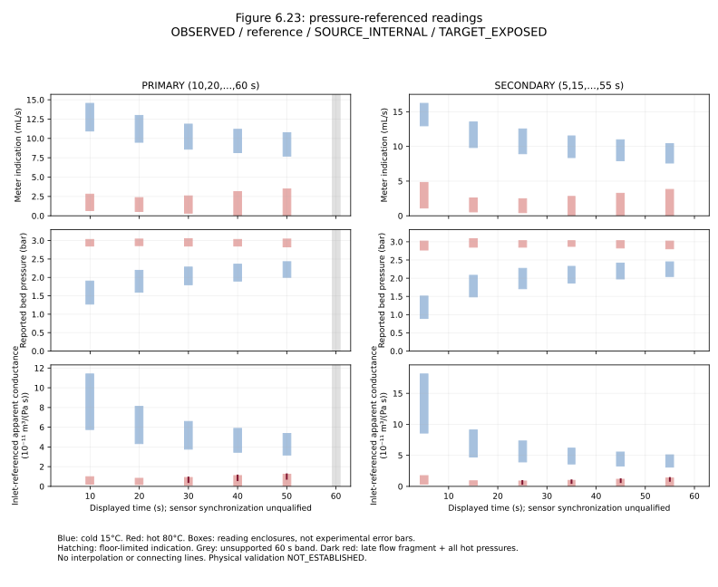

# SCI-MD-CORROCHANO-PRESSURE-FLOW-001

**Cold inlet-referenced apparent conductance declines on both declared grids.
The complete hot-condition envelopes do not resolve a temporal trend.** One
separately readable late hot-flow fragment resolves a small secondary-grid
increase when divided by the full hot pressure envelope. Cold conductance exceeds
hot at every supported declared time. These are changes in published indication
ratios under fixed source-reading bounds; **PHYSICAL_VALIDATION=NOT_ESTABLISHED**.

G1 / NO_GOVERNING_PHYSICS_CHANGE / RESEARCH_ONLY / RETROSPECTIVE /
TARGET_EXPOSED / SOURCE_INTERNAL. No mechanism implementation, hydraulic fit,
viscosity-only rejection, production adoption or independent campaign replication.
The [plan](PLAN.md) was frozen after qualitative source inspection, before
coordinate transcription or numerical scoring. The [source reconciliation](SOURCE_RECONCILIATION.md)
separates supported facts, assumptions and unresolved joins. The
[offline producer](../../../puckworks/analysis/corrochano2017_pressure_flow.py)
reuses the unchanged Melrose finite-order functions.

## A. Recovered pressure-referenced information

The scored source is Roman Corrochano's2017 Birmingham Eng.D.
[Figure6.23](https://etheses.bham.ac.uk/7176/2/Roman-Corrochano17EngD.pdf),
printed266/PDF291: Psi_B, initial400kg/m³,15°C/80°C. Both native512×384 JPEGs
and the PDF match the requested hashes. Source PDFs, images and overlays stay
outside Git. [Coordinates and contract](../../../puckworks/data/romancorrochano2017/fig6_23_pressure_flow_temperature/PROVENANCE.md)
retain shared calibration, full time bands, guards and missing support.

Recovered:44/48 requested condition-panel slots (11 times ×2 conditions ×2
panels), plus7 readings of one late hot-flow fragment. Three flow strokes per
condition can be distinguished somewhere, but complete individual pressure-flow
trajectories and authenticated cross-panel pairs recovered are **zero**. Hidden
trajectory and physical-run counts remain UNKNOWN. Three repetitions are stated
in the caption; the intake does not manufacture three named paired runs.
All four60s slots are unsupported because their full bands extend beyond the
visible endpoints. No ordinates from Figures6.15/6.16/6.24 are added.

New here is a time-varying **reported bed-pressure ordinate**, so the numerator
is divided by its supported pressure range at the same displayed-time band,
not by constant tank pressure. Cold pressure rises substantially while hot
pressure is already near its plateau. This allows a pressure-referenced
figure-level constraint absent from the prior Melrose outlet-aliquot intake.
It does not convert that earlier dataset or its historical conclusions.

For nonnegative meter-indication bounds and P_L>0:

    G_app = Q_meter / DeltaP_bed_reported
    G_app in [Q_L/P_U, Q_U/P_L], in m³/(Pa s).

The following bounds use display unit **10⁻¹¹m³/(Pa s)**; multiply by1e-11 for SI.
No central representative trajectory is assigned to a condition envelope.

### PRIMARY grid

| Nominal t (s) | Cold G_app enclosure | Hot G_app enclosure | Cold−hot enclosure | Cold/hot ratio | Hot flow calibration support |
|---:|---:|---:|---:|---:|---|
| 10 | [5.765, 11.4] | [0.2214, 0.9804] | [4.784, 11.18] | [5.88, 51.51] | BELOW |
| 20 | [4.337, 8.112] | [0.1838, 0.8203] | [3.516, 7.928] | [5.287, 44.13] | BELOW |
| 30 | [3.775, 6.584] | [0.1099, 0.902] | [2.873, 6.474] | [4.185, 59.91] | BELOW |
| 40 | [3.46, 5.882] | [0, 1.098] | [2.362, 5.882] | [3.151, unbounded] | AMBIGUOUS |
| 50 | [3.18, 5.363] | [0, 1.225] | [1.954, 5.363] | [2.595, unbounded] | AMBIGUOUS |
| 60 | UNSUPPORTED | UNSUPPORTED | UNSUPPORTED | UNSUPPORTED | UNSUPPORTED |

### SECONDARY grid

| Nominal t (s) | Cold G_app enclosure | Hot G_app enclosure | Cold−hot enclosure | Cold/hot ratio | Hot flow calibration support |
|---:|---:|---:|---:|---:|---|
| 5 | [8.593, 18.13] | [0.3704, 1.734] | [6.859, 17.75] | [4.956, 48.94] | AMBIGUOUS |
| 15 | [4.731, 9.098] | [0.1812, 0.902] | [3.829, 8.917] | [5.245, 50.22] | BELOW |
| 25 | [3.941, 7.32] | [0.1476, 0.8627] | [3.078, 7.173] | [4.568, 49.59] | BELOW |
| 35 | [3.606, 6.168] | [0, 0.9728] | [2.633, 6.168] | [3.707, unbounded] | BELOW |
| 45 | [3.287, 5.537] | [0, 1.146] | [2.141, 5.537] | [2.868, unbounded] | AMBIGUOUS |
| 55 | [3.105, 5.082] | [0, 1.355] | [1.75, 5.082] | [2.292, unbounded] | AMBIGUOUS |

All11 supported condition-envelope differences are strictly positive. Finite
ratio bounds are indication-level bounds only; hot-floor times retain an
unbounded upper ratio, not a silently omitted comparison. No comparison exists
at60s. Nine hypothetical cold/hot track pairs would not be nine independent
experiments; here the output is conservative group envelopes, not such a pairing.
Rounding above is for display; exact fractions and unrounded results are retained.

### Temporal compatibility and exact quantifiers

| Grid / retained support | Nondecreasing | Nonincreasing | Constant | Resolved same-trough decline/recovery |
|---|---|---|---|---|
| PRIMARY / complete cold envelopes | Excluded | Not excluded | Excluded | None |
| SECONDARY / complete cold envelopes | Excluded | Not excluded | Excluded | None |
| PRIMARY / complete hot envelopes | Not excluded | Not excluded | Not excluded | None |
| SECONDARY / complete hot envelopes | Not excluded | Not excluded | Not excluded | None |
| PRIMARY / late hot-flow fragment + full hot P | Not excluded | Not excluded | Not excluded | None |
| SECONDARY / late hot-flow fragment + full hot P | Not excluded | Excluded | Excluded | None |

“Not excluded” means **not excluded by the declared rectangular relaxation**,
not a jointly admissible physical trajectory. Feasible interval selections may
use mutually inconsistent shared calibration, times or pressure partners.

The strongest PRIMARY cold decline is10→50s:

    cold_G_10 lower = 5.764705882352941e-11
    cold_G_50 upper = 5.363128491620112e-11
    strict gap = 611/152150000000000 = 4.015773907328295e-12 m³/(Pa s).

The strongest SECONDARY cold decline is5→55s:

    cold_G_05 lower = 8.592592592592593e-11
    cold_G_55 upper = 5.081967213114754e-11
    strict gap = 2891/82350000000000 = 3.510625379477839e-11 m³/(Pa s).

Their exact quantifier is **universal separation of complete condition envelopes**
for the represented plotted support at those times. It survives every admissible
fixed cross-panel matching whose ordinates are contained in those envelopes,
and all contained within-panel identity alternatives. Under the explicit
same-represented-population assumption, every such represented run has a decline
across the named pair under every such matching. This is **not** an authenticated
all-physical-repetitions claim or an individual-run trend count. No vertical-rank
matching was used and no artificial list of six matchings is reported.

For the late upper hot-flow fragment on the SECONDARY grid,25→55s gives:

    hot_G_late_upper_25 upper = 8.627450980392157e-12
    hot_G_late_upper_55 lower = 8.888888888888889e-12
    strict gap = 1/3825000000000 = 2.614379084967321e-13 m³/(Pa s).

This small result is restricted to **one documented flow fragment against every
pressure partner contained in the hot pressure envelopes**, including any fixed
partner. It is particularly reading-contract dependent; it does not establish
all hot runs recover. The early hot merge is not joined to the fragment, so
there is no same-run decline-then-recovery claim. Neither condition has a resolved
universal same-trough witness on either grid. The complete hot envelopes allow
constant selections even while a documented subset excludes constancy: an
outer envelope's feasibility cannot validate every individual trajectory.

[RESULT.json](RESULT.json) retains each reading ID, time enclosure, SI interval,
censoring/applicability, quantifier, supported pair/triple and strongest witness.
The reused transitive closure includes nonadjacent contradictions; equality or
touching is compatible. All source-derived strict decisions use exact rational
arithmetic. Witness/triple/grid counts are not independent experiments and have
no significance interpretation. Finite comparisons establish neither derivatives,
a continuous minimum, nor monotone intervening segments.



Rectangles show the full retained displayed-time and ordinate bounds. Hatching
marks hot floor-indication regions; grey marks unsupported60s bands. Dark red
segments identify the late-flow-fragment ratio bounds. There is no display-only
interpolation or connecting curve; gaps remain visible. This original plot uses
a local VizSpec bound to the producer and does not add a runtime/physics registry
entry or reproduce source artwork.

## B. Pairing, coverage, calibration and observation qualifications

The upstream meter precedes the heaters. Its nominal indication is not collected
outlet flow, a supported saturated through-bed discharge, or bed-condition volume
flow. Reference temperature/density and compensation are unknown. Common10Hz
logging supports a shared acquisition system, but does not recover raster samples
or prove equal response/filter delay or figure-specific synchronization. The
source explicitly describes early inlet/outlet differences from circuit filling
and absorption (p.274). Primary10s start does not prove those effects ended.

Reported bed pressure subtracts a Q-dependent empty-cell apparatus-loss estimate
from a pre-cell transducer. It is not an independent direct two-tap differential;
no apparatus correction is applied again. Figure3.3's printed polynomial gives
25200Pa at1e-5m³/s, while the displayed calibration is near21000Pa. That
inconsistency remains unresolved. The displayed six calibration observations
span approximately3.2e-6 to1.66e-5m³/s; axis limits are not calibration support.
Low hot enclosures at10–30s lie below the observed support; boundary-spanning
ones are marked ambiguous. No calibration temperature or extrapolation-error
bound is invented. Reading enclosures do not include these experimental errors.

Near-floor meter indications may still have bounded indication-level ratios.
Recorded zero in some fine-grind runs coincided with physical dripping. A zero
lower reading bound is neither exact physical zero nor a physical upper-flow
bound, threshold or infinite resistance. Ratios with a potentially vanishing
hot denominator have null upper values and an explicit unbounded status.

Full-band condition envelopes contain all represented coloured strokes, including
merges. They do not recover hidden counts, certify the source's full physical
membership, or authenticate an unshown run. The60s bands are incomplete. For the
late hot fragment, pressure uncertainty is conservatively the complete hot
pressure envelope, never an optimally switched named partner. Source-reading
bounds, experimental uncertainty and physical eligibility remain separate.

## C. Conditional hydraulic and viscosity implications

For a fixed-topology passive positive-linear quasi-static network, write
Q(t)=K(t)P(t). At unit terminal pressure difference, effective K is the minimum
of sum_e g_e(Delta v_e)² over internal node potentials. Increasing every edge
conductance increases this energy at every admissible potential, so its minimum
cannot decrease. Thus fixed fluid/constitutive properties and opening that makes
every g_e nondecreasing imply **K nondecreasing along an individual run**.
Constant imposed pressure is unnecessary for this Q/P statement. It proves no
ordering between different runs, cross-pressure discharge theorem, or claim for
arbitrary nonlinear/dynamic hydraulics.

The observer is a separate premise. If P_reported=beta(t) P_actual and
Q_meter=alpha(t) Q_bed, then G_app=(alpha/beta)K. A positive time-invariant
alpha/beta, valid timing/response alignment, and a quasi-static single-phase
through-bed Q/P are needed to transfer K's monotonicity. These require qualified
pressure correction/reference, meter-to-bed volume mapping, negligible or
accounted storage/wetting, thermal/property evolution, and phase effects. None
is established merely by nominal temperatures or a common logger. Pressure
normalization improves on constant-applied-head inference, but the corrected
pressure's calibration provenance and dynamic validity remain qualifications.

A resolved decline constrains the **conjunction** of those hydraulic and observer
premises. It cannot identify gas, fines, consolidation, swelling or viscosity as
the cause. Not-excluded monotonicity does not validate opening-only physics.
Future models/observers intended to reproduce this figure must explain the
resolved cold decline and the cold/hot separation, and the limited late hot
recovery if using this reading contract, through hydraulics or a supported
observation/property mapping.

Under single-phase quasi-static Darcy with common geometric conductance:

    alpha_T = Q_meter,T / Q_bed,T
    G_app,T = alpha_T C_geom,T / mu_T
    mu_hot/mu_cold = (alpha_hot/alpha_cold)(G_app,cold/G_app,hot).

Only the explicitly **EQUAL-alpha/common-geometry** scenario makes the cold/hot
ratios in the tables required viscosity ratios. RESULT.json computes that
conditional scenario separately. Unknown mapping factors leave the corresponding
physical viscosity ratio unresolved even at times with finite figure ratios.
Equal grind and initial density do not establish common later geometry. There
is no alpha estimate, unsupported density correction or empirical viscosity-only
rejection. Figure6.20's inferred other-condition viscosity and unresolved printed
3.3–3.6Pa s unit do not supply a measured synchronized bound for Figure6.23.

## D. Limits, missing information and delivery

Physical validation remains **NOT_ESTABLISHED**. PR348's Melrose results and
qualifications remain historical and unchanged. EWP remains
UNRESOLVED_BOUNDED_ANALYSIS; its line-pressure applicability remains NOT_ASSESSED.
This dataset belongs to the existing Corrochano/Melrose campaign, not independent
replication. No new model, runtime component, gate, lock or production setting.

Information that could change the conclusion is specific: authenticated raw
pressure/flow records and run keys; full endpoints/coverage; the actual apparatus
correction implementation, calibration temperatures and its supported low-flow
error; meter volume reference/response and a synchronized meter-to-bed flow map;
figure clock/filter alignment; and synchronized thermal/property, storage/phase
and geometry information. These are missing joins, not a claim that raw data do
not exist or a request to start a new experiment.

Offline reproduction (from repository root; optional existing figures extra):

```bash
python -m puckworks.analysis.corrochano2017_pressure_flow --output /tmp/corrochano-reproduction --plot
cmp /tmp/corrochano-reproduction/RESULT.json docs/analysis/sci_md_corrochano_pressure_flow_001/RESULT.json
cmp /tmp/corrochano-reproduction/conductances.csv docs/analysis/sci_md_corrochano_pressure_flow_001/conductances.csv
cmp /tmp/corrochano-reproduction/readings.csv puckworks/data/romancorrochano2017/fig6_23_pressure_flow_temperature/readings.csv
cmp /tmp/corrochano-reproduction/reconstruction.svg docs/analysis/sci_md_corrochano_pressure_flow_001/reconstruction.svg
python -m pytest -q tests/test_corrochano2017_pressure_flow.py tests/test_melrose2019bed_transient.py
```

Without `--plot`, numerical reproduction requires no plotting library. No source
download is performed. Input hashes, units, null/status dispositions and stable
ordering are retained in RESULT.json. The source producer's default also writes
the packaged readings CSV. [Review](REVIEW.md) records one independent substantive
scientific review; [verification](VERIFICATION.md) distinguishes local and hosted
QA and their examined revisions. Intake base is
96d8fe8779f065f12eeeed3c96de0a2d0c4a758b; read-only EWP context is
aace2cc6b6c2a393d2dbfb0274104192ca6c7203. Final head/check URLs are recorded in the
single draft PR and handoff, avoiding a self-referential commit claim here.
