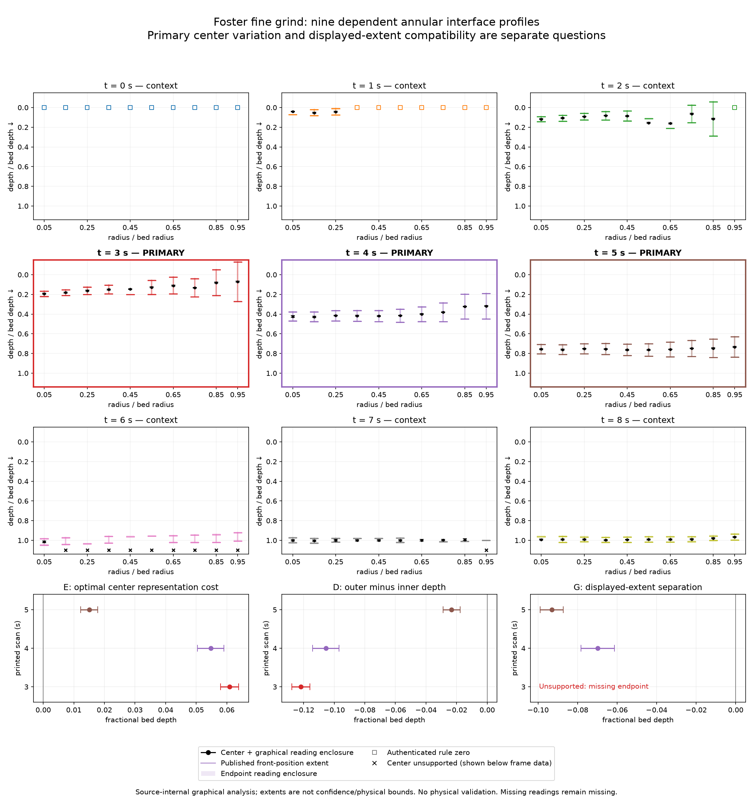

# Foster's published fine-grind radial interface estimates

**All three primary scans resolve radial variation of the fitted centers.
At 4 and 5 seconds, a common position is compatible with the displayed extents
for every admissible graphical reading. At 3 seconds, one hidden cap leaves
the complete extent test unsupported.** This is a finite statement about the published
annular absorption-fit observer, not a physical uniformity test.

SCI-MD-FOSTER-RADIAL-FRONT-001; G1 / NO_GOVERNING_PHYSICS_CHANGE / RESEARCH_ONLY /
RETROSPECTIVE / TARGET_EXPOSED / SOURCE_INTERNAL / NONSCORING.
**PHYSICAL_VALIDATION=NOT_ESTABLISHED.** Selection followed figure inspection;
[PLAN](PLAN.md) froze the reading/analysis contract before new numerical reads.
[Source construction and visibility](SOURCE_NOTES.md), [machine results](scan_results.json),
[CSV](scan_results.csv) and [summary](summary.json) retain exact identities/support.

## Primary results: native fractional bed depth

E is the best per-reading maximum discrepancy of one depth from ten fitted
centers. D is outermost minus innermost center; negative means outer shallower.
G=max(lower endpoints)-min(upper endpoints); G<=0 admits a common position.
All bounds below are conservative graphical enclosures, rounded outward to
0.001 bed depth. Extra decimals/exact rational bounds in JSON are arithmetic
certificates, not extra pixel measurement precision.

| printed scan | E nominal; enclosure | D nominal; enclosure | G nominal; enclosure | complete support and disposition |
|---:|---|---|---|---|
| 3 s | 0.061; [0.057, 0.064] | -0.122; [-0.128, -0.115] | unsupported (one cap hidden) | 10 centers, 19 endpoints; E resolved; outer shallower; complete G unsupported |
| 4 s | 0.055; [0.050, 0.060] | -0.105; [-0.115, -0.096] | -0.070; [-0.079, -0.061] | 10 centers, 20 endpoints; E resolved; outer shallower; G compatible for every reading |
| 5 s | 0.015; [0.012, 0.018] | -0.023; [-0.029, -0.017] | -0.093; [-0.099, -0.087] | 10 centers, 20 endpoints; E resolved; outer shallower; G compatible for every reading |

The center cost is approximately **6.1%, 5.5% and 1.5% of bed depth** at the
three nominal readings; these percentages describe discrepancy, not an acceptance
tolerance. Each E encloses the optimum *after* choosing one admissible reading,
not a robust representative preselected before graphical uncertainty is known.
End-shell direction cannot establish monotonic radial ordering; profiles visibly
include interior departures from monotonicity.

| scan | nominal optimal representative | nominal minimum-center shell | nominal maximum-center shell | certified invariant extreme IDs |
|---:|---:|---|---|---|
| 3 | 0.132 | r09 (0.9<r<1.0) | r00 (0.0<r<0.1) | r09 minimum and r00 maximum |
| 4 | 0.373 | r09 | r01 (0.1<r<0.2) | neither single identity certified |
| 5 | 0.748 | r09 | r04/r05 tied | r09 minimum; no single maximum certified |

At 4 and 5 s, the nominal extents admit respectively [0.378933,0.448700]
and [0.709986,0.803010] as common-depth intervals (rounded display of checked
exact witnesses). Endpoint witnesses are A/B=r00/(r08,r09) and r01/r02. These
intervals belong to the **joint feasible nominal reading**, including the
Figure 8 center linkages. They are not asserted to work unchanged across all
readings. Universal classification means **for every reading u, there exists
c_t(u)** at that scan. No common depth is required across times.
H=max(0,G)/2 is zero throughout all admissible readings at 4 and 5 s.
No complete G, H or common-position witness is reported at 3 s.

## Why the bounds are qualified

The continuous reading set is nonempty: rational nominal calibrations satisfy
all ticks; every retained nominal feature lies in its box; ordered endpoints
contain centers where supported; all three shared Figure 8 centers admit a
simultaneous pixel witness. Figure 9's shared offset cancels from E/D/G, while
its scale remains in [1/734,1/728]. The two depiction offsets are never equated.

For example, t=3 extreme centers differ nominally by 89 px. Their +/-2-pixel
readings yield E between 85/1468 and 93/1456. One t=3 lower cap is hidden by the green t=2 disk, so no complete G is
computed there. At t=4, the critical cap-box differences enclose G between
-57/728 and -45/734, strictly negative. The calculation
covers the full continuous set with exact rational arithmetic and outward
reporting, not sampled readings or an uncertified floating optimizer.

The t=4 legend recovery uses actually visible pale-purple disk/cap pixels and
the predeclared +/-4 allowance. Figure 8 supplies three authenticated shared
end-shell centers but **no transferred endpoints**. Bounds do not exploit the
additional linkage to tighten results, so they remain conservative. No claim
of sharp correlated bounds, independent repeatability or confidence coverage
is made. All nine scan records have separate E/D/G support/status.

## Context and missing support

Exactly 90 slots are retained; no scan or shell was dropped. t=0 is a source-rule
cohort, t=1 has three fitted and seven rule observations, and t=2 has nine fitted
and one rule observation. Their E/D/G complete-cohort statuses are
`UNSUPPORTED_COMPLETE_COHORT`, not ordinary ten-fitted-front estimates. Rule
zeros do not prove no penetration. No fitted-only center summary is substituted
for these complete cohorts.

At t=6, overlap leaves 1/10 fitted centers and 17/20 endpoints read. At t=7,
9/10 centers and 13/20 endpoints are read. Their complete E/D/G are unsupported.
At t=8, all ten centers support E=0.016 with outward enclosure [0.012,0.019]
and D=-0.026 with [-0.032,-0.020] (outer shallower), but only 19/20 endpoints
are supported, so complete G is unsupported. Missing support never becomes a
zero or an assumed symmetric cap. The canonical audit identifies each feature.
No valid positive partial extent-obstruction certificate is found at any scan;
absence of such a certificate does not establish missing-cohort compatibility.
The hidden r04 lower cap at t=3 is an unresolved primary visibility limitation.
No discrete branch, duplicate conflict or numerical qualification failure remains.
Independent review corrected six unsupported caps (one primary, five context)
and applied the frozen partial-overlap allowance to visible cap fragments.
The initial complete G3 compatibility statement is withdrawn; E/D and G4/G5
are unchanged. This was correction of source support, not a tolerance retune.



Colors preserve source scan identity; primary panels are outlined. Black disks
and small bars show center reads and graphical enclosures. Colored long bars
are published extents; translucent cap bands show endpoint reading enclosures.
Hollow squares denote authenticated source-rule zeros. Black crosses below the
data indicate missing centers, not inferred locations. All nine profiles remain
visible, including incomplete terminal profiles. The comparison is a scientific
analysis artifact, not a runtime-mechanism visualization.

## Development consequence and physical ceiling

Retain the qualified common-position result: **this displayed-extent test
supplies no obstruction to a single-depth representation at 4 or 5 s**.
At 3 s retain the precise hidden-cap limitation without choosing radial physics;
complete extent compatibility/exclusion is unsupported, and no positive partial
obstruction is certified.
Center representation costs remain separately quantified. A nonzero E does not
alone reject a useful approximate one-dimensional wetting representation.
Compatible displayed extents do not establish true uniformity, equivalence,
a physical uncertainty bound or a realizable fitted trajectory.

The observer is an annular absorption-fit transition, not authenticated first
liquid arrival, extraction onset or cup effect. Shells/scans are dependent
observations from the displayed fine-grind experiment; equal radial widths do
not mean equal annular areas. No area-average front or wet volume was calculated.
Radial position, transition sharpness, binary saturation and model validity are
distinct. The source's same-campaign fit does not independently validate model
form. Figure 11 coarse-grind evidence remains qualitative and does not furnish
a matched cohort or causal grind effect.

Graphical reading uncertainty, published extent width, one-second reconstruction
duration and unquantified physical/observation uncertainty remain separate.
No conclusion follows about azimuthal uniformity, channeling, permeability,
physical porosity, binary saturation or cup improvement. Neither Foster's entire
model nor EWP's spatial capabilities is adjudicated. No model/default/parameter/
lock changes, EWP execution, merge or successor are authorized by this result.

## Reproduction and audit

```bash
python -m puckworks.analysis.foster2025_radial_front --output /tmp/foster-report --plot
python -m pytest -q tests/test_foster_radial_front.py
python tools/foster_radial_source.py overlay --output /tmp/foster-overlays
# Separate optional source workflow (PyMuPDF 1.26.6):
python tools/foster_radial_source.py extract --pdf SOURCE.pdf --output /tmp/foster-source
```

The analysis reads committed JSON and runs offline; PDF extraction/network and
Pillow/PyMuPDF are not analysis dependencies. Plotting uses the existing figures
extra. Input/output identities, review and local/hosted checks are recorded in
[VERIFICATION](VERIFICATION.md). Source-derived assets retain the article's
CC BY-NC 4.0 notice and attribution in [SOURCE_NOTES](SOURCE_NOTES.md).
