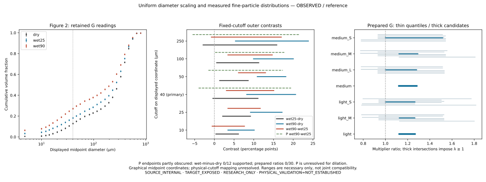

# Uniform diameter scaling and changes in measured fine-particle distribution

**SCI-MD-HARGARTEN-WET-PSD-001** — G1 / NO_GOVERNING_PHYSICS_CHANGE /
RESEARCH_ONLY / RETROSPECTIVE / TARGET_EXPOSED / SOURCE_INTERNAL / NONSCORING.
**PHYSICAL_VALIDATION=NOT_ESTABLISHED.**

**G, plotted interval-midpoint coordinates:** uniform diameter dilation is excluded
for both non-sieved wet protocols on the declared cutoff set. At primary 40 µm,
wet90 is excluded; wet25 is non-excluding at that cutoff, but excluded at other fixed
cutoffs. **P:** both dilation decisions are **UNRESOLVED_SOURCE_OR_READING**, because
the dry cumulative confidence-interval endpoints cannot be separated reliably.
These G exclusions are not published-uncertainty or family-wide 95% test results.
**Physical fractions below exact cutoffs remain unresolved in both layers.**

Prepared medium S/M/L and light S/M yield **NONEMPTY_OUTER_CANDIDATE_RANGE** in G,
within every fraction and within each roast, with all six quantiles evaluated.
These necessary outer ranges do not certify simultaneous compatibility. P yields
no finite supported dry/wet ratio and remains unresolved; it is not a non-exclusion
with complete coverage. No multiplier grid, mechanism fit or optimizer was used.

## Source, observation and exposure

Actual base: `853cc0b609e0abaf9713579f7c0237a859692400` (current main, #354 merged).
No intervening changes or existing Hargarten implementation/PR were found.
Plan/contract fixed at `64c6a1a9` before formal outputs; original artwork had been
inspected. This chronology is retrospective source analysis, not an independent
holdout or validation cohort. Final submitted/tested head and hosted CI are in the
single draft PR handoff. EWP `f44c33dbb9b4fb80143e360e6f4a90f8ac0aa516` was read-only.

[Provenance](../../../puckworks/data/hargarten2020/wet_psd_001/PROVENANCE.md),
[contract](../../../puckworks/data/hargarten2020/wet_psd_001/contract.json),
[coordinates](../../../puckworks/data/hargarten2020/wet_psd_001/coordinates.csv), and
[holdings checked](../../../puckworks/data/hargarten2020/wet_psd_001/holdings_checked.json)
retain exact identities and admission rules. The published 11-page article was
recovered from [TUM](https://mediatum.ub.tum.de/doc/1580140/document.pdf), SHA256
`4a41545954e6748a33ec1d956fd690bea58aba9c2e38955dfbb3ae9f5bffbfb0`.
Publisher methods, Table1 and captions agree. Original artwork is raster: Figure2
printed p3964/PDF5; Figures3b/5b p3965/PDF6. Source-derived measurements retain
Hargarten et al. (2020), DOI [10.1002/jsfa.10440](https://doi.org/10.1002/jsfa.10440),
and CC BY-NC rights; source artwork is external, not MIT-licensed repository art.

Cumulative triangles use the right linear-percent axis; circles use the density
axis and are excluded. All three diameter axes are logarithmic. The source calls
points interval midpoints. Actual bin boundaries and a binning/scaling observation
map are unavailable. Thus F here is a nondecreasing graphical representation through
midpoint-coordinate readings, bracketed monotonically across gaps; it is not an
authenticated physical-cutoff CDF. Connecting lines are not extra measurements.
No integration of log-axis density, forced 0/1 endpoints, tail renormalization,
unsupported interpolation or raw-bin reconstruction is used.

The “90 °C” protocol cools to approximately 60 °C during 20 minutes stirring.
Non-sieved wet samples use direct suspension aliquots and 60 seconds ultrasound;
dry air dispersion differs. Prepared S/M/L fractions undergo sieving/air-jet
preparation, hot treatment, retention on a 200 µm sieve, five minutes washing and
wet measurement without ultrasound. These selected retained preparations are not
same-particle pairs, and do not automatically share the non-sieved multiplier.
Table1 defines S=200–300 µm/dial2, M=400–500/dial5, L=710–800/dial8; it does not
provide the requested quantile diameters. Figure5b shows only light S/M, consistent
with p3964 prose and Figure6; its caption's L is not used. Figures4/6 and scalar
anchors provide descriptive consistency only. The q=.99 requests remain regardless
of source-summary exclusions. Neither 15% nor its spread is a hard input bound.

Configured inventory queries rehashed the registered Hargarten and Pannusch holdings.
The two existing Hargarten scalar CSVs were inspected and preserved. The actual
Pannusch dry-PSD workbook headers/analysis were inspected: 2022-02-04 dry RODOS
measurements, different grind labels, no authenticated Hargarten 2020 wet pair.
Other Pannusch files were catalogued, not semantically inspected. No compatible
original table was located; this bounded search does not establish that external
data do not exist. Thesis republication is not a new campaign.

## Reading and uncertainty layers

Original integer pixel readings retain stable series/point IDs, CDF CI endpoints,
status and reasons. Each point/endpoint has ±3 px reading allowance; each panel's
two x and two y calibration anchors have shared ±1 px allowances. These are
reading assumptions, not experimental error bounds. G uses central marker readings;
P uses identifiable cumulative published CI endpoints only. Missing/overlapping
endpoints are unsupported, never zero-width. The source identifies displayed PSD
intervals as 95% CIs; covariance and simultaneous coverage are not authenticated.
Rectangular marginal enclosures relax shared dependencies and are valid for
exclusion; their extrema are not claimed jointly attainable. Unquantified
experimental, sampling and observation-operator uncertainty remains outside G/P.

A common nominal calibration admits nondecreasing CDF assignments in [0,1] for all
retained supported readings, separately in G/P; [feasibility.json](feasibility.json)
contains actual assignments. This establishes source-reading consistency only,
not a simultaneous dry/wet dilation witness. Independent source review corrected
two medium-fraction ordinate errors and marked three crowded L dry proposed centres
unsupported before the first formal result. [Correction record](source_corrections.json).
No allowance, cutoff or quantile changed in response to results.

| Layer | Requested table | Supported / required |
| --- | --- | --- |
| G | marker_bounds | 173 / 176 |
| G | cdf_readings | 18 / 18 |
| G | contrasts | 18 / 18 |
| G | quantile_diameters | 60 / 60 |
| G | multiplier_intervals | 30 / 30 |
| P | marker_bounds | 49 / 176 |
| P | cdf_readings | 9 / 18 |
| P | contrasts | 4 / 18 |
| P | quantile_diameters | 9 / 60 |
| P | multiplier_intervals | 0 / 30 |

G retains 176 proposed marker rows, including three unsupported identities; all
requested derived G comparisons nevertheless have conservative bracketing support.
The P support deficit remains visible in every output table, including one-sided
quantile bounds. These counts are requests/graphical points, not independent replicates.

## A/B: fixed-cutoff contrasts and certificates

All entries below are conservative **percentage-point** intervals. Corresponding
fraction readings and exact rational operands are in [cdf_readings.csv](cdf_readings.csv),
[contrasts.csv](contrasts.csv) and the matching JSON files. Multiply a fraction
difference by 100 for percentage points; it is not a relative percent increase.

| Cutoff µm | G wet25 − dry | G wet90 − dry | G wet90 − wet25 |
| --- | --- | --- | --- |
| 10 | [0.381679, 6.106871] | [3.435114, 10.114504] | [-0.572520, 7.633588] |
| 25 | [2.099236, 9.160306] | [9.160305, 17.175573] | [3.435114, 11.641222] |
| 40 (primary) | [-0.381680, 11.068703] | [8.206106, 20.610688] | [3.053435, 15.076336] |
| 50 | [1.335877, 8.587787] | [10.877862, 18.129771] | [6.106870, 12.977100] |
| 100 | [0.572519, 11.259542] | [9.923664, 20.038168] | [3.435114, 14.694657] |
| 250 | [-2.862596, 15.839695] | [5.343511, 23.854962] | [-0.763359, 16.984733] |

For each condition separately, test exactly Fwet(d)=Fdry(d/λ), λ≥1. Monotonicity
implies Fdry(d/λ)≤Fdry(d). Therefore Fwet(d)−Fdry(d/λ)≥Fwet(d)−Fdry(d)≥L(d).
Any strictly positive L excludes every allowed λ with no dry-tail extrapolation.
No vertical offset/amplitude, additive fine population or CDF warping is allowed.

Wet25 has witnesses at 10,25,50,100 µm; 40 and250 span zero and are evaluated
non-exclusions. Its largest certified lower bound is **11/524 = at least
2.099236 pp**, at25 µm. Wet90 has witnesses at every declared cutoff; primary40
is **43/524 = at least 8.206106 pp**, and largest is **57/524 = at least
10.877862 pp**, at50 µm. Every positive lower endpoint in the table is a
certificate; [witnesses.json](witnesses.json) retains all ten and their source
operands. A positive witness survives unrelated missing requests. Exact contact
with zero is non-excluding; all classifications use rigorous arithmetic rather
than rounded floats or a scientific tolerance.

B=max(0,max supported L) lower-bounds the maximum absolute CDF discrepancy over
the declared cutoffs for every uniform-growth transform. It is **not** the exact
best-fit error, eroded-mass fraction or mobile-fines inventory. For the entirely
unsupported P wet/dry contrasts, serialized B=0 is only the trivial bound and
carries no evaluated non-exclusion claim.

All twelve P wet-minus-dry contrasts are unsupported. P hot-minus-cool has:

| Cutoff µm | P wet90 − wet25 (pp) |
| --- | --- |
| 10 | unsupported |
| 25 | unsupported |
| 40 | [-4.007634, 19.465649] |
| 50 | [-1.526718, 17.366413] |
| 100 | [0.190839, 17.748092] |
| 250 | [-5.534352, 21.564886] |

The supported P hot/cool sign at100 µm is descriptive of those source protocols;
it does not identify a temperature-dependent erosion law or exclude either
wet-versus-dry family without the required dry operands.

## C: prepared-fraction quantile constraints

Q(q)=inf{d:F(d)≥q}. A below anchor must establish Fupper<q; an above anchor may
establish Flower≥q. Plateaus use the first admissible crossing; gaps remain brackets.
For finite positive bounds, λq lies in [Qwet_lower/Qdry_upper,
Qwet_upper/Qdry_lower]. Intersect these necessary intervals with [1,infinity).
The complete [quantile table](quantile_diameters.csv) retains all60 requests per
layer; [individual ratios](multiplier_intervals.csv) retain all30, including q=.99.

| G sharing hypothesis | Necessary outer candidate range | Coverage | Limiting lower / upper operand |
| --- | --- | --- | --- |
| medium_S | [1.000000, 1.516245] | 6/6 | lambda>=1 / G:medium_S:q0.10 |
| medium_M | [1.122018, 1.292822] | 6/6 | G:medium_M:q0.99 / G:medium_M:q0.50 |
| medium_L | [1.000000, 1.281598] | 6/6 | lambda>=1 / G:medium_L:q0.50 |
| medium | [1.122018, 1.281598] | 18/18 | G:medium_M:q0.99 / G:medium_L:q0.50 |
| light_S | [1.000000, 1.265870] | 6/6 | lambda>=1 / G:light_S:q0.90 |
| light_M | [1.125108, 1.265870] | 6/6 | G:light_M:q0.99 / G:light_M:q0.50 |
| light | [1.125108, 1.265870] | 12/12 | G:light_M:q0.99 / G:light_S:q0.90 |

All G intersections are nonempty and complete over the fixed quantile requests;
there is no empty-intersection witness. Every P intersection is unresolved with
0 supported ratios; supported one-sided/individual dry-quantile readings are still
reported. No arbitrary denominator epsilon is used. Nonempty G ranges are outer
candidates, not proof that one jointly admissible pair of CDFs/calibrations and
multiplier exists. Across-fraction sharing within a roast is explicitly stronger
than within-fraction sharing. No cross-roast pooling or causal roast comparison
is performed. The illustrative source summary ~1.15 lies in the outer ranges,
which is descriptive consistency, not an added constraint or validation.



This local-VizSpec figure is generated from retained measurements by the producer.
It separates G intervals and supported P hot/cool contrasts, shows missing P support,
and draws no inferred CDF through gaps. Thin quantile lines and thicker intersections
show necessary-only constraints; the graphic is not source artwork.

## Practical modeling implication

For this source's non-sieved measured distributions, a single uniform diameter-growth
operator leaves certified graphical CDF discrepancies, even when each wet protocol
has its own multiplier. Prepared retained coarse fractions still admit the reported
necessary-only scale ranges on the fixed quantiles. Use these as constraints on a
future dry-to-wet representation, with the observation-coordinate and P limits intact.
A downstream packing/hydraulic map is not identified here.

Uniform geometric enlargement preserves relative volume weights in the stated
family. Size-dependent swelling can change them: rejecting this family does not
reject every swelling-only process or the native Mo model. Fine-volume excess is
not a measurement of mobile, detached, newly formed, retained, deposited or escaped
fines mass. Preparation, release, fragmentation, deagglomeration and measurement
response are not separately identified. The authors already report qualitative
effects; the new contribution is retained quantitative evidence and a reproducible
representation test. **PHYSICAL_VALIDATION=NOT_ESTABLISHED.**

## Reproduction and handoff

Python≥3.10; standard-library numerical producer/checker; matplotlib for the figure.
Install `.[dev,figures]` once, then reproduce without network or PDF access:

```sh
python -m puckworks.analysis.hargarten2020_wet_psd --output /tmp/hargarten-psd --plot
python docs/analysis/sci_md_hargarten_wet_psd_001/review_check.py
python -m pytest -q tests/test_hargarten2020_wet_psd.py
python -m pytest -q -m 'not slow and not live and not gpu and not external_data'
```

Optional source reinspection is separate: download the authenticated PDF from TUM,
install PyMuPDF, then `python tools/hargarten2020_wet_psd_extract.py SOURCE.pdf
--output EXTERNAL_DIRECTORY`. PDF/image hashes verify identity, not transcription;
the independent reviewer inspected actual source artwork. [Review](REVIEW.md) and
[verification](VERIFICATION.md) distinguish scientific result, software checks and
hosted CI. All historical results and accepted Hargarten CSVs are preserved.
One OPEN / DRAFT / UNMERGED PR, auto-merge disabled. No constitutive-law, EWP coupling,
broader source campaign or new experiment is authorized by this result.
