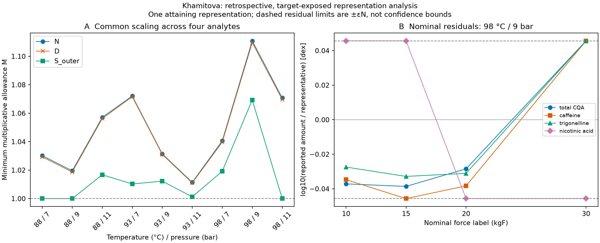

# Can the reported force-label changes share one concentration factor?

**SCI-MD-KHAMITOVA-COMMON-SCALING-001:** no exact common scaling represents the
printed means in any of the nine temperature-pressure strata. Declared decimal
rounding alone does not restore compatibility in any stratum. The generous
reported-RSD-scale outer envelopes still require additional expansion in six
strata; three admit a complete common-factor witness at M=1.

G1 / NO_GOVERNING_PHYSICS_CHANGE / RESEARCH_ONLY / RETROSPECTIVE /
TARGET_EXPOSED / SOURCE_INTERNAL / NONSCORING.
**PHYSICAL_VALIDATION=NOT_ESTABLISHED.** These are finite-table representation
results, not a confidence-level rejection, causal tamping effect or practical
adequacy decision. The source tables and selection arithmetic were already
inspected; no protected holdout, scoring claim, preregistration or independent
experimental validation is created. [Plan and selection reasoning](PLAN.md).

## Question, observations and interval layers

For each of nine separate strata (88/93/98 °C × 7/9/11 bar), retain all four
nominal force labels (10/15/20/30 kgF) and all four analytes (total CQA, caffeine,
trigonelline, nicotinic acid). Minimize

`M* = min(g>0,a>0) max_cells {1, L/(g*a), (g*a)/U}`, with `g_10=1`.

Each stratum has its own g and a. No force monotonicity, cross-stratum sharing,
polynomial or hydraulic/kinetic constraint is imposed. Divide all native amounts
by the fixed unit **1 mg per reference 40 mL** for graph arithmetic and restore
that unit to a. The dimensionless g is a common factor on reported amounts and,
because the reference volume is fixed, a common concentration scaling. It is not
measured dilution, actual cup volume, recovered mass, extraction yield or an
identified assay correction. The family requires invariant analyte ratios across
force labels within a stratum.

The accepted [observations.csv](../sci_md_khamitova_tamping_chemistry_001/observations.csv)
is the regression and provenance reference, not copied as a new raw dataset.
The unchanged accepted loader joins audited strings to canonical CSVs as exact
rationals. All 144 accepted keys and qualifications remain. Per-cell audited
amount/RSD decimal-place fields give **dx=0.005 mg/reference 40 mL** and
**dr=0.05 percentage point** in all 144 cells; aggregate metadata and formatted
floats do not supply precision.

| Layer | Exact interval | Additional support beyond positive supported mean |
|---|---|---|
| N | [x,x] | None; RSD and precision not required |
| D | [x−dx,x+dx] | Supported amount rounding, nonnegative integer place count excluding booleans, positive half-place and x−dx>0 |
| S_outer | [(x−dx)(1−(r+dr)/100), (x+dx)(1+(r+dr)/100)] | D plus supported RSD and RSD rounding, r≥0, valid integer places, positive dr and r+dr<100 |

S_outer is a **researcher-defined rectangular sensitivity envelope** permitting
one reported-RSD scale with favorable printed rounding. It is not a source
confidence region, established error bound, standard error or shot standard
deviation. No RSD/√2, inferred analysis count, covariance or confidence level.
No S_inner claim. Supported bounds satisfy 0<L≤U. Missing RSD cannot erase N/D;
unused concentration precision and global precision support cannot erase a
supported primary amount. Malformed inputs are not clamped. Missing/duplicate
source keys or identity mismatches fail input integrity rather than shrink the
matrix. Unsupported layer/cell requests retain explicit reasons and no optimum.
**Current support is complete: zero unsupported cells or matrices.**

## All primary results

Values below are approximate M*, rounded to 12 decimal places. The authoritative
[primary summary](primary_summary.csv) also reports certified outward 12-place
brackets for M and 1/M, exact radicands/degrees, epsilon and oriented cycles.
[Exact JSON](results.json) retains the complete certificates and witnesses.
M is a multiplicative allowance: feasible cells obey L/M ≤ g*a ≤ U*M.
Upper percentage 100(M−1)% and lower percentage 100(1−1/M)% differ.
The log cost is epsilon=log10(M), in dex; exact expression log10(R)/k is
reported alongside its approximate decimal, not as a rational logarithm.

| Temperature °C | Pressure bar | N | D | S_outer |
|---:|---:|---:|---:|---:|
| 88 | 7 | 1.030161124310 | 1.029280795939 | 1.000000000000 |
| 88 | 9 | 1.019509036756 | 1.018699880097 | 1.000000000000 |
| 88 | 11 | 1.057059114050 | 1.056251714086 | 1.016726281048 |
| 93 | 7 | 1.072137018107 | 1.071618969906 | 1.010280239258 |
| 93 | 9 | 1.031447853727 | 1.031066936033 | 1.012241905220 |
| 93 | 11 | 1.011395722626 | 1.011004208465 | 1.001241419458 |
| 98 | 7 | 1.040599356644 | 1.039683243669 | 1.019223879395 |
| 98 | 9 | 1.110896326783 | 1.109636422615 | 1.069286777409 |
| 98 | 11 | 1.070711499675 | 1.069562938929 | 1.000000000000 |

N and D have M>1 in **9/9** primary strata. S_outer has M>1 in **6/9**;
88 °C/7 bar, 88 °C/9 bar and 98 °C/11 bar attain M=1. These three results
mean compatibility with this envelope only. Exact nesting and
`M[S_outer] ≤ M[D] ≤ M[N]` are verified, including every diagnostic matrix.

The largest primary cost in each layer occurs at **98 °C/9 bar**. Its nominal
M=(3324118/2182641)^(1/4) is in [1.110896326782,1.110896326783];
1/M is in [0.900174008942,0.900174008943], and epsilon≈0.045673530762 dex.
Thus the nominal allowance is approximately +11.089633% / −9.982599%, not a
symmetric percentage. The D and S_outer costs are approximately 1.109636422616
and 1.069286777409. No source-backed practical tolerance is available.

The [pairwise ratio diagnostics](pairwise_ratios.csv) retain every within-stratum
analyte pair at every force in each layer: 648 interval quotients L_s/U_z to
U_s/L_z. They refer to the original amount intervals before additional M
expansion. Nominal quotients are points. Recomputed caffeine/nicotinic-acid
ratios at 98 °C/9 bar are 238.54/2.83≈84.28975265 at 15 kgF and
234.92/1.83≈128.37158470 at 30 kgF. The oriented four-edge relation
`F15 → A(nicotinic acid) → F30 → A(caffeine) → F15` yields
`(2.83×234.92)/(1.83×238.54)=3324118/2182641`; the full witness attains its
fourth-root bound. These reproduce the exposed exploratory checks, not inputs
hard-coded into the optimizer.

## Exact optimum and attaining representation

Use force nodes F_f, analyte nodes A_s and positive potentials p_f=g_f,
p_s=1/a_s in dimensionless units. Each cell gives edges
`A_s → F_f` of weight U_fs M and `F_f → A_s` of weight M/L_fs.
Multiplication around a k-edge cycle requires M^k≥R, where R is the product
of lower-bound values divided by upper-bound values along the oriented cycle.
Every closed walk decomposes into simple cycles, so
`M*=max(1,max_simple_cycles R^(1/k))`.

The producer enumerates all 424 canonical directed simple cycles per 4×4
matrix (16/72/192/144 at lengths 2/4/6/8) and all 96 per 4×3 matrix
(12/36/48 at lengths 2/4/6). Rotations are identified; reverse orientations
of length ≥4 are retained. Roots compare by rational integer powers; ties
retain the first cycle in deterministic length/node order, with the floor first.

At M*, no cycle has product below one. Add a super-root with unit edges to
all nodes. Removing repeated cycles cannot increase a path product, so minimum
products over at most n−1 graph edges supply feasible node potentials.
Multiplicative Bellman-Ford stores each as `rational_coefficient * M^exponent`.
The exact comparison of positive monomials raises both to k and uses rational
`coefficient^k * R^exponent`, including negative integer exponents. Normalize
`g_f=p_f/p_10`, `a_s=p_10/p_s`; then g_10=1 and every prediction is p_f/p_s.

For M>1, the controlling cycle proves the lower bound and all expanded-interval
checks prove attainment, hence global optimality for this specified family.
For M=1, the objective floor and full feasible witness suffice. The factors
can remain nonunique after gauge fixing; these are **one attaining
representation**, not uniquely identified force effects, chemical baselines,
kinetic predictions or physical parameters.

The [independent checker](../../../puckworks/analysis/khamitova2020_common_scaling_check.py)
uses only the accepted source loader, independently reconstructs all layer
bounds and expected matrix/cell/ratio keys, recomputes oriented cycle products,
verifies root identity, every positive factor/prediction, gauge and expanded
interval. It does not call the producer optimizer, path or layer constructor,
or trust stored bounds, predictions, selected lists or PASS flags. Root and
reciprocal brackets are checked by rational powers; display decimals do not
determine feasibility. An incomplete correctly labelled result remains incomplete.

All **27 primary + 108 diagnostic = 135 matrices** have exact lower-bound and
full-witness certificates: **432 primary + 1296 diagnostic = 1728 interval
checks, or 3456 one-sided inequalities**. These reuse the same 144 means; they
are not new experiments. The separately built log LP agrees for all 135
matrices, maximum absolute epsilon difference 1.744×10⁻¹⁶ dex against a
1×10⁻⁹-dex numerical-only tolerance. [Exact and LP receipt](independent_check.json).

## Longer cycles and symmetric analyte influence

M4 is the strongest oriented four-cell lower bound, floored at one; it is not
in general the full optimum. The gap is M*−M4. Its nonnegativity and zero versus
positive status are established exactly before decimal conversion. Every
strict improvement is listed below; all are controlled by six-edge cycles.
No eight-edge cycle controls a current matrix, though those cycles are included.
All unlisted matrices have exact zero gap, not just a rounded zero.

| °C / bar | Layer | Omitted analyte (diagnostic) | M* approx | M4 lower bound approx | Gap approx |
|---|---|---|---:|---:|---:|
| 88 / 7 | N | nicotinic acid | 1.005854956245 | 1.005490022393 | 0.000364933852 |
| 88 / 7 | D | nicotinic acid | 1.005822523100 | 1.005452275446 | 0.000370247654 |
| 93 / 9 | N | nicotinic acid | 1.013277930125 | 1.012346817915 | 0.000931112210 |
| 93 / 9 | D | nicotinic acid | 1.013246292445 | 1.012319152434 | 0.000927140010 |
| 93 / 11 | N | none — primary | 1.011395722626 | 1.010884581083 | 0.000511141543 |
| 93 / 11 | N | caffeine | 1.011395722626 | 1.010884581083 | 0.000511141543 |
| 93 / 11 | N | trigonelline | 1.011203944176 | 1.010884581083 | 0.000319363093 |
| 93 / 11 | D | none — primary | 1.011004208465 | 1.010317596401 | 0.000686612065 |
| 93 / 11 | D | caffeine | 1.011004208465 | 1.010317596401 | 0.000686612065 |
| 93 / 11 | D | trigonelline | 1.010818474438 | 1.010317596401 | 0.000500878037 |
| 98 / 9 | N | nicotinic acid | 1.007551703351 | 1.007421923003 | 0.000129780348 |
| 98 / 9 | D | nicotinic acid | 1.007519063252 | 1.007391024871 | 0.000128038381 |

At 93 °C/11 bar nominal, the controlling cycle is
`F10 → A(total CQA) → F30 → A(trigonelline) → F20 → A(nicotinic acid) → F10`,
with M=(9263886589/8654989675)^(1/6)≈1.011395722627. The four-cell bound is
only about 1.010884581084. This explicitly demonstrates why pairwise-only
optimization is insufficient. Of all 135 optima, 103 use a four-edge certificate,
12 use a six-edge certificate, and 20 use the M=1 floor.

Each of four symmetric omissions retains all four force labels; the omitted
analyte is not predicted. [All 108 diagnostic results](analyte_influence.csv)
and [all factor/prediction rows](factors_predictions.csv) retain exact identities.
The following are maxima across strata, not pooled fits or averages; the
parentheses give the number of strata with M>1.

| Omitted analyte | N max (positive/9) | D max (positive/9) | S_outer max (positive/9) |
|---|---:|---:|---:|
| total CQA | 1.110896326783 (9/9) | 1.109636422615 (9/9) | 1.069286777409 (6/9) |
| caffeine | 1.106397099306 (9/9) | 1.105133710394 (9/9) | 1.064947797052 (6/9) |
| trigonelline | 1.110896326783 (9/9) | 1.109636422615 (9/9) | 1.069286777409 (6/9) |
| nicotinic acid | 1.013277930125 (9/9) | 1.013246292445 (9/9) | 1.001812845692 (1/9) |

Omitting nicotinic acid produces the largest relief: nominal maximum falls to
about 1.013278 and S_outer remains positive only at 93 °C/7 bar. Every reduced
cost is exactly no larger than its primary cost because constraints were removed.
These are analyte-influence/output-compression diagnostics, not cross-validation
or a statistical discovery. They locate finite-table constraints; they do not
identify assay failure or a different physical mechanism. All four analytes
remain primary; no preferred subset or three-analyte physical model is selected.

## Figure, source preservation and limits

[Figure specification](VIZ_SPEC.json). Panel A shows all nine primary strata;
connections guide the eye and impose no cross-stratum law. Panel B uses the
largest nominal primary cost (ties: ascending temperature, then pressure) and
shows log10(x/(g*a)) for all 16 cells of one attaining representation. Dashed
±epsilon_N limits are representation-error limits, not confidence bars.
The full numerical table remains authoritative. Matplotlib version is recorded
in [plot environment](plot_environment.json); cross-version PNG byte identity
is not asserted. The figure was rendered and visually inspected.

Gulzhan Khamitova (2020), *Advanced experimental and analytical study for the
optimization of the Espresso Coffee extraction*, University of Camerino PhD
thesis; [DOI](https://doi.org/10.15165/khamitova-gulzhan_phd2020-06-25),
[official record](https://pubblicazioni.unicam.it/handle/11581/480144).
The accepted [source notes](../sci_md_khamitova_tamping_chemistry_001/SOURCE_NOTES.md)
and [source metadata](../sci_md_khamitova_tamping_chemistry_001/source_metadata.json)
remain the qualification authority. The authenticated PDF SHA256
`59065ee31eb23c694c53dd1c7702c141d5c29bdd79413933e1b62e2fc70aa229`
is carried forward; no retrieval/re-audit was needed. Open access does not
supply a redistribution licence: all-rights-reserved default, factual derived
analysis only, no source PDF or artwork newly committed.

- The 144 analyte means come from **72 extractions / 36 duplicated
  configurations**, not 144 independent shots. Mean/RSD aggregation, effective
  analysis count, cross-analyte covariance and shot-to-assay joins are unresolved.
- Primary amounts refer to the source's reference 40 mL, not authenticated
  whole-cup recovered mass or EY. Total CQA is not species-matched 5-CQA.
- The source's fixed-grind/granulometry assertion (§5.4.3) and manual tuning
  passage (§5.3.3) both remain, with unresolved scope/chronology. The source's
  40±2 g and 1:2±0.02 tolerance inconsistency and mass-volume assumption remain.
- Table 5.2, 7 bar/88 °C/10 kgF retains 131.84 mg/reference 40 mL and the
  inconsistent related concentration 3.29 mg/mL. Only the accepted primary
  amount enters the analysis; columns are neither fused nor silently repaired.
- Table 5.6 ground-coffee context is outside the calculation and supplies no
  inventory denominator. No initial species inventory or reference-extractability
  estimate is needed to answer the within-stratum representation question.
- Failure of common multiplicative scaling does not reject all shared hydraulic
  or transport states with species-specific observation operators. It identifies
  neither separate kinetic rates, causal tamping effects, assay failure nor
  individual-shot behavior. No practical-adequacy tolerance is supplied.

The exact optimizer quantifies the error of compressing four reported chemical
outputs into one scalar response. Mathematical exactness applies to this declared
observation contract; it is not experimental certainty or physical validation.
All [23 input/predecessor identities](input_sha256.json) match, including the
accepted loader, source CSV bytes/line endings and predecessor artifact manifest.
Discovery wording extends the same dataset without changing campaign counts,
rights, data-only/card status or evidence strength. Matias and I-024 results,
production solvers/defaults, EWP and its dependency lock remain unchanged.

See [verification and handoff](VERIFICATION.md) and [brief independent review](REVIEW.md).
Stop at one open draft PR, unmerged with auto-merge disabled; no successor.
