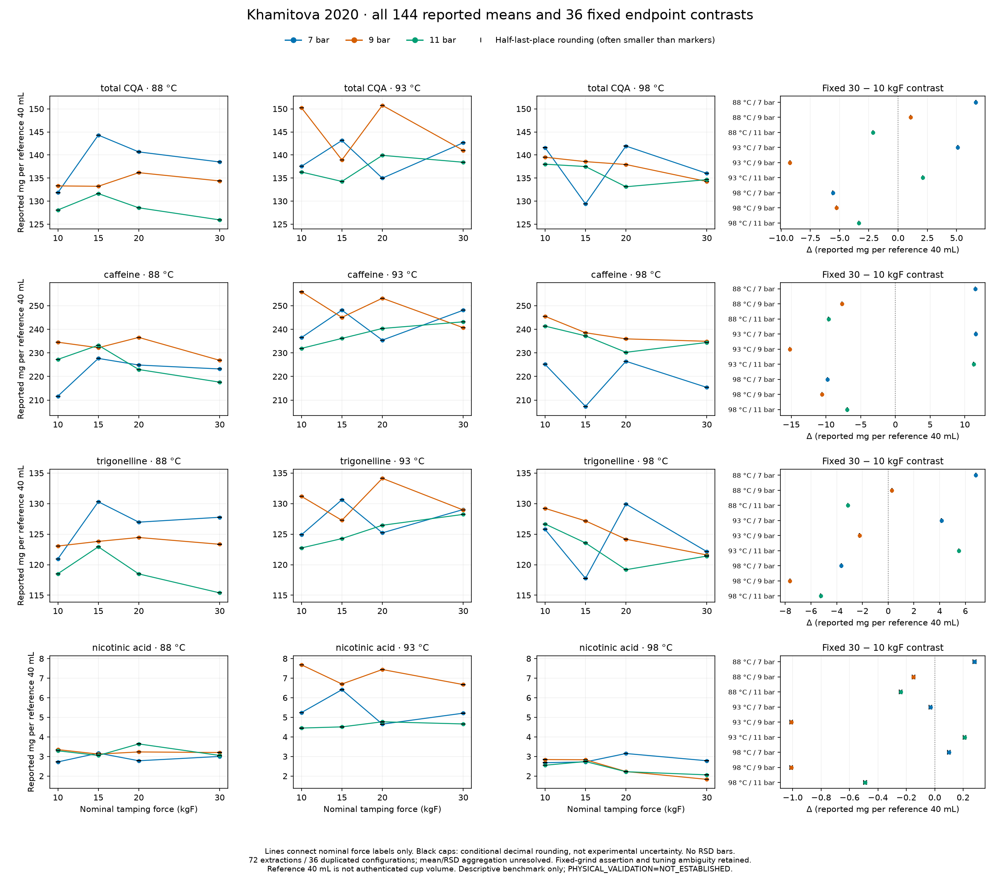

# SCI-MD-KHAMITOVA-TAMPING-CHEMISTRY-001

Suppressing nominal tamping-force labels incurs a nonzero four-level constant
representation cost in all **36/36** reported pressure/temperature/analyte blocks.
The optimal maximum absolute discrepancy **E ranges from 0.115 to 9.56 mg per
reference 40 mL**, with different analytes at those extrema. The same absolute
cost expressed relative to each block's 10 kgF value ranges from **0.568874% to
17.781690%**, again at different blocks. These are observed minimum/maximum
summaries, not statistical intervals. No application error budget or adequacy
threshold has been selected, so collapse is declared neither adequate nor
inadequate for a later use.

**G1 / NO_GOVERNING_PHYSICS_CHANGE / RESEARCH_ONLY / RETROSPECTIVE /
TARGET_EXPOSED / SOURCE_INTERNAL / NONSCORING. PHYSICAL_VALIDATION=NOT_ESTABLISHED.**

## Observation basis and coverage

Primary values are **reported amounts per reference 40 mL**, not measured
whole-cup recovered masses or extraction yields. The source reports 72
extractions / 36 duplicated configurations; the analysis retains 144 analyte
means, not 144 independent extractions. Mean/RSD aggregation remains unresolved.
The fixed-grind/granulometry assertion and manual grinder-tuning passage both
remain relevant, with unresolved chronology/scope. Protocol tolerances disagree,
and the source model assumes mass–volume equivalence. Table 5.2's 131.84 versus
40×3.29 pair is faithfully retained; Table 5.6 is context with unit/dilution
ambiguity. Total CQA is not species-matched 5-CQA. Detailed locators, quotations'
context and dispositions are in [SOURCE_NOTES](SOURCE_NOTES.md).

| Requested feature | Supported / requested |
|---|---:|
| Unique analyte × temperature × pressure × force records | 144 / 144 |
| Printed means; RSD entries; mean precision; RSD precision | 144 / 144 each, separately |
| Fixed 30-minus-10 kgF endpoint contrasts | 36 / 36 |
| Complete four-level representation and interior information | 36 / 36 |
| Positive nominal normalization denominators | 36 / 36 |
| Native endpoint and representation rounding bounds | 36 / 36 each |
| Normalized endpoint bounds and conservative normalized E enclosure | 36 / 36 each |
| Finite nominal RSD diagnostic | 36 / 36 |
| Finite conservative RSD rounding enclosure | 36 / 36 |
| Related-unit consistency under rounding convention | 143 / 144; one retained source mismatch |

No conditions are pooled. [results.json](results.json) is the exact rational
scientific output, including every requested key and result-specific status;
[observations.csv](observations.csv), [endpoints.csv](endpoints.csv) and
[representation.csv](representation.csv) are CSV views. JSON represents rational
numbers as strings (`n/d` for nonintegers); original source display strings remain
separate. CSV scalar nominal values round to nearest at 12 decimal places and
lower/upper bounds round outwards. Lists retain exact rational strings. Strict
statuses use exact arithmetic before display rounding. Volatile run/CI metadata
are outside these scientific files.



Colors identify pressure; separate analyte scales are shared across temperatures
within each analyte. Points are reported means, lines merely connect the nominal
labels, and black caps mark conditional decimal-rounding sensitivity (often
smaller than markers). No RSD bars, shot-independence claim or causal trend is
implied. The figure is research output, not a new visualization registry entry.

## Four-level representation cost

For each block, `R=max(y)-min(y)`, `E=R/2`, and `c_star=(max(y)+min(y))/2`.
Any constant must be at least R/2 from one of the two extremes; their midpoint
attains that bound for all four means. It need not be the arithmetic mean.
`E_percent_reference=100 E/y_10` expresses this optimal **absolute** discrepancy
against the reference; it does not separately optimize relative error.

In the table below, every block is written **temperature °C / pressure bar**.

| Analyte (9/9 blocks each) | Minimum E, block | Maximum E, block | Minimum E/y₁₀ %, block | Maximum E/y₁₀ %, block |
|---|---|---|---|---|
| total CQA | 1.475; 88/9 | 6.265; 98/7 | 1.106527; 88/9 | 4.729217; 88/7 |
| caffeine | 4.855; 88/9 | 9.560; 98/7 | 2.070098; 88/9 | 4.246058; 98/7 |
| trigonelline | 0.700; 88/9 | 6.080; 98/7 | 0.568874; 88/9 | 4.833837; 98/7 |
| nicotinic acid | 0.115; 88/9 | 0.880; 93/7 | 3.432836; 88/9 | 17.781690; 98/9 |

E is in mg per reference 40 mL. The normalized maximum for nicotinic acid is
98°C/9 bar, with y₁₀=2.84, y₃₀=1.83 and E=0.505; its native E maximum is instead
93°C/7 bar. The full block tables below retain R, E, c_star, all means, extrema
and ties. No opposing changes are averaged into a null result.

## Fixed endpoints and intermediate settings

`Delta=y_30-y_10`; `Percent_change=100(y_30/y_10-1)`. Positive means the
highest-force-labelled mean is larger. Across **36/36** blocks: **14 positive,
22 negative, zero exactly zero**. All 36 directions persist under the declared
decimal-rounding convention; none is rounding-unresolved or unsupported.
Endpoint direction does not establish monotonicity or causation.

| Analyte | Positive / 9 | Negative / 9 | Minimum Δ, block | Maximum Δ, block | Minimum percent change, block | Maximum percent change, block |
|---|---:|---:|---|---|---|---|
| total CQA | 4 | 5 | −9.24; 93/9 | +6.65; 88/7 | −6.150160%; 93/9 | +5.043993%; 88/7 |
| caffeine | 3 | 6 | −15.19; 93/9 | +11.59; 93/7 | −5.936608%; 93/9 | +5.442434%; 88/7 |
| trigonelline | 4 | 5 | −7.63; 98/9 | +6.81; 88/7 | −5.904659%; 98/9 | +5.630426%; 88/7 |
| nicotinic acid | 3 | 6 | −1.01; 93/9 and 98/9 | +0.28; 88/7 | −35.563380%; 98/9 | +10.294118%; 88/7 |

The sign pattern exposes all reversals. Each entry lists **7 / 9 / 11 bar**:

| Analyte | 88°C | 93°C | 98°C |
|---|---|---|---|
| total CQA | + / + / − | + / − / + | − / − / − |
| caffeine | + / − / − | + / − / + | − / − / − |
| trigonelline | + / + / − | + / − / + | − / − / − |
| nicotinic acid | + / − / − | − / − / + | + / − / − |

The nominal `endpoint_missed_range=R−abs(Delta)` is positive in **28/36** blocks:
8/9 total CQA, 6/9 caffeine, 7/9 trigonelline and 7/9 nicotinic acid. It is zero
in the remaining 8/36; zero alone does not prove a monotone four-point sequence.
The intermediate 15 and 20 kgF settings matter in the following maximum-missed
blocks (no excursion threshold or additional hypothesis test):

| Analyte | Maximum missed range | Block | Minimum / maximum force | Endpoint Δ | Full R |
|---|---:|---|---|---:|---:|
| total CQA | 6.95 | 98/7 | 15 / 20 kgF | −5.58 | 12.53 |
| caffeine | 9.33 | 98/7 | 15 / 20 kgF | −9.79 | 19.12 |
| trigonelline | 8.52 | 98/7 | 15 / 20 kgF | −3.64 | 12.16 |
| nicotinic acid | 1.73 | 93/7 | 20 / 15 kgF | −0.03 | 1.76 |

All quantities above are mg per reference 40 mL. The nicotinic-acid 93°C/7-bar
means are 5.24, 6.41, 4.65 and 5.21: almost equal endpoints coexist with E=0.88.
The minimum missed range is zero at total CQA 98/9; caffeine 93/9, 93/11, 98/9;
trigonelline 93/11, 98/9; and nicotinic acid 93/9, 98/9. Interior extrema and all
ties are retained in the full output, including nicotinic acid 88/11's minimum
tied at 15 and 30 kgF.

## Conditional decimal-rounding sensitivity

We declare closed intervals at **half one unit in each last printed decimal
place**. This is a reporting convention, not experimental error, confidence
coverage or a calibrated uncertainty model. All audited primary means have two
printed decimals (±0.005); RSDs have one (±0.05 percentage point). Cartesian
boxes assert no statistical independence. Missing precision would leave nominal
results intact and the affected rounding calculation unsupported.

Endpoint bounds use `[L30−U10,U30−L10]` and, with positive bounds,
`100[L30/U10−1,U30/L10−1]`. Range bounds are
`R_lower=max(0,max L−min U)` and
`R_upper=max(0,max_(i≠j)(Ui−Lj))`. The lower range is attained by intersecting all
intervals with the smallest bridging segment (or choosing a common point if
there is overlap). The upper range is attained by two distinct observations at
their opposing interval endpoints; one observation cannot occupy both ends of
its own interval. E bounds are half those ranges. Exact rational arithmetic
certifies the exported quantities; no epsilon or sampled-grid proof is used.

For these 36 source blocks, `E_bounds=[E−0.005,E+0.005]` and
`Delta_bounds=[Delta−0.01,Delta+0.01]`. All **36/36** E lower bounds are positive:
`POSITIVE_LOWER_BOUND_UNDER_ROUNDING_CONVENTION`. Endpoint statuses are **14/36**
`POSITIVE_UNDER_ROUNDING_CONVENTION` and **22/36**
`NEGATIVE_UNDER_ROUNDING_CONVENTION`. Neither family asserts statistical
significance, equivalence, repeatability, practical importance or causation.

`[100 E_lower/U10,100 E_upper/L10]` is a **conservative** normalized enclosure,
relaxing shared-variable dependence, not a sharp or jointly attainable pair.
E bounds optimize the constant separately for each admissible realization;
they do not guarantee one constant fixed before rounding uncertainty.
The related concentration column is never intersected with the primary column
to narrow these boxes. Source pair inconsistency does not remove an otherwise
faithfully reported primary amount.

## Secondary reported-RSD scale diagnostic

Define `s_f=y_f r_f/100` and
`lambda_star=max_(i<j) abs(yi−yj)/(si+sj)`.
Constructed intervals `[y_f−lambda s_f,y_f+lambda s_f]` share a point exactly
when their maximum lower endpoint is no larger than their minimum upper
endpoint. That is equivalent to every pair satisfying
`abs(yi−yj) <= lambda(si+sj)`, which gives the formula. Units rescaling of y
rescales s by the same factor, leaving lambda unchanged.

| Analyte (9/9 finite nominal and rounding diagnostics each) | Minimum lambda, block | Maximum lambda, block | Pair attaining maximum |
|---|---|---|---|
| total CQA | 0.537007; 98/9 | 3.663319; 93/7 | 20–30 kgF |
| caffeine | 0.565199; 98/9 | 8.812074; 93/7 | 20–30 kgF |
| trigonelline | 0.380770; 88/9 | 10.357242; 88/7 | 10–15 kgF |
| nicotinic acid | 0.565861; 88/9 | 5.480607; 93/11 | 15–20 kgF |

The largest multiplier need not involve the largest-range pair: the scale
sizes also matter. All attaining pairs and all four scales are in
[representation.csv](representation.csv). These are constructed scale intervals,
not published extents, confidence intervals or calibrated physical uncertainty.
Lambda=1 is not an acceptance/equivalence threshold. No standard errors,
p-values, reconstructed replicates or covariance model are derived.

For rounding sensitivity, RSD boxes are clipped to the nonnegative domain.
For each pair the numerator enclosure is
`[max(0,Li−Uj,Lj−Ui),max(abs(Ui−Lj),abs(Uj−Li))]`;
positive-mean scale bounds are `[Li*rLi/100,Ui*rUi/100]`.
Pair lower bounds divide the numerator lower by the sum of scale uppers; pair
uppers divide the numerator upper by the sum of scale lowers. Maxima of these
pair bounds enclose lambda. This **relaxes the shared means** appearing in
numerator and denominator and claims neither sharpness nor joint attainability.
All 36 source enclosures are finite. The implementation separately supports
nominal zero scales: unequal zero-scale pairs imply an unbounded nominal
multiplier; equal zero-scale pairs contribute zero. A finite nominal diagnostic
can have a conservative unbounded rounding upper enclosure. It retains a finite
lower bound and null upper with explicit status; that enclosure status does not
claim proven unboundedness of the dependence-preserving diagnostic. Missing or
invalid RSD suppresses only this diagnostic.

## Development consequence

This is a **source-specific representation benchmark**: retain nominal force
labels and link any future collapse decision to the relevant quantified block,
preparation protocol and independently justified application error budget.
Practical adequacy, exact interchangeability, population behavior and isolated
causal tamping effects remain unestablished. The author's narrow-but-appreciable
variation interpretation is preserved; no original statistical null is invented.
Nonzero reported-mean differences do not refute statistical nonsignificance or
prove practical importance.

The bounded reference search found no current numerical consumer of the blanket
null wording. Qualifying that data-use assumption identifies neither a production
bug nor a mechanism and earns no EWP implementation. Data-only/reference strength
remains; I-024's historical exclusion and accepted Foster, Mo, Cameron, Corrochano
and Waszkiewicz evidence are unchanged. No component, equation, calibration,
cross-source score, solver campaign, validation edge, physical-validation upgrade,
production adoption, EWP/lock edit or automatic successor is included.

## Full nominal block view

Order within each mean vector is **10, 15, 20, 30 kgF**. Native quantities are
reported mg per reference 40 mL. Force extrema list every tie; interior extrema
are the listed 15/20 kgF entries. The exact JSON and CSV additionally retain
normalizations, all rounding bounds/statuses and RSD scales/attaining pairs.

### total CQA

| °C / bar | Four means | R | E | c_star | E/y₁₀ % | Δ | Missed range | Minimum / maximum kgF |
|---|---|---:|---:|---:|---:|---:|---:|---|
| 88/7 | 131.84, 144.31, 140.67, 138.49 | 12.47 | 6.235 | 138.075 | 4.729 | 6.65 | 5.82 | 10 / 15 |
| 88/9 | 133.3, 133.22, 136.17, 134.38 | 2.95 | 1.475 | 134.695 | 1.107 | 1.08 | 1.87 | 15 / 20 |
| 88/11 | 128.09, 131.64, 128.56, 125.94 | 5.7 | 2.85 | 128.79 | 2.225 | -2.15 | 3.55 | 30 / 15 |
| 93/7 | 137.54, 143.14, 134.98, 142.65 | 8.16 | 4.08 | 139.06 | 2.966 | 5.11 | 3.05 | 20 / 15 |
| 93/9 | 150.24, 138.92, 150.75, 141 | 11.83 | 5.915 | 144.835 | 3.937 | -9.24 | 2.59 | 15 / 20 |
| 93/11 | 136.31, 134.27, 139.92, 138.43 | 5.65 | 2.825 | 137.095 | 2.072 | 2.12 | 3.53 | 15 / 20 |
| 98/7 | 141.6, 129.41, 141.94, 136.02 | 12.53 | 6.265 | 135.675 | 4.424 | -5.58 | 6.95 | 15 / 20 |
| 98/9 | 139.52, 138.56, 137.94, 134.26 | 5.26 | 2.63 | 136.89 | 1.885 | -5.26 | 0 | 30 / 10 |
| 98/11 | 138.01, 137.5, 133.12, 134.66 | 4.89 | 2.445 | 135.565 | 1.772 | -3.35 | 1.54 | 20 / 10 |

### caffeine

| °C / bar | Four means | R | E | c_star | E/y₁₀ % | Δ | Missed range | Minimum / maximum kgF |
|---|---|---:|---:|---:|---:|---:|---:|---|
| 88/7 | 211.67, 227.66, 224.85, 223.19 | 15.99 | 7.995 | 219.665 | 3.777 | 11.52 | 4.47 | 10 / 15 |
| 88/9 | 234.53, 232.19, 236.56, 226.85 | 9.71 | 4.855 | 231.705 | 2.07 | -7.68 | 2.03 | 30 / 20 |
| 88/11 | 227.24, 233.24, 222.95, 217.6 | 15.64 | 7.82 | 225.42 | 3.441 | -9.64 | 6 | 30 / 15 |
| 93/7 | 236.49, 248.11, 235.41, 248.08 | 12.7 | 6.35 | 241.76 | 2.685 | 11.59 | 1.11 | 20 / 15 |
| 93/9 | 255.87, 245.04, 253.17, 240.68 | 15.19 | 7.595 | 248.275 | 2.968 | -15.19 | 0 | 30 / 10 |
| 93/11 | 231.91, 236.14, 240.35, 243.17 | 11.26 | 5.63 | 237.54 | 2.428 | 11.26 | 0 | 10 / 30 |
| 98/7 | 225.15, 207.33, 226.45, 215.36 | 19.12 | 9.56 | 216.89 | 4.246 | -9.79 | 9.33 | 15 / 20 |
| 98/9 | 245.51, 238.54, 235.94, 234.92 | 10.59 | 5.295 | 240.215 | 2.157 | -10.59 | 0 | 30 / 10 |
| 98/11 | 241.35, 237.23, 230.25, 234.41 | 11.1 | 5.55 | 235.8 | 2.3 | -6.94 | 4.16 | 20 / 10 |

### trigonelline

| °C / bar | Four means | R | E | c_star | E/y₁₀ % | Δ | Missed range | Minimum / maximum kgF |
|---|---|---:|---:|---:|---:|---:|---:|---|
| 88/7 | 120.95, 130.3, 126.96, 127.76 | 9.35 | 4.675 | 125.625 | 3.865 | 6.81 | 2.54 | 10 / 15 |
| 88/9 | 123.05, 123.81, 124.45, 123.34 | 1.4 | 0.7 | 123.75 | 0.569 | 0.29 | 1.11 | 10 / 20 |
| 88/11 | 118.52, 122.93, 118.49, 115.39 | 7.54 | 3.77 | 119.16 | 3.181 | -3.13 | 4.41 | 30 / 15 |
| 93/7 | 124.89, 130.63, 125.21, 129.03 | 5.74 | 2.87 | 127.76 | 2.298 | 4.14 | 1.6 | 10 / 15 |
| 93/9 | 131.18, 127.26, 134.13, 128.95 | 6.87 | 3.435 | 130.695 | 2.619 | -2.23 | 4.64 | 15 / 20 |
| 93/11 | 122.74, 124.27, 126.45, 128.23 | 5.49 | 2.745 | 125.485 | 2.236 | 5.49 | 0 | 10 / 30 |
| 98/7 | 125.78, 117.76, 129.92, 122.14 | 12.16 | 6.08 | 123.84 | 4.834 | -3.64 | 8.52 | 15 / 20 |
| 98/9 | 129.22, 127.17, 124.17, 121.59 | 7.63 | 3.815 | 125.405 | 2.952 | -7.63 | 0 | 30 / 10 |
| 98/11 | 126.66, 123.56, 119.18, 121.41 | 7.48 | 3.74 | 122.92 | 2.953 | -5.25 | 2.23 | 20 / 10 |

### nicotinic acid

| °C / bar | Four means | R | E | c_star | E/y₁₀ % | Δ | Missed range | Minimum / maximum kgF |
|---|---|---:|---:|---:|---:|---:|---:|---|
| 88/7 | 2.72, 3.17, 2.78, 3 | 0.45 | 0.225 | 2.945 | 8.272 | 0.28 | 0.17 | 10 / 15 |
| 88/9 | 3.35, 3.12, 3.23, 3.2 | 0.23 | 0.115 | 3.235 | 3.433 | -0.15 | 0.08 | 15 / 10 |
| 88/11 | 3.29, 3.05, 3.64, 3.05 | 0.59 | 0.295 | 3.345 | 8.967 | -0.24 | 0.35 | 15,30 / 20 |
| 93/7 | 5.24, 6.41, 4.65, 5.21 | 1.76 | 0.88 | 5.53 | 16.794 | -0.03 | 1.73 | 20 / 15 |
| 93/9 | 7.68, 6.7, 7.44, 6.67 | 1.01 | 0.505 | 7.175 | 6.576 | -1.01 | 0 | 30 / 10 |
| 93/11 | 4.45, 4.51, 4.77, 4.66 | 0.32 | 0.16 | 4.61 | 3.596 | 0.21 | 0.11 | 10 / 20 |
| 98/7 | 2.68, 2.72, 3.15, 2.78 | 0.47 | 0.235 | 2.915 | 8.769 | 0.1 | 0.37 | 10 / 20 |
| 98/9 | 2.84, 2.83, 2.23, 1.83 | 1.01 | 0.505 | 2.335 | 17.782 | -1.01 | 0 | 30 / 10 |
| 98/11 | 2.55, 2.74, 2.22, 2.06 | 0.68 | 0.34 | 2.4 | 13.333 | -0.49 | 0.19 | 30 / 15 |

Reproduce offline from a source checkout (existing optional `figures` extra for the image):

```bash
python -m puckworks.analysis.khamitova2020_tamping_chemistry --output /tmp/khamitova-report --plot
```

[Verification, independent-method review and identities](VERIFICATION.md).
