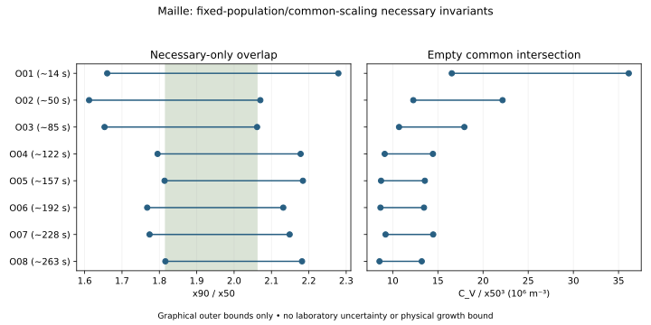

# Maille particle swelling and population-sampling evidence

**The authenticated poster's retained laser-diffraction markers exclude a
fixed-population/common-size-scaling representation, conditionally on the declared
graphical reading and observation assumptions. They do not identify a numerical
bound on actual geometric particle growth.** The concentration/median-cube invariant
has an empty common intersection; the x90/x50 invariant has necessary-only overlap.
Source observations support floating/entrainment as a measurement-population effect,
but do not quantify its share of apparent growth. Microscopy remains descriptive
because later coffee boundaries and projection errors are not sufficiently bounded.

SCI-MD-MAILLE-SWELLING-EVIDENCE-001 — G1 / NO_GOVERNING_PHYSICS_CHANGE /
RESEARCH_ONLY / RETROSPECTIVE / TARGET_EXPOSED / NONSCORING.
**PHYSICAL_VALIDATION=NOT_ESTABLISHED.**

## Evidence and distinct claim levels

**REPORTED_FINDING:** the2021 authors report no significant particle swelling on
the examined brewing timescales after accounting for entrainment. The poster shows
initially floating large particles entering the flow later and warns about bubbles.
Nonsignificance supplies neither zero growth, equivalence, statistical power nor
a numerical detection limit. The reported correction is not a recovered corrected
trace in this intake. [Journal](https://doi.org/10.1016/j.jfoodeng.2020.110420),
[official poster](https://www.alphavisa.com/asic/2021/documents/eposters-presentation/S8-PO-01_KYLE.pdf).

**RECOVERED_REPRESENTATION:** Figure4 left has eight aligned marker groups, each
with x50, x90 and volume concentration. All24 markers are retained in native raster
coordinates. The first-to-last x50 graphical intervals change from335.609756–413.658537µm
to600.975609–679.024391µm; x90 changes from686.829268–764.878049µm to1233.170731–1311.219513µm;
concentration from0.117073–0.136586vol% to0.267317–0.286830vol%. These are increases
in the **observed LD summaries**, not measurements of one particle's enlargement.
Native immersion-time support is approximately14–263s, with retained time bounds
in [intervals.csv](intervals.csv); no exact schedule or dry t0 marker is invented.

**PHYSICAL_CONSTRAINT:** numerical geometric-growth bounds are **null /
NOT_IDENTIFIABLE**. LD sampling membership, size weighting and optical/concentration
calibration are incompletely specified; the surviving graphical conclusion is
conditional. Same-particle microscopy supplies correspondence/common magnification
but not bounded complete coffee boundaries or3Dgeometry. No equilibrium, population
maximum or dry-to-wet bound follows.

Both retrieved PDFs match the supplied SHA256 fingerprints. Full journal access
failed (HTTP403); indexed publisher text was inspected, not journal tables/figures.
The poster supports a conditional graphical analysis independently of that failure.
Thesis p31 Figure2.5 reproduces the same18/66/180/283s particle sequence and verifies
the250µm scale/common magnification; it is not another replicate. Its four overlay
panels copy the18s outline. Detailed source gates, unknown conditions and inspected
versus catalogued coverage are in [SOURCE.md](SOURCE.md); exact identities, rights,
native readings and freeze in the [dataset](../../../puckworks/data/maille2021/swelling_evidence_001/PROVENANCE.md).

## Restricted invariant test

H_FIXED_SCALE assumes fixed observed membership and particle number; one positive,
shape-preserving multiplier λ(t) for every particle; fixed suspension/measurement
volume; unchanged optical/concentration mappings; and a consistent quantile basis.
Then d_i(t)=λ(t)d_i(0), v_i(t)=λ(t)³v_i(0), and each volume weight normalized by
total volume is unchanged. Quantiles therefore scale byλ, so
`R(t)=x90(t)/x50(t)` is constant. Also
`C_V(t)=sum_i v_i(t)/V_s=λ(t)^3 C_V(0)`, hence
`K(t)=C_V(t)/x50(t)^3` is constant. The argument also applies to consistent fixed
number/shape-derived area weights under common scaling. It does not authenticate
which basis the source instrument used.

The conditional observation map must be **scale-equivariant**: reported quantiles
scale with geometricλ and reported volume concentration withλ³. A fixed but
arbitrary nonlinear or offset instrument mapping need not preserve these invariants.
Readable axes do not establish that property. This is a test of the mapped graphical
representation, not exclusion of physical common growth under every fixed optical map.

Total volume generally depends on the **third moment of a number distribution**,
not the cube of its median. Here both total volume and median cube scale byλ³
because of the restricted hypothesis. This is not a general test of arbitrary
size-dependent swelling, which can change distribution shape and relative volume
weights. The native Mo model need not obey one common multiplier across sizes.

At each positive supported row, calculate
`R=[x90_low/x50_high, x90_high/x50_low]` and
`K=[C_low/x50_high³, C_high/x50_low³]`.
Concentration is divided by100 fromvol% to volume fraction; x50 is converted fromµm
to metres, making K units m⁻³. Exact rational arithmetic controls positivity and
intersection decisions. Printed decimal bounds round outward; no epsilon or
laboratory error independence is introduced.

The original710×268 raster has approximately7–9pixel glyphs. Retained allowances
are±4native pixels per marker coordinate and±1pixel per shared axis anchor. The
rectangular calibration/reading enclosures contain all shared dependencies; their
extrema need not coexist. They are deliberately outer necessary sets, not
simultaneous confidence intervals. Experimental uncertainty is not supplied.

| Invariant | Support | Common intersection / decision |
|---|---:|---|
| x90/x50 |8/8 groups |[158/87,134/65], outward[1.816091,2.061539]; **NOT_EXCLUDED_BY_OUTER_RELAXATION** |
| C_V/x50³ |8/8 groups |Empty; **CONDITIONAL_EXCLUSION_ON_RETAINED_SUPPORT** |

The decisive K operands are O01 (native x79; x50 y168; C y151) and O08
(native x306; x50 y134; C y74). Under the frozen shared calibration outer bounds:

- O01: C_low=24/205vol%, x50_high=16960/41µm;
  K_low=2462402343750/148877m⁻³, at least16,539,843.923171m⁻³.
- O08: C_high=294/1025vol%, x50_low=24640/41µm;
  K_high=246240234375/18634m⁻³, at most13,214,566.618816m⁻³.

The first lower endpoint strictly exceeds the last upper endpoint. Thus no
constant K can meet all retained intervals. [RESULT.json](RESULT.json) stores
every interval, exact fraction, limiting observations and strict gap; the
[independent check](review_check.py) directly reconstructs these operands without
importing producer logic. The eight R intervals have overlap only: no jointly
admissible physical or graphical common-scale construction is demonstrated.
An exclusion on these plotted markers does not establish a complete raw history.



The figure is an independently rendered comparison of retained readings, not source
artwork. Right-panel poster points/overlap are retained separately and not pooled:
its lack of time labels leaves the last-cluster row join unresolved. Its dashed
linear fit and R² are not used to select a physical mechanism. Dotted left-panel
lines are not extra measurements. Concentration and size come from LD and may share
the same scattering inversion; no independent measurement confirmation is asserted.

## What entrainment and microscopy identify

A minimal conditional observation map illustrates the confounding. With sampled
membership weights w_i(t), geometric volumes v_i(t) and apparent optical sizes
g_i(t), an idealized volume distribution is
`F_obs(d,t)=sum_i w_i(t)v_i(t)1[g_i(t)<=d]/sum_i w_i(t)v_i(t)`.
An ideal concentration would be `sum_i w_i(t)v_i(t)/V_s`; the actual instrument's
inversion/calibration is not recovered. This equation explains possible population
weighting, not a fitted or authenticated instrument law.

Changing membership without growth can alter both quantiles and concentration.
Growth and changing membership can coexist. Size-dependent growth with stable
membership remains possible. Optical/bubble response, agglomeration/fragmentation,
and other population changes are not separately identified. Only the conjunction
in H_FIXED_SCALE is excluded on retained support. Bulk concentration does not
identify size-resolved w_i(t), and correlation cannot assign an entrainment fraction.
No entrainment-rate law or corrected geometry trace is derived.

For the selected in-situ particle, the authenticated baseline is **18s already wet**,
with a last frame at283s. Later protrusions include bubbles; the copied reference
outline cannot supply the missing coffee edges. Boundary identification therefore
stops before quantitative segmentation. Even a qualified projected-area change
would use `d_A=sqrt(4A/pi)` and would not imply3Dvolume growth without a supported
geometric assumption. Earlier dry-to-wet growth and population maxima are not
bounded. Separate before/after10-minute images lack their own adequate calibration
and uncertainty contract in the admitted source.

## Hargarten and future-model implications

The [single comparison table](COMPARISON.md) separates Hargarten prepared/sieved
fractions, non-sieved dry/wet distributions and individual histories from every
admitted Maille depiction. Quantitative physical comparability is not established:
retain **DIFFERING_PUBLISHED_CONCLUSIONS**, not a demonstrated contradiction.
Prepared coarse-fraction≈15% diameter summaries are neither exact universal values
nor hard bounds; #355's non-sieved exclusion does not reject them. Hargarten
Figures7/10 duplicate the same particles and #356's discrepancies are not lab error.

The unchanged Mo implementation implies
`s_max_percent=100*((1-C_M)^(-1/3)-1)`.
At C_M=.1 this is approximately**3.5744% diameter/radius growth**, a model
equilibrium interpretation, not an empirical estimate. This intake supplies:

- Finite-window projected growth: no numerical bound; image boundary map unresolved.
- Dry-to-wet growth and equilibrium expansion: no numerical constraint; wet baseline
  and missing geometry/saturation premise prevent transfer to equilibrium C_M.
- Kinetic timescale, D_W, temperature and water-chemistry dependence: unidentified;
  no supported geometry/clock/condition map for a kinetic inference.
- Observation mapping: a future explanation of Figure4 must permit departure from
  at least one fixed-population/common-scaling/volume/optical assumption. The source
  supplies qualitative evidence that changing sampled membership matters.

Neither C_M nor D_W is fitted or bounded. A finite-time reported null cannot bound
equilibrium C_M without supported saturation/kinetics, nor can an unresolved clock
identify D_W. Mo constants/code and its known finite-grid quadrature issue remain
unchanged; no new Mo sweep or endpoint correction is run. No porosity/permeability
law or espresso pressure-response conclusion follows automatically.

## Reproduction and delivery

Actual refreshed bases: Puckworks`4f378aa6757e9d61c4231d078aa4e7718736a394`,
EWP`f44c33dbb9b4fb80143e360e6f4a90f8ac0aa516`. The isolated branch preserves
predecessors and the distinct2024 extraction-normalization result. Plan/readings
were frozen after public-source inspection and before derived comparisons;
this retrospective sequence is not target-blind parameterization or holdout validation.

```sh
python -m puckworks.analysis.maille2021_swelling_evidence --output /tmp/maille-replay --plot
python docs/analysis/sci_md_maille_swelling_evidence_001/review_check.py --output /tmp/maille-replay
python -m pytest -q tests/test_maille2021_swelling_evidence.py
python -m pytest -q -m 'not slow and not live and not gpu and not external_data'
```

The producer/checker use the standard library; the optional figure uses matplotlib
and the existing local VizSpec convention. PDFs/network are unnecessary offline.
[REVIEW.md](REVIEW.md) records the bounded independent review and corrections;
[VERIFICATION.md](VERIFICATION.md) separates checks from science and hosted CI.
Final submitted/tested head and live PR state are recorded in the PR delivery.
Leave one OPEN/DRAFT/UNMERGED PR with auto-merge disabled. EWP, locks, production
solvers/defaults/parameters, governing equations and CI configuration are unchanged.
No successor is launched. **PHYSICAL_VALIDATION=NOT_ESTABLISHED.**
