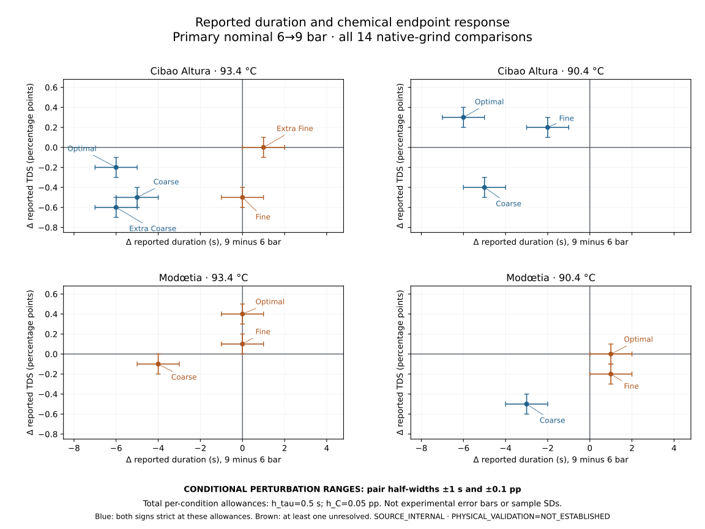

# SCI-MD-PERTICARINI-PRESSURE-CHEMISTRY-001

**The reported shorter-duration response can accompany either lower or higher TDS.**

G1 / NO_GOVERNING_PHYSICS_CHANGE / RESEARCH_ONLY / RETROSPECTIVE /
TARGET_EXPOSED / SOURCE_INTERNAL / NONSCORING. **PHYSICAL_VALIDATION=NOT_ESTABLISHED.**

This generated result joins the same 30 original conditions, counted once. The 14 primary
pairs cover 28; two additional 12-bar conditions complete the union. The 14 + 6 + 4
reporting slots are dependent contrasts, not 24 independent experiments or raw-shot pairs.
Sources and preliminary contrasts were exposed before [PLAN](PLAN.md). This is not
preregistration, held-out prediction or a protected score. [SOURCE_NOTES](SOURCE_NOTES.md)
qualifies the operator, native formatting, lineage and unknown uncertainty.

Illustration: h_tau=0.5 s and h_C=0.05 pp, total per-condition allowances.
Thresholds below are **exclusive**: strict signs require 0 ≤ h < threshold;
at equality an interval touches zero and is unresolved. Threshold 0 denotes a printed
tie with no strict sign even at zero allowance, never physical equality.

## Complete primary 9-minus-6-bar pattern

All pressure differences are higher nominal pressure minus lower; TDS/EY differences
are percentage points (pp), not relative percent changes. The source pairs, TDS SDs,
separate signs/tie flags and exact joint regions are in [primary.csv](primary.csv).

| Coffee / °C | Native grind / bar difference | Δ duration (s) | Δ TDS (pp) | Δ EY (pp) | Nominal joint | Conditional joint | h_tau / h_C sign-loss thresholds |
|---|---|---:|---:|---:|---|---|---|
| Cibao Altura / 93.4 | Extra Fine / 9−6 | 1 | 0 | -0.03 | LONGER / TDS PRINTED TIE | DURATION SIGN UNRESOLVED / TDS SIGN UNRESOLVED | 0.5 s / 0 pp |
| Cibao Altura / 93.4 | Fine / 9−6 | 0 | -0.5 | -0.96 | DURATION PRINTED TIE / LOWER TDS | DURATION SIGN UNRESOLVED / LOWER TDS | 0 s / 0.25 pp |
| Cibao Altura / 93.4 | Optimal / 9−6 | -6 | -0.2 | -0.58 | SHORTER / LOWER TDS | SHORTER / LOWER TDS | 3 s / 0.1 pp |
| Cibao Altura / 93.4 | Coarse / 9−6 | -5 | -0.5 | -0.29 | SHORTER / LOWER TDS | SHORTER / LOWER TDS | 2.5 s / 0.25 pp |
| Cibao Altura / 93.4 | Extra Coarse / 9−6 | -6 | -0.6 | -0.9 | SHORTER / LOWER TDS | SHORTER / LOWER TDS | 3 s / 0.3 pp |
| Cibao Altura / 90.4 | Fine / 9−6 | -2 | 0.2 | 0.78 | SHORTER / HIGHER TDS | SHORTER / HIGHER TDS | 1 s / 0.1 pp |
| Cibao Altura / 90.4 | Optimal / 9−6 | -6 | 0.3 | 0.19 | SHORTER / HIGHER TDS | SHORTER / HIGHER TDS | 3 s / 0.15 pp |
| Cibao Altura / 90.4 | Coarse / 9−6 | -5 | -0.4 | -0.41 | SHORTER / LOWER TDS | SHORTER / LOWER TDS | 2.5 s / 0.2 pp |
| Modœtia / 93.4 | Fine / 9−6 | 0 | 0.1 | 0.02 | DURATION PRINTED TIE / HIGHER TDS | DURATION SIGN UNRESOLVED / TDS SIGN UNRESOLVED | 0 s / 0.05 pp |
| Modœtia / 93.4 | Optimal / 9−6 | 0 | 0.4 | 0.44 | DURATION PRINTED TIE / HIGHER TDS | DURATION SIGN UNRESOLVED / HIGHER TDS | 0 s / 0.2 pp |
| Modœtia / 93.4 | Coarse / 9−6 | -4 | -0.1 | -0.67 | SHORTER / LOWER TDS | SHORTER / TDS SIGN UNRESOLVED | 2 s / 0.05 pp |
| Modœtia / 90.4 | Fine / 9−6 | 1 | -0.2 | -0.4 | LONGER / LOWER TDS | DURATION SIGN UNRESOLVED / LOWER TDS | 0.5 s / 0.1 pp |
| Modœtia / 90.4 | Optimal / 9−6 | 1 | 0 | 0.28 | LONGER / TDS PRINTED TIE | DURATION SIGN UNRESOLVED / TDS SIGN UNRESOLVED | 0.5 s / 0 pp |
| Modœtia / 90.4 | Coarse / 9−6 | -3 | -0.5 | -1.01 | SHORTER / LOWER TDS | SHORTER / LOWER TDS | 1.5 s / 0.25 pp |

Nominal primary counts: 2 DURATION PRINTED TIE / HIGHER TDS; 1 DURATION PRINTED TIE / LOWER TDS; 1 LONGER / LOWER TDS; 2 LONGER / TDS PRINTED TIE; 2 SHORTER / HIGHER TDS; 6 SHORTER / LOWER TDS.

Conditional primary counts at the displayed allowances: 1 DURATION SIGN UNRESOLVED / HIGHER TDS; 2 DURATION SIGN UNRESOLVED / LOWER TDS; 3 DURATION SIGN UNRESOLVED / TDS SIGN UNRESOLVED; 2 SHORTER / HIGHER TDS; 5 SHORTER / LOWER TDS; 1 SHORTER / TDS SIGN UNRESOLVED.

The exact strict two-component region for each nonzero pair is
`0 <= h_tau < |delta_tau|/2 AND 0 <= h_C < |delta_C|/2`.
A printed tie in either component makes that region empty; the other component
retains its own status. [contrasts.json](contrasts.json) records all regions and reasons.

## Pressure-by-temperature TDS interactions

I_C = (C9−C6) at 93.4 °C minus (C9−C6) at 90.4 °C, directly from four
original means. Each row has coefficient norm 4. Component IDs and their exact
domain intersections are retained in [interactions.csv](interactions.csv).

| Coffee | Native grind | I_C (pp) | Exact h_C sign-loss threshold (pp) | Conditional range (pp) | Conditional sign | Opposite component domain | Conditional opposition |
|---|---|---:|---:|---|---|---|---|
| Cibao Altura | Fine | -0.7 | 0.175 | [-0.9, -0.5] | negative | 0 ≤ h_C < 0.1 | strict_opposite |
| Cibao Altura | Optimal | -0.5 | 0.125 | [-0.7, -0.3] | negative | 0 ≤ h_C < 0.1 | strict_opposite |
| Cibao Altura | Coarse | -0.1 | 0.025 | [-0.3, 0.1] | unresolved | empty | nominal_opposition_not_established |
| Modœtia | Fine | 0.3 | 0.075 | [0.1, 0.5] | positive | 0 ≤ h_C < 0.05 | unresolved |
| Modœtia | Optimal | 0.4 | 0.1 | [0.2, 0.6] | positive | empty | nominal_opposition_not_established |
| Modœtia | Coarse | 0.4 | 0.1 | [0.2, 0.6] | positive | empty | nominal_opposition_not_established |

Cibao Optimal components `J-cibao-T93.4-optimal-P6to9` and
`J-cibao-T90.4-optimal-P6to9` report duration changes -6 and -6 s,
TDS changes -0.2 and 0.3 pp and published EY changes -0.58 and 0.19 pp.
Both shorter-duration / opposite-TDS directions persist together exactly for
**0 ≤ h_tau < 3 s and 0 ≤ h_C < 0.1 pp**.
Equal printed shortening does not establish equal actual shortening.
Their current conditional duration/TDS ranges are respectively:

- 93.4 °C: [-7, -5] s; [-0.3, -0.1] pp.
- 90.4 °C: [-7, -5] s; [0.2, 0.4] pp.

Modœtia Fine has I_C=0.3 pp (threshold 0.075 pp), while its supporting
`J-modoetia-T93.4-fine-P6to9` and `J-modoetia-T90.4-fine-P6to9` components
oppose strictly only at h_C<0.05 pp. A strict interaction at h_C=0.05
does not establish strict opposition: the hot 0.1 pp component touches zero.
The hot Modœtia Coarse -0.1 pp component also touches zero at that allowance.
A 1 s duration contrast touches zero at h_tau=0.5 s.
All such zero-touch cases remain unresolved.

## Secondary extreme-grind comparisons

Only Cibao / 93.4 °C; these four rows do not enlarge the primary pressure family.
Full source pairs and statuses: [secondary.csv](secondary.csv).

| Coffee / °C | Native grind / bar difference | Δ duration (s) | Δ TDS (pp) | Δ EY (pp) | Nominal joint | Conditional joint | h_tau / h_C sign-loss thresholds |
|---|---|---:|---:|---:|---|---|---|
| Cibao Altura / 93.4 | Extra Fine / 12−9 | 7 | 0.1 | -0.32 | LONGER / HIGHER TDS | LONGER / TDS SIGN UNRESOLVED | 3.5 s / 0.05 pp |
| Cibao Altura / 93.4 | Extra Coarse / 12−9 | -1 | 0 | -0.22 | SHORTER / TDS PRINTED TIE | DURATION SIGN UNRESOLVED / TDS SIGN UNRESOLVED | 0.5 s / 0 pp |
| Cibao Altura / 93.4 | Extra Fine / 12−6 | 8 | 0.1 | -0.35 | LONGER / HIGHER TDS | LONGER / TDS SIGN UNRESOLVED | 4 s / 0.05 pp |
| Cibao Altura / 93.4 | Extra Coarse / 12−6 | -7 | -0.6 | -1.12 | SHORTER / LOWER TDS | SHORTER / LOWER TDS | 3.5 s / 0.3 pp |

Extra Fine 12−9 has 0.1 pp TDS and -0.32 pp EY: the differing chemical
directions are retained. Published EY is a related central endpoint with uncertainty
unqualified here; it is not independent confirmation and is not inferred from TDS.

At each extreme grind, (12−6)=(12−9)+(9−6). Shared P9 coefficients cancel:
the composed TDS radius is 2*h_C, and the duration radius is 2*h_tau.
Both identity residuals have coefficient norm/radius zero at every allowance,
with threshold null, not a division by zero or an extra observation.

## Scientific increment and limits

The chemical columns add the joint direction and temperature-conditioned contrast
pattern to the [accepted duration result](../sci_md_perticarini_pressure_grind_001/RESULT.md).
Duration-only agreement and broad per-grind EY/TDS range bracketing leave this
condition-level joint response untested. This bundle supplies an observation target
for future comparisons; it fits no model and rejects no physical duration-only law.

All exact boxes combine original-condition coefficients before taking their L1 norm.
The allowances are a deterministic convention, not experimental error, rounding accuracy,
SD, SE, CI, statistical significance or practical tolerance. Shared variables mean
arbitrary marginal extrema need not be jointly attainable; no probabilistic independence
is asserted. Reported TDS SDs, including zeros, remain descriptive metadata in the
tables. There is no SD-to-mean conversion or EY uncertainty propagation.

The sources measure a prepared beverage aliquot by refractometer; C and samplewise
calculated EY are averaged over three chemical extractions. Individual samples, EY SDs,
covariance, condition masses and authenticated joint timing/chemistry replicates are
unavailable. Nominal dose/beverage targets do not imply E_bar=2*C_bar.

No causal pressure effect, experimentally resolved reversal, population law, mechanism,
shot covariance or causal duration-to-chemistry relation follows. Nominal pressure is
not measured puck pressure drop; temperature settings are not puck histories; duration
is not instantaneous flow or residence time. No flow from 40g/duration, individual
masses from mean ratios, cross-coffee particle-size mapping, equality, practical
equivalence, sensory value, production adequacy or EWP comparison is established.
Unknown experimental uncertainty remains unknown; existing range-bracket qualification,
models/defaults/pins and predecessor artifacts are unchanged.
**PHYSICAL_VALIDATION=NOT_ESTABLISHED.**
