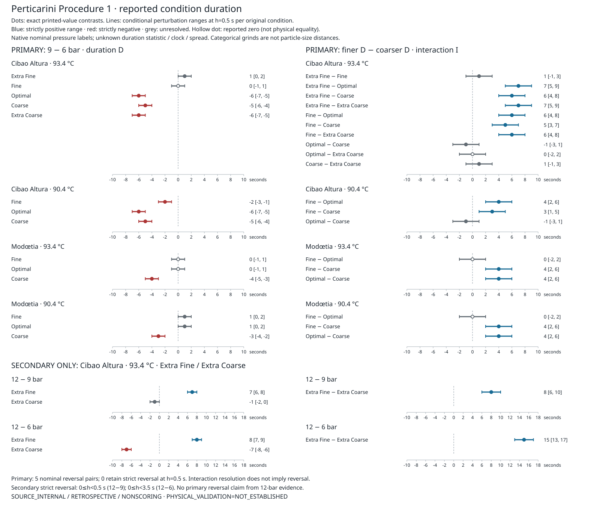

# SCI-MD-PERTICARINI-PRESSURE-GRIND-001

**Reported condition duration has a grind-dependent response to nominal pressure.**
Across the four separate coffee-temperature strata, the primary 9−6-bar duration
contrasts are three positive, eight negative and three reported zero. Fourteen
of 19 finer-minus-coarser interactions are positive, two are negative and three
are reported zero. Under the conditional ±0.5 s allowance on every original
condition, eight negative duration contrasts and twelve positive interactions
retain strict signs. **No primary reversal remains strict at h=0.5 s.**

G1 / NO_GOVERNING_PHYSICS_CHANGE / RESEARCH_ONLY / RETROSPECTIVE /
TARGET_EXPOSED / SOURCE_INTERNAL / NONSCORING.
**PHYSICAL_VALIDATION=NOT_ESTABLISHED.**

This is one bounded retrospective source analysis of all thesis Tables 4.2/4.3
conditions. Source values and preliminary arithmetic were already inspected;
the complete [plan](PLAN.md) was frozen before implementation outputs. There is
no preregistration, target-blind/held-out claim, protected scoring, fitting or
model validation. [Source notes](SOURCE_NOTES.md) authenticate both PDFs and every
cell. Canonical inputs remain `perticarini2024/ey_tds_cibao` (18 Cibao rows) and
`egidi2024/table2` (12 Modœtia rows). Thesis Table 4.3 and Egidi Table 2 present
the **same observations**, counted once. These are 30 reported conditions, not
30 authenticated individual shots or 90 timed-shot inputs.

## Primary 6-to-9-bar responses

D = τ9 − τ6; I = D(finer) − D(coarser), all in seconds. Positive D means longer
reported duration at nominal 9 bar; positive I means a more positive pressure
response at the finer grind. Exact temperature identities are preserved; coffees
and temperatures are neither pooled nor compared through significance labels.

| Stratum | Native grind | D (s) | Conditional h=0.5 range (s) | Strict sign at h=0.5 | Critical h (s), exclusive |
|---|---|---:|---|---|---:|
| Cibao, 93.4 °C | Extra Fine | +1 | [0, 2] | unresolved | 0.5 |
| Cibao, 93.4 °C | Fine | 0 | [−1, 1] | unresolved | 0 |
| Cibao, 93.4 °C | Optimal | −6 | [−7, −5] | negative | 3 |
| Cibao, 93.4 °C | Coarse | −5 | [−6, −4] | negative | 2.5 |
| Cibao, 93.4 °C | Extra Coarse | −6 | [−7, −5] | negative | 3 |
| Cibao, 90.4 °C | Fine | −2 | [−3, −1] | negative | 1 |
| Cibao, 90.4 °C | Optimal | −6 | [−7, −5] | negative | 3 |
| Cibao, 90.4 °C | Coarse | −5 | [−6, −4] | negative | 2.5 |
| Modœtia, 93.4 °C | Fine | 0 | [−1, 1] | unresolved | 0 |
| Modœtia, 93.4 °C | Optimal | 0 | [−1, 1] | unresolved | 0 |
| Modœtia, 93.4 °C | Coarse | −4 | [−5, −3] | negative | 2 |
| Modœtia, 90.4 °C | Fine | +1 | [0, 2] | unresolved | 0.5 |
| Modœtia, 90.4 °C | Optimal | +1 | [0, 2] | unresolved | 0.5 |
| Modœtia, 90.4 °C | Coarse | −3 | [−4, −2] | negative | 1.5 |

All 19 primary interactions are retained in [the complete generated tables](CONTRASTS.md),
including every exact threshold, nominal zero and unresolved range.

| Stratum | I positive / negative / reported zero | I strictly positive at h=0.5 | I unresolved at h=0.5 |
|---|---|---:|---:|
| Cibao, 93.4 °C | 8 / 1 / 1 | 6 | 4 |
| Cibao, 90.4 °C | 2 / 1 / 0 | 2 | 1 |
| Modœtia, 93.4 °C | 2 / 0 / 1 | 2 | 1 |
| Modœtia, 90.4 °C | 2 / 0 / 1 | 2 | 1 |

At **Cibao/93.4**, Extra Fine exceeds Optimal/Coarse/Extra Coarse in D by
7/6/7 s, and Fine exceeds Optimal/Coarse/Extra Coarse by 6/5/6 s. These six
interactions exceed the ±2 s interaction radius. Extra Fine−Fine is +1,
Optimal−Coarse is −1, Optimal−Extra Coarse is 0 and Coarse−Extra Coarse is +1:
all four are unresolved at h=0.5. At **Cibao/90.4**, Fine−Optimal is +4 and
Fine−Coarse +3 (both strict); Optimal−Coarse is −1 (unresolved). Thus both
adverse Cibao Optimal−Coarse comparisons remain visible; the positive majority
does not establish global monotonicity across all grinds.

At **Modœtia/93.4**, Fine−Coarse and Optimal−Coarse are each +4 s (strict);
Fine−Optimal is reported zero. At **Modœtia/90.4**, those same two contrasts are
again +4 s (strict) and Fine−Optimal is again reported zero. In descriptive terms,
Modœtia's Fine/Optimal pressure contrasts are 0/0 at 93.4 °C and +1/+1 at
90.4 °C; its Coarse contrast is −4 versus −3. Cibao's Optimal/Coarse contrasts
are −6/−5 at both temperatures, while Fine is 0 versus −2. The extreme grinds
are available only in Cibao/93.4. These separate descriptions are not a temperature
effect test or a claim of physically matched grinds between coffees.

## Reversal is a separate question

Five primary pairs have nominal opposite nonzero D signs: Cibao/93.4 Extra Fine
versus Optimal, Coarse and Extra Coarse; Modœtia/90.4 Fine versus Coarse and
Optimal versus Coarse. **Each is strict only for 0≤h<0.5 s.** At exactly h=0.5,
the +1 s component touches zero, so reversal is unresolved. The remaining
14 primary pairs do not establish nominal opposite signs; their thresholds are
null, not fabricated positive values. A positive interaction can remain strict
even when a component sign or reversal is unresolved.

## Secondary 12-bar extension, Cibao/93.4 extreme grinds only

| Interval | Extra Fine D (s); h=0.5 range | Extra Coarse D (s); h=0.5 range | I (s); h=0.5 range | Strict reversal domain |
|---|---|---|---|---|
| 12−9 bar | +7; [6, 8] | −1; [−2, 0] | +8; [6, 10] | 0≤h<0.5 s |
| 12−6 bar | +8; [7, 9] | −7; [−8, −6] | +15; [13, 17] | 0≤h<3.5 s |

Secondary D critical h values are respectively 3.5/0.5 s for 12−9 and 4/3.5 s
for 12−6; I thresholds are 2 and 3.75 s. The 12−6 reversal survives h=0.5;
the 12−9 reversal does not. At each threshold the strict claim is unresolved,
not disproved. No 12-bar evidence substitutes for a primary 6-to-9 reversal.

There are **39 distinct dependent contrasts** (14 primary D, 19 primary I,
4 secondary D, 2 secondary I) and **21 diagnostics** (19 primary, 2 secondary).
[reversals.csv](reversals.csv) and [reversals.json](reversals.json) record every
component ID and nominal/h=0.5 status. Exact source-coefficient identities
D6,12=D6,9+D9,12 at each extreme and I6,12=I6,9+I9,12 cancel shared cells;
their structural residuals and bound radii are zero for every h, with no critical
threshold. They are arithmetic identities, not independent confirmations.



## What the conditional sensitivity means

Layer A is exact arithmetic on printed durations. Reported zero is distinct from
physical equality. Layer B applies one common entrywise box τi*∈[τi−h,τi+h] to
all 30 condition values. After shared coefficients are combined, L0=Σaiτi,
s=Σ|ai| and L(h)=[L0−hs,L0+hs]. D has s=2; I has s=4. A nonzero strict sign
survives exactly when **h<|L0|/s**. Reported zero never has a strict sign, even at
h=0. A structural zero has s=0 and no division/threshold.

The [generated breakpoint summary](CONTRASTS.md#exact-sign-breakpoints) covers
all h≥0 using exact critical values, not a coarse grid. Primary D positive signs
are lost at h=0.5; its negative signs are lost at h=1, 1.5, 2, 2.5 and 3 s.
Primary I nonzero signs are lost at h=0.25, 0.75, 1, 1.25, 1.5 and 1.75 s.
Every threshold is exclusive. Exact fractions, coefficients, original condition
IDs and assumptions are retained in [contrasts.json](contrasts.json) and
[contrasts.csv](contrasts.csv); the figure uses those same computed records.

**h=0.5 s is only a conditional nearest-second illustration.** Integer printing
does not authenticate the source's rounding rule. These are deterministic
perturbation ranges, not confidence intervals, timing error bars, experimental
variability, significance or measurement accuracy. No h is estimated from these
comparisons. The common box makes no probabilistic independence assumption;
all contrasts share the original condition values and arbitrary combinations of
marginal extrema need not be jointly attainable. Composed claims use original
coefficients. Unknown shot-to-shot variability stays unknown even for large
critical h values.

## Recurrence relative to Cameron S2

The accepted [Cameron S2 result](../sci_md_cameron_pressure_tamp_001/RESULT.md)
retains two separate layers. Its **central-reading bounds** resolve opposite
9−6-bar signs at grinds 1.3/1.5 in all four common nominal force groups, with
four positive interactions. Its **displayed-extents layer** supports three
positive grind-1.3 duration contrasts and one positive interaction (F1); it
establishes no reversal. The only complete reversal pair includes an unresolved
grind-1.5 contrast; other pairs lack extents.

Perticarini descriptively repeats pressure-by-grind dependence, a more positive
pressure response at finer grinds for many pairs, and the distinction between
interaction resolution and reversal resolution. It also retains adverse and
zero interactions and several zero or small positive duration responses.
Cameron's central-reading bounds and displayed extents are **not** Perticarini's
assumed perturbation allowance. The campaigns and their uncertainty meanings
remain separate: no pooled effect, grinder-scale alignment, matched replication,
shared physical mechanism or comparison of significance labels. Perticarini's
fixed nominal tamp provides no new test of Cameron's tamp dependence.

## Observation limits and stronger inference

Procedure 1 supplies nominal dose 20±0.1 g, beverage endpoint 40±2 g, tamp 20 kgF
and apparatus/basket context. It does not supply condition-specific endpoint
masses, authenticated duration statistic/repetition/spread, clock convention,
rounding rule, pressure reference/sensor node or actual pressure histories.
Three chemical samples and averaged TDS/EY do not fill timing gaps; sigma is TDS SD.
Table 4.1 pooled times, model times and fitted Darcy fluxes are excluded.

Stronger inference would require per-extraction IDs and raw durations, statistic/
aggregation weights and covariance, timing start/stop and rounding/resolution,
actual dose/beverage masses and endpoint control, pressure-node/reference and
synchronized pressure histories, plus a qualified mass/flow observer and material/
preparation information for physical explanations. None is inferred from 40/τ or
EY/TDS summaries. No compaction, channeling, choking, fines migration, measured
puck pressure drop, intrinsic permeability/resistance or causal/population effect
is established. Existing EY/TDS bracket and model-validation qualifications stand.

## Reproduction and delivery

```bash
python -m puckworks.analysis.perticarini2024_pressure_grind --output /tmp/perticarini-pressure-grind
```

Only the committed canonical tables and Python standard library are needed for
this deterministic numerical/figure command. [VERIFICATION.md](VERIFICATION.md)
records local versus hosted checks and the plan freeze; [REVIEW.md](REVIEW.md)
records one substantive independent review. Actual base:
`1398d38ff1986aa85150d55ad9f797bc1aaff1eb`. Final submitted/tested head and hosted
check states are identified in the draft PR closeout without self-referential
hashes. EWP remains read-only at `f44c33dbb9b4fb80143e360e6f4a90f8ac0aa516`.
No production/default/lock change, model fit, experiment, merge or successor.
