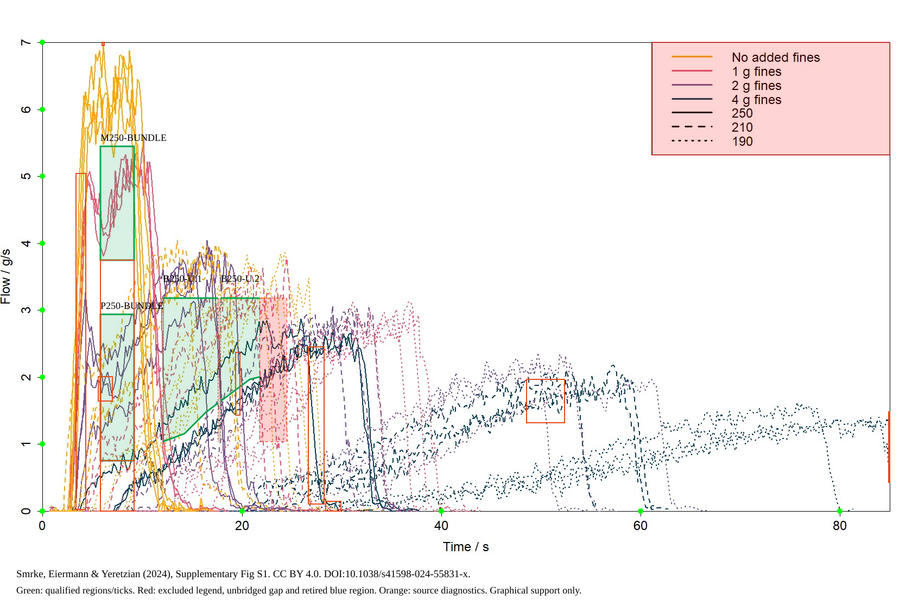
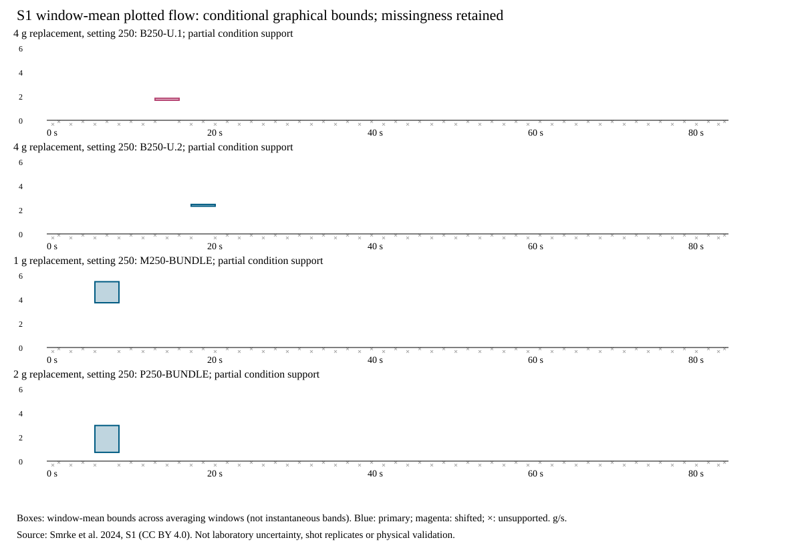

# SCI-MD-SMRKE-TRANSIENT-HYDRAULICS-001

**At grinder setting 250, the retained solid-line branches with 2 g replacement
fines have lower mean plotted beverage delivery over 6–9 s than the retained
branches with 1 g replacement: difference 2g−1 g is enclosed by
[−4.742197,−0.760693]g/s.** This is one secondary, partial graphical comparison.
It does not cover complete condition populations, establish a fines-wide shape
effect, or compare added fines with zero replacement.

**No within-fragment temporal direction or constant-window-mean exclusion
qualifies on the fixed lattices.** The two retained blue fragments are too short
after enforcing gaps and identity boundaries. All nine primary0-vs-added-fines
condition pairs, all same-clock multipliers, and normalized shapes remain
unsupported. This is a limit of this bounded reconstruction, not proof of no
fines effect or of impossibility of a better reconstruction.

G1 / NO_GOVERNING_PHYSICS_CHANGE / RESEARCH_ONLY / RETROSPECTIVE / TARGET_EXPOSED /
SOURCE_INTERNAL / NONSCORING. PHYSICAL_VALIDATION=NOT_ESTABLISHED.

## Source and correction

Smrke, Eiermann & Yeretzian (2024), Scientific Reports 14:5612,
[article](https://doi.org/10.1038/s41598-024-55831-x), Supplementary Figure S1,
[CC BY 4.0](https://creativecommons.org/licenses/by/4.0/). The held and independently
downloaded official DOCX match SHA2563979d56519975550a7bf6b67684f7b6243b0b1f527795b94201d9d8ea91e2859;
embedded native 1680×1041 image matches79a208a13500b230eaae9e89d66e641e8f459e5fa0797f769a838b6f8bfba36e.
Methods and licensing were inspected in primary full-text XML; see [PLAN](PLAN.md).

The active source is reconstructed from native pixels with the full0–7 g/s
scale, explicit non-data masks and source-coordinate provenance. The defective
18,001-row CSV is retired to its pinned Git identity; it is neither doubled nor
treated as shots. The known late yellow legend row is excluded. Details and
failed-attempt identities are in [CORRECTION](../../../puckworks/data/smrke2024/s1/CORRECTION.md).

The original retrospective contract was frozen before numerical contrasts.
Independent review identified a blue branch substitution and missed boundary
contact; an author check also found identity continuation across an oversized
gap. Corrections remove unsupported temporal evidence and retain the original
contract hashes and candidate readings. They do not change the3 s windows or
1.5 s sensitivity offset. The native right-frame remainder is also accounted for.
These corrections are disclosed in [CONTRACT_FREEZE](CONTRACT_FREEZE.json).



## Coverage and the four supported window requests

| Setting | Fines replacement(g) | Nominal extractions per cell | Retained qualified objects | Complete represented condition envelope |
|---|---|---:|---|---|
|190|0,1,2,4 (four separate cells)|3 each|None|No, all four|
|210|0,1,2,4 (four separate cells)|3 each|None|No, all four|
|250|0|3|None; upper-boundary clipping among other ambiguities|No|
|250|1|3|M250-BUNDLE: crossed solid branches, no persistent partner identity|No|
|250|2|3|P250-BUNDLE: crossed solid branches, no persistent partner identity|No|
|250|4|3|B250-U.1 andB250-U.2: disconnected fragments of one candidate corridor|No|

All 12 cells/36 nominal extractions remain in [COVERAGE.json](COVERAGE.json).
Recovered physical shots:0. Full source-visible trace counts and fully hidden
support are unknown.14,753 admitted raster runs form5,866 generic ink fragments;
these are not replicates. Their ambiguous memberships overlap all 12 cells and
must not be summed across cells. Three audited regions yield four qualified
objects after splitting the blue gap. Objects are subsets of the ink inventory,
not additional observations or extra shots.

| Object | Lattice/window(s) | Mean plotted flow enclosure(g/s) | Native support witness |
|---|---|---|---|
|M250-BUNDLE,1g|Primary[6,9]|[3.722543352,5.470520232]|x 185–247; y 270–480 solid-cluster slab|
|P250-BUNDLE,2g|Primary[6,9]|[0.728323699,2.961849711]|x 185–247; y 580–850 solid-cluster slab|
|B250-U.2,4g|Primary[18,21]|[2.302986512,2.450404625]|qualified native columns 407–478; per-column extents retained|
|B250-U.1,4g|Shifted[13.5,16.5]|[1.665703275,1.829710983]|qualified native columns 301–401; per-column extents retained|

Displayed bounds round outwards. [WINDOW_WITNESSES.json](WINDOW_WITNESSES.json)
contains exact rational bounds, every time-weighted integration cell, uncertain
x ranges, native y extents and source-cell IDs. The first two windows have
uncertain inverse-x range[7487/40,19541/80] across their full window (187.175–244.2625px);
their entire range lies inside both audited slabs. The lower purple bound is
intentionally loose; the slab contains every retained continuation, rather than
estimating a representative shot.

All 232 selected-object/window requests are in [WINDOWS.csv](WINDOWS.csv);
228 are unsupported. [GENERIC_WINDOW_REQUESTS.json](GENERIC_WINDOW_REQUESTS.json)
compactly and exactly specifies all 340,228 generic-fragment/window requests as
the Cartesian product of the hash-bound fragment table and58 listed windows;
all are unsupported for temporal inference. It is an explicit factorization,
not omitted requests. Both lattices include their incomplete leading/terminal
remainders, ending at native-frame 124880/1469 s. The uncertain edge is recorded in
[DOMAIN_COVERAGE](DOMAIN_COVERAGE.json). Startup, terminal-candidate falls, tails,
patterned gaps and boundary contacts remain in source accounting. None supplies
a qualified interior conclusion merely by being low or falling.

## Scientific outcomes

1. **Interior window-mean behaviour:** each blue fragment has at most one complete
   window per lattice, hence zero eligible ordered pairs or successive three-window
   recovery tests. Constant window means are UNINFORMATIVE for these fragments;
   the crossed bundles are UNSUPPORTED for persistent-history tests. They cannot
   be joined across missing columns 402–406 or across lattices. No pointwise
   monotonicity, instantaneous trough or sustained instantaneous change follows.
   The caption's typically increasing-flow interpretation is not verified or
   refuted by the qualified temporal support.
2. **Fixed-grind fines contrasts:** all 18 intended pairs are enumerated on all 58
   windows (1,044 requests). One secondary250:1g-vs2 g request supports a strict
   partial-bundle separation;17 intended pairs have no eligible request. All nine
   primary0-vs1/2/4 g comparisons are unsupported. For the supported pair the exact
   bounds are A=[644/173,4732/865], B=[126/173,2562/865]; B−A=[−4102/865,−658/865]g/s.
   Within-bundle mean-flow spread is only enclosed: 0–1512/865 g/s for1 g and
   0–1932/865 g/s for2 g, including graphical allowances. These are upper bounds,
   not measured replicate variation. Every retained path in the1 g slab exceeds
   every retained path in the2 g slab on this window under the contract. Complete
   condition, physical-replicate and population claims remain unsupported.
3. **Constant multipliers:** all 18 intended condition pairs on both lattices are
   UNSUPPORTED: no fixed persistent cross-condition pairing has two complete
   common interior windows. No multiplier exclusion or equivalence is earned.
   The implemented exact necessary-overlap test handles signed/zero-containing
   bounds and fixed-pair alternatives; it does not switch partners between windows.
   The constant-mean tests likewise earn no exclusion or not-excluded history
   claim from a single window. General permeability explanations, amplitude plus
   time shifts and duration rescaling are not adjudicated.
4. **Processing/clock/pressure/identity limits:** S1 is the derivative of beverage
   mass, not volumetric flow, puck throughput or intrinsic permeability. Pump
   events, balance response, smoothing/differentiation and per-trace alignment
   are not established. Nominal9 bar is not synchronized measured puck pressure.
   The 40 g manual target is not an exact area; onsets/endpoints and physical shot
   identities are not recovered. NORMALIZED_SHAPE_SUPPORT=UNRESOLVED_SOURCE_SUPPORT.

The intervention replaces0/1/2/4 g within nominal 20 g, not an increase in total dose.
Zero replacement retains native fines. The 120 µm sieve cut differs from measured
volume share below 100 µm. Settings are apparatus-specific, not particle diameters.
Graphical reading/calibration allowances are not confidence intervals,
experimental error bars, sensor-response bounds or replicate uncertainty.



## Consequence, preservation and reproduction

Models reproducing these particular retained beverage-delivery branches must
respect the conditional6–9 s separation. No new law, migration/deposition, erosion,
clogging, channel mechanism, pressure equivalence or physical validation follows.
No condition-wide shape conclusion is licensed. The authors' permeability-only
interpretation is recorded as an assumption, not imposed on future models.

Figure 3 CSV bytes/order/keys, envelope/transfer code, S-A and blocked S-B, and all
accepted endpoint receipts/verifier remain unchanged. Historical endpoint
negative results concern their tested endpoint models; EWP's prior fines screen
rejected a particular family on pressure ordering and did not evaluate its
temporal gate. Neither establishes absence of real fines effects. EWP source,
production/defaults, dependency locks and historical corpus snapshots are unchanged.

Exact offline commands from the repository root:

```bash
# Analysis uses committed native cells; standard library only.
python -m puckworks.analysis.smrke2024_transient --output /tmp/smrke-s1-reproduced
# Full native reconstruction additionally uses the existing viz extra's Pillow.
python -m puckworks.analysis.smrke2024_transient --reconstruct --output /tmp/smrke-s1-reconstructed
python docs/analysis/sci_md_smrke_transient_hydraulics_001/review_check.py
python -m pytest -q tests/test_smrke2024_transient.py tests/test_data_loaders.py \
  tests/test_smrke2024_envelope.py tests/test_smrke2024_transfer.py
```

The full reconstruction writes deterministic data files in the existing family;
run in a clean checkout or copy for byte comparison. No network, source code from
the publication, optimizer, physical model or endpoint fit is executed by the
producer. Synthetic endpoint regressions do not refit source endpoint observations.
[REVIEW.md](REVIEW.md) records the independent scientific disposition; [VERIFICATION.md](VERIFICATION.md)
records software/reproduction and hosted-CI dispositions separately. One draft
PR remains open/unmerged with auto-merge disabled. No successor is executed.
