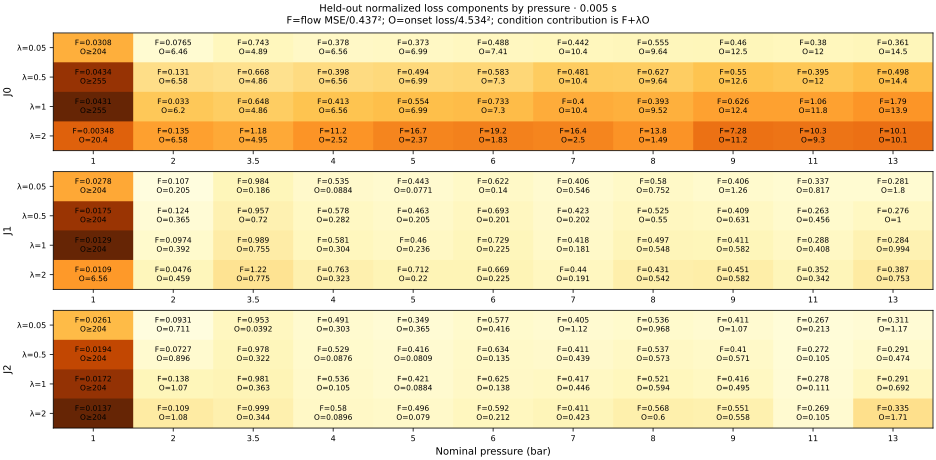

# PW-JOINT-CLOCK-001 — coupled clocks

**Retrospective capability comparison; TARGET_EXPOSED; PHYSICAL_VALIDATION=NOT_ESTABLISHED.**

**At primary λ=1, J1/J2 reduce the onset RMSE bound from J0's 18.79 to 8.60/8.34 s; four 1-bar brews remain undetected.** Final scores use frozen parameters at **0.005 s**, all **56/56 brews** and FORM_A's common masks.

| Primary comparison | Flow RMSE endpoint/primary/companion, g/s | Onset RMSE bound, s | 0.02-s sensitivity: primary flow / onset |
|---|---|---:|---|
| J0, no delay | 0.2154/0.3263/0.3719 | ≥18.785 | 0.3263 / ≥18.785 |
| J1, constant front delay | 0.2020/0.2783/0.2817 | ≥8.598 | 0.2783 / ≥8.598 |
| J2, pressure front + scale lag | 0.2080/0.2744/0.2755 | ≥8.336 | 0.2744 / ≥8.336 |
| D0 benchmark | 0.1530/0.2676/0.3449 | ≥17.974† | 0.2676 / ≥17.974† |
| B1 | 0.2865/0.4555/0.6214 | unavailable | — |

†D0's added fresh-bed beverage observer is ungraded. Its separate historical replay reproduces **0.153001/0.254185 g/s** endpoint/own-support trace. [All comparators](COMPARISON_TABLE.csv), including W0/W1/W2/W2T. Scored flow is liquid ρQ against scale-derived beverage flow; [endpoint basis difference](FLOW_BY_BREW.csv) is ungraded.

Primary onset grades all **MISSES**; endpoint accuracy versus B1 is J0 **MEETS / TIE**, J1/J2 **NEAR / UNRESOLVED**. [Existing bands/all grades](GRADES.csv).

**Paired differences of computed onset bounds [95%]:** J1−J0 **−10.19 [−12.22, −8.28] s**; J2−J0 **−10.45 [−12.57, −8.42]**; J2−J1 **−0.26 [−0.84, +0.40]**. These compare computed bounds, not unknown true-RMSE differences. J2−J0 primary-flow difference is **−0.0519 [−0.1269, +0.0139] g/s**; J2−D0 endpoint difference **+0.0550 [+0.0198, +0.0884]**. [Both scores/all paired metrics](PAIRED_COMPARISONS.csv); identical draws, intervals conditional on fitted parameters/fixed Mc.

**Sensitivities:** λ=.05/.5/1/2 give J1 onset bounds/scores **8.70/8.59/8.60/3.72 s** and J2 **8.97/8.22/8.34/8.56**. Corresponding 1-bar detections: J0 **1/0/0/5**, J1 **1/1/1/5**, J2 **1/1/1/1**, each of five. λ=2 J1 detects all 56, grades onset **NEAR**, but ≥9-bar slope **MISSES**; flow RMSE becomes **0.228/0.291/0.293**. λ=2 J0's primary-flow RMSE rises to **1.177**. No weight is selected by these results. [Every weight/step](NUMERICAL_SCORES.csv).

F and O use the declared fixed fitting support/normalizations; held-out condition contribution is F+λO. This is a composite criterion on shared histories, not independent likelihoods; normalizations are not noise estimates. [Values](LOSS_BY_PRESSURE.csv).

**Pressure errors:** primary J0/J1/J2 at **2 bar: −11.44/+1.68/+3.51 s** (4/4 detections each); at **1 bar**, medians remain bounds near **97.9 s**, observed **25.06**. Actual censor starts span **97.858–97.946 s**. At 3.5/6/13 bar J2 errors are **+2.43/−0.09/+3.49 s**. Supplementary nine-condition median RMS: J0/J1/J2 **13.409/2.219/1.669 s**; this suppresses within-condition variation. [Per brew](ONSET_BY_BREW.csv) · [all pressures/fronts](ONSET_BY_PRESSURE.csv).

**In-sample counterexample:** the descriptive J1 λ=1 curve detects 1-bar onset at **18.6 s** (observed **25.06**), with endpoint flow **0.112 g/s** and 9–13-bar slope **−0.0808 g/s/bar**. Pooled held-out slope columns combine three different fold fits; they are not one constitutive curve. [Retained sweep](DESCRIPTIVE_SWEEP.csv).

**τ0 point estimates:** DESCRIPTIVE_ALL across weights **11.60–13.58 s**; ordinary folds at λ=1 **13.14–13.96 s**. These come from overlapping training sets, are not uncertainty intervals, and are not a measured wetting duration. [Fits](FITS.csv).

The [LC_JOINT_TRANSFER_001 frozen f=0 diagnostic](https://github.com/trbrewer/puckworks/blob/0e1944de72819f0a058b99b6c0b2879e2d4ffde6/docs/research/LC_JOINT_TRANSFER_001/SUMMARY.md) found better feasible A-J1 solutions in **11/48 fits**, including the primary **9- and 11-bar folds**.

J2 provides no resolved incremental onset gain at the primary weight, and its front/lag decomposition is weakly identified. Some sensitivity comparisons improve flow (λ=0.05 J2−J1 primary trace −0.01045 [−0.01889, −0.00208] g/s), without resolving the full-cohort problem. Primary J2 bed/scale primary-flow RMSE is **0.2638/0.2744**; **fitted scale lag; physical mechanism unidentified**. [Details](RESULTS.md).

**Distinct extrema:** primary descriptive J0/J1/J2 100-s flow peaks **5.113/6.566/6.577 bar** (numerical interpolation, no statistical interval); nominal peak grades all **MEETS**. J2 front minimum is **3.5 bar on-grid** (Pw=3.597); detector minimum ties **4/5 bar**, while its held-out minimum is **6 bar**, observed **3.5**. J0/J1 fronts are pressure-flat. [All extrema/ties/boundaries](EXTREMA.csv).

Largest step effects: detector **0.100 s** (held-out **0.094**), flow RMSE **0.0000403 g/s**; no detection changes. **144 fits, 2,592 starts, 948 case pairs, 315.58 recorded core-hours**; six interrupted attempts retained and completed, no CFD. [Methods/limitations](METHODS.md) · [verification](VERIFICATION.json) · [manifest](RUN_MANIFEST.json).

J1 is the parsimonious timing reference among the tested coupled models. At primary λ=1 it substantially reduces the computed onset-error bound, but four 1-bar brews remain undetected and endpoint error is higher than D0. J2 has no resolved incremental onset gain at the primary weight, and its front/lag decomposition is weakly identified. The λ=2 J1 sensitivity detects all 56 brews and reaches onset NEAR, while its 1-bar median remains 10.12 s late and the pooled held-out high-pressure slope becomes too flat. No evaluated held-out calibration repairs all the timing and flow features. These results identify a remaining low-pressure prediction problem under the fixed recovery and observation assumptions; they do not establish that Form A is incapable of combining low-pressure detection with a high-pressure downturn.
