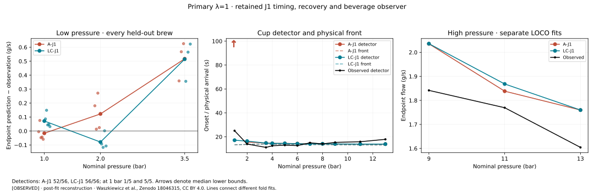
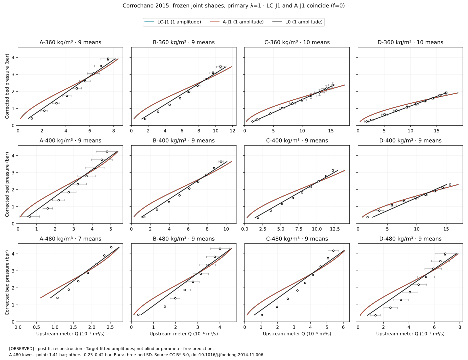

# PW-LC-JOINT-TRANSFER-001 — retained J1, substituted LC capacity

**At primary λ=1, LC-J1 detects 56/56 brews versus A-J1's 52/56, but worsens
1-bar flow and gives no Corrochano shape improvement.** The high-pressure downturn
is retained. This task has **not earned a cross-experiment advance**.
Retrospective, TARGET_EXPOSED; PHYSICAL_VALIDATION=NOT_ESTABLISHED.

All scores use frozen parameters at **0.005 s**, all **56/56 available brews**,
eleven whole-condition folds, matching fixed Mc and the original masks. RMSE here
is the inherited mean of within-condition RMSEs. A-J1 is the saved comparator,
replayed without optimization; LC-J1 is the best finite evaluated result from the
declared search. All 48 searches show start disagreement, so these are not claims
about globally optimized model families.

| Full-cohort metric | A-J1 | LC-J1 | LC−A [paired 95%] |
|---|---:|---:|---:|
| Endpoint flow, g/s | 0.201970 | 0.202459 | +0.000489 [−0.020714, +0.017218] |
| Primary trace, g/s | 0.278278 | 0.275165 | −0.003113 [−0.013572, +0.006152] |
| Companion trace, g/s | 0.281734 | 0.279808 | −0.001926 [−0.011635, +0.005763] |
| Detector onset, s | ≥8.598026; 52/56 detected | 3.554141; 56/56 detected | −5.043885 [−16.242803, +0.154999]† |

†This subtracts an A-J1 computed censor bound from an LC-J1 score; it is not a
bound on the unknown true-error difference. The 1,000 identical condition-then-
whole-brew resamples are conditional on fitted parameters and fixed Mc, without
refit uncertainty. [All paired results](PAIRED_COMPARISONS.csv).

**1. Low-pressure flow: worse at 1 bar, better point errors at 2 bar, a small
improvement at 3.5 bar.** The 1- and 2-bar paired intervals include zero; the
3.5-bar endpoint change is −0.002713 [−0.002779, −0.002679] g/s on its three brews.

| Held pressure; brews | Selected f | Endpoint RMSE A→LC, g/s | Primary trace A→LC | Companion trace A→LC |
|---|---:|---:|---:|---:|
| 1 bar; 5 | 0.438998 | 0.051780 → 0.083298 | 0.051537 → 0.054257 | 0.049819 → 0.057284 |
| 2 bar; 4 | 0.301669 | 0.163588 → 0.092193 | 0.125181 → 0.097437 | 0.121119 → 0.096927 |
| 3.5 bar; 3 | 0.001234 | 0.529820 → 0.527108 | 0.404757 → 0.404318 | 0.392265 → 0.391852 |

Endpoint signed condition errors change **−0.016006/+0.122432/+0.517287** to
**+0.071542/−0.079111/+0.514508 g/s** at 1/2/3.5 bar. Opposing errors make the
1–2-bar signed bias look better (+0.053213→−0.003785), while its mean absolute
condition error rises **0.069219→0.075327 g/s**. Across 1/2/3.5 bar, MAE rises
**0.218575→0.221720**. The inherited low-bias grade changes MISSES→NEAR
(signed bias +0.207904→+0.168979), not a uniform low-pressure improvement.
These MAEs average the absolute condition-mean residuals, not absolute errors
pooled across individual brews.

The within-2-bar ratio moves **1.824743→1.677963**, observed **1.249606**;
its absolute error falls 0.575136→0.428357. Alongside that, brew **1-2** endpoint
error rises **+0.075464→+0.148586 g/s**, and the 3.5-bar mean error remains
**+0.514508 g/s**. Both ratio denominators are positive; zero denominators remain
undefined. All five 1-bar brews (1-1, 1-2, 1-3, 1-4, 1-5b), including the inherited
native-qualification flag on 1-2, remain in [per-brew flow](FLOW_BY_BREW.csv).
[Pressure scores](FLOW_BY_PRESSURE.csv) · [paired pressure results](PAIRED_PRESSURE.csv)
· [low-pressure summaries](LOW_PRESSURE.csv).

**2. Detector timing/detection: the full-cohort score improves and all five
1-bar brews become detected, but pressure-specific timing errors remain.**
At 1 bar, A-J1 detects 1/5 and its median is bounded below by 97.871 s;
LC-J1 detects 5/5 with median **17.121 s**, versus **25.058 s** observed
(**7.937 s early**). LC-J1's five signed errors range from −11.227 to −6.269 s.
At 2 bar both detect 4/4, but onset RMSE worsens **2.840399→3.450147 s**;
the paired increase is **+0.609748 [+0.385340, +0.802569] s**. At 3.5 bar both
detect 3/3 and onset RMSE is unchanged at **3.939239 s**. Onset grades are
MISSES→NEAR. The physical front remains **13.284701 s at 1 bar** and
**13.623585 s at 2 bar** in both arms: improved cup detection is not improved
physical-front prediction. [Every onset/front](ONSET_BY_BREW.csv) ·
[pressure medians and counts](ONSET_BY_PRESSURE.csv).

**3. Useful high-pressure response: retained, with remaining level errors.**
The 9/11/13-bar out-of-fold slope changes **−0.074648→−0.075191 g/s/bar**;
both grade MEETS. LC's interval is [−0.075458, −0.074954]. Endpoint means at
9/11/13 bar are A **2.035346/1.838229/1.759808**, LC
**2.035955/1.868290/1.759808**, observed **1.841608/1.769480/1.604378 g/s**.
All three selected LC fits have **f=0**. The 9- and 11-bar changes come from
better feasible A parameter vectors, not the added term. Both arms retain
nominal peak **7 bar, MEETS**, rising-trend matches **5/5, MEETS**, and endpoint
accuracy versus B1 **NEAR**. [Scores/grades](SCORES.csv) · [continuous trends](LATE_TRENDS.csv).

These out-of-fold slopes combine different fitted models. The identical primary
descriptive constitutive curves instead have a 9–13-bar capacity slope
**−0.076649 g/s/bar** and global capacity maximum **2.195440 g/s at 6.560505 bar**
(all stationary candidates and endpoint limits checked). Their 100-s flow peaks
are **6.5 bar on-grid / 6.566199 bar interpolated**. Physical front arrival is
flat at **13.484510 s** over all 23 pressures; detector minima tie at **14.1 s
from 5 through 9 bar** on the retained grid. Held-out detector medians instead
reach their minimum at **13 bar**, across different folds.
[Capacity extrema](DESCRIPTIVE_CAPACITY.csv) · [sweep/ties](EXTREMA.csv).

**4. Corrochano: no primary improvement against A-J1, and worse than L0.**
The primary descriptive LC selection is exactly the saved **f=0** embedding;
the frozen shapes and amplitude-fitted predictions coincide in every realization.

| Primary matched contrast | D | 95% graphical-reading interval |
|---|---:|---:|
| LC-J1 − A-J1 | 0 exactly | [0, 0] |
| LC-J1 − L0 | +0.0263320 | [+0.0256033, +0.0270710] |
| A-J1 − L0 | +0.0263320 | [+0.0256033, +0.0270710] |

D is the equal-series mean of MSE differences divided by fixed central S².
Zero here follows identical functions, not an equivalence inference. The 108
means/twelve unequal series and 4,096 matched readings retain COR15's corrected
bed Pa→bar mapping and upstream-meter Q in m³/s. Only positive amplitudes are
target-fitted; constant recovery within each series is an assumption. These
reading intervals are conditional on frozen shapes, not population intervals.
All pressures are approximately 0.23–4.5 bar: no peak, high-pressure or fresh-puck
onset test. A-480's lowest point is **1.41 bar**, versus **0.23–0.42 bar** elsewhere;
lowest-point residuals are not at a common pressure.
[Dimensional scores](CORROCHANO_SERIES.csv) · [all signed residuals](CORROCHANO_RESIDUALS.csv)
· [paired reading contrasts](CORROCHANO_PAIRED.csv).

**Frozen-zero attribution and search limitations.** Objectives below are the
training composite at 0.02 s; the last column uses 0.005 s. The frozen diagnostic
changes only f, without fitting. Full precision, both numerical steps, all 48
selected f values and their resolution diagnostics are in [FITS.csv](FITS.csv).

| Training set | f | Saved A J | Selected LC J | Frozen f=0 J | Frozen f=0 − A, .005 s |
|---|---:|---:|---:|---:|---:|
| DESCRIPTIVE_ALL | 0 | 0.853016495 | 0.853016495 | 0.853016495 | 0 |
| LOCO 1.0 | 0.438997632 | 0.831114397 | 0.807536162 | 22.692451631 | +21.859502124 |
| LOCO 2.0 | 0.301668523 | 0.888068041 | 0.831621942 | 26.315386492 | +25.427318469 |
| LOCO 3.5 | 0.001233813 | 0.792808494 | 0.792227034 | 0.924463212 | +0.131654717 |
| LOCO 4.0 | 0 | 0.862753688 | 0.862753688 | 0.862753688 | 0 |
| LOCO 5.0 | 0 | 0.876756984 | 0.876756984 | 0.876756984 | 0 |
| LOCO 6.0 | 0.347728244 | 0.855746501 | 0.853106228 | 60.893601509 | +60.037854987 |
| LOCO 7.0 | 0.001886045 | 0.879446860 | 0.877315932 | 1.008666949 | +0.128680946 |
| LOCO 8.0 | 0 | 0.837189292 | 0.837189292 | 0.837189292 | 0 |
| LOCO 9.0 | 0 | 0.841056674 | 0.841015408 | 0.841015408 | −0.000041266 |
| LOCO 11.0 | 0 | 0.871124889 | 0.867482264 | 0.867482264 | −0.004077918 |
| LOCO 13.0 | 0 | 0.812335102 | 0.812335102 | 0.812335102 | 0 |

The 9/11-bar frozen-zero improvements exceed both inherited numerical diagnostics;
**11/48 fits** do so across weights. No A refit was added. The selected-versus-zero
columns measure only the term's effect at fixed common parameters. At primary
3.5 bar, the LC−A training difference changes **−0.00058146→+0.00063357** between
steps: the small training gain is unresolved. Small nonzero f alone is not attribution.

All **912** optimizer returns are successful, but **48/48 fits** have start
objective spread above 1e-6·max(1,Jbest). The retained primary descriptive f=0
point is the saved embedding, not proof of a stable global optimum. Exact f=0
is selected in **7/12 primary fits**; it is not automatically non-identification.
No selected fit has exactly f=1 or n=1. Near-objective sampled capacity spreads
at the primary weight are at most **0.00032014 g/s** on the 0–13-bar, 0.05-bar
grid; most sets contain only one sampled vector, so this does not establish
parameter identification or a continuum stability bound.

With 3.5 bar withheld, selected n at λ=.05/.5/1/2 is
**1.9968/4.0069/1.9794/2.0652**, rather than a selected near-step opening.
Some unselected starts have enormous n with f near one and objectives **2.53–3.73**
above their selected result. Raw n in those nearly linear mixtures does not
demonstrate a steep capacity curve. [Every start/boundary contact](OPTIMIZER_STARTS.csv)
and [sampled capacity envelopes](CAPACITY_CURVES.csv) preserve the evidence;
full trial histories remain external.

**Sensitivities do not replace the primary answer.** At λ=.05/.5/2, endpoint
RMSE A→LC is **0.203832→0.196910 / 0.207911→0.183087 / 0.227894→0.228586 g/s**;
onset is **≥8.697201→3.865839 / ≥8.587139→3.554971 / 3.717425→3.599856 s**.
LC detects 56/56 at every weight; A detects 52/56 except λ=2 (56/56).
Descriptive f is **0.365064/0.001079/0.093719** at those sensitivities.
Their external LC−A D values are **+0.00655237/+0.000037426/+0.00142271**,
all with positive graphical-reading intervals; LC−L0 is also positive at every
weight. The λ=2 high-pressure slope changes **−0.013651 (MISSES)→−0.112351 (NEAR)**.
No weight was selected by held-out or external performance.

**Verification and scope.** The matching 48 saved A objectives and 316 reference
case pairs reproduced, with maximum trace difference zero. Across all 632 frozen
case pairs there are no detection changes between steps; maximum onset change
is 0.100 s, endpoint change 3.84×10⁻⁸ g/s and common-trace change 8.01×10⁻⁷ g/s.
Twenty focused checks pass, including nesting, coordinate order, fold/seed/Mc
isolation, censoring and independent paired-metric arithmetic. The baseline quick
suite passed 8,065 tests; registry, Ruff and generated-artifact checks passed.
[Verification](VERIFICATION.json) · [reproduction/accounting](REPRODUCTION.json)
· [commands](REPRODUCE.md) · [methods](METHODS.md).

Exactly **48 fits / 912 starts**, no omission twins or bootstrap refits, and
**204.744 measured scientific core-hours**. The initial failed preflight replay's
total CPU was not captured (observed parent CPU ≥38 s), so this is not a complete
all-attempt total; [the gap and retained failure](PREFLIGHT_FAILURE.json) are
disclosed. All optimizer attempts are accounted for. A later figure-only import
failure and its retry are timed and included. Source attribution/permissions and
matching Mc are in [SOURCE_AUDIT.json](SOURCE_AUDIT.json) and
[MC_PROVENANCE.csv](MC_PROVENANCE.csv). The two existing campaigns are reused;
independent-campaign counts do not increase. EWP, defaults and historical results
are unchanged. No f value measures pores, bypass or channels; no causal mechanism
or physical validation is established. The declared comparison ends here.
