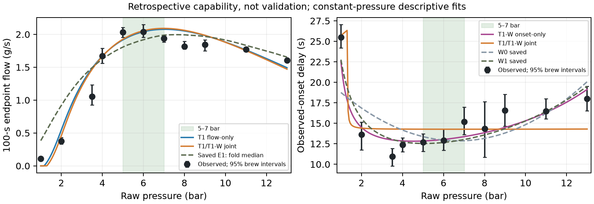

# PRESSURE-PEAK: consolidated findings

**capability demonstration, not validation; PHYSICAL_VALIDATION=NOT_ESTABLISHED; TARGET_EXPOSED.** This note consolidates existing results; it adds no analysis.

## The observation

Across 56 brews, flow peaks near 6 bar of measured line pressure. Above 9 bar, the measured decline is −0.0655 g/s per bar, with a wholly negative 95% interval of [−0.0880, −0.0403].[^observation] Stopping and restarting raises flow from 1.82 to 3.23–4.31 g/s; the cause remains unexplained.[^restart]

## What was ruled out

Strictly local, instantaneous compaction cannot produce the downturn: raising pressure adds non-negative permeability contributions to the flow integral, so flow cannot decrease.[^local] Tested swelling left the peak at too high a pressure. Trapped air reduced low-pressure error but made the decline too steep, and its flow and timing fits disagreed. Neither was a sufficient stand-alone explanation in the tested framework; other forms were not ruled out.[^mechanisms]

## Wetting

Observed first drip is fastest near 3.5 bar and generally gets slower above about 4 bar. The solver's simple Darcy wetting gives overlapping observed and simulated ranges at 1–2 bar, but its paired median first drip is 15.6 s too early at 13 bar. Both use time since stable pressure; observed onset also includes transport and detection lag.[^wetting]

## Earlier leads: C0 to C2

D0's form A, described below, is now the best graded fit. The C0 to C2 results in this section show how the work got there.

C0's strongest working lead combines a threshold around 1 bar with whole-bed compaction on a pressure scale around 5–6 bar. It reduces low-pressure overprediction; its flow-only fit met or nearly met every scored criterion.[^c0] The joint constant-pressure peak remains at 7.00 bar against the observed continuous estimate of 6.1 bar: roughly a 1-bar offset. Fitted separately, flow peaks at 7.05 bar (fold range 6.80–7.20) and wetting is fastest at 4.55 bar (2.35–5.05); the single compaction law forces both to one pressure, which is why the joint fit compromises.[^c0-separated] Its onset curve is nearly flat. The shape limitation is structural: the same exponential compaction law ties the flow peak and onset minimum to the same pressure, although the observations place them apart.[^shape]

C1 found a lower-objective onset-only fit (4.870 vs 6.014), but it places P0 (1.294 bar) above the early pressure of four of the five 1-bar brews, so their onset is set by the fixed 0.01-bar denominator floor rather than by the onset law. C0's onset-only values are therefore not superseded by a better physical fit. See PRESSURE_PEAK_STAGE_C1/SUMMARY.md.

The threshold is the firmest new result: its 95% interval excludes zero in every fit (flow-only 1.163 [0.894, 1.339] bar; onset-only 0.542 [0.147, 0.759]; joint 1.296 [0.709, 1.323]).[^c0-threshold]

[^attribution]

Stage C2 (feasible onset threshold) gives a two-scale fit with a consistent local scale: flow peak 6.90 bar and onset minimum 4.55 bar, a separation close to the observed one but about 1 bar high at both ends. Flow and onset need different thresholds (about 1.3 vs below 0.9 bar), so the flow threshold is not a simple wetting-entry pressure; see PRESSURE_PEAK_STAGE_C2/SUMMARY.md.

## What C3a and C3b add

At 1 bar, the detector's 0.1 g/s flow criterion fires last in 4/5 brews, compared with 0/51 elsewhere. Halving the detection thresholds moves the fitted onset scale Pd from 3.98 to 3.65 bar and the plug-in flow peak about 0.25 bar lower. That peak keeps the saved flow parameters; it isn't a flow refit. The slow 1-bar onset is partly a detector effect, but most of its slowness remains.[^c3-detector]

Smoothing the hard flow threshold with an exponential threshold distribution makes every in-sample screen worse. All three versions over-predict flow at 1, 2 and 3.5 bar.[^c3-smooth]

Applying the detector to the model's own flow (T3-O) leaves 4/5 held-out 1-bar onsets censored at the record end: the fitted flow threshold, 1.10 bar, exceeds their usual line pressure. Including the 1-bar onsets in the fit lowers the threshold to about 0.74 bar, but held-out 2-bar flow is over-predicted by +0.38 g/s. The open problem is the low-pressure flow law: the 1-bar brews flow at roughly 0.1 g/s below thresholds that fit 2 bar and above. C3b's other fits had unstable finite-difference Jacobians, so its 6.45-bar peak isn't an established result.[^c3-observer]

A single lagging whole-bed state isn't supported by these checks. The traces want no resolvable lag, and no tau in the tested range gives more than about 1.25 times the pre-pause flow, against the observed 1.75–2.35 times. Flow ratchets up after each restart, and pause flow rises from about 0.10 to 0.20 g/s across successive pauses. That points toward an irreversible change, but it's one qualitative record. The replay's zero flow during pauses is a simplification.[^c3-restart]

## What C3c to D0 add

C3c tried a convex opening, 1-exp(-(P/Pd)^n), with Pd fixed from each fold's onset fit. It failed at held-out 1 and 2 bar, but those are exactly the folds where the transferred Pd was distorted: with 1 bar held out, the onset fit's P0 sits on its -5 bar bound and hands over Pd = 7.37 bar, and with 2 bar held out it hands over 4.86 bar, against about 4 bar elsewhere. C3c couldn't separate the two causes.[^c3c] C3d freed Pd in the flow fit. Across its five screened fits and both seed groups, Pd stayed between 3.46 and 3.64 bar, so the flow data pin their own scale and it's the onset scale that moves. Freeing Pd improved held-out 1-bar flow, consistent with the transferred Pd causing C3c's 1-bar failure. At 2 bar the opening's shape, not the transferred Pd, remained the limit.[^c3d]

C3e screened four low-pressure variants on that free-Pd base and carried two forward: A, the convex opening with free Pd (four parameters), and LC, a mix of that opening with a linear one (five parameters, exploratory). A memory-clock term and a recovery-law swap added almost nothing and were dropped.[^c3e]

D0 graded A and LC with 200 paired whole-brew refits on the same draws as C2. A has no MISSES: accuracy and late trends are NEAR; peak, high-pressure slope, low-pressure bias and scale consistency MEET. Its continuous peak is 6.00 [5.77, 6.27] bar against the observed 6.1 [5.9, 6.3], the first graded fit to land on it. Its slope above 9 bar is -0.076 [-0.097, -0.056] g/s per bar, overlapping the observed interval. On identical draws it beats C2's T2-F on endpoint error by 0.025 [0.006, 0.040] g/s, and on trace error and slope as well.[^d0]

Low pressure is still wrong. A's held-out residuals are -0.06, -0.19 and +0.43 g/s at 1, 2 and 3.5 bar. The signed bias passes only because they cancel; their mean absolute value is 0.23 g/s. The scale MEETS is weak too: A's flow Pd, [3.37, 3.71] bar, sits inside the much wider onset interval, [3.23, 4.76] bar, and with n near 2.5 the two Pd values don't scale the same function. Neither form contains an onset law, so onset isn't scored.[^d0-limits]

LC lowers overall error (endpoint RMSE 0.125 against A's 0.153 g/s) and improves the shape within the 2-bar condition, but it predicts the 1-bar brews worse. When 3.5 bar is held out, 48 of 200 refits move to a much steeper opening near 4 bar, near-step in most of them. With no training data between 2 and 4 bar, the location of that step isn't pinned down.[^d0-lc]

## External consistency (X1)

In a separate lab, machine and coffee, reported shot durations for extra-fine grind were longer at higher nominal pressure (12 vs 9 bar: +7 s; 12 vs 6 bar: +8 s). For extra-coarse grind they were 7 s shorter at 12 vs 6 bar and about the same at 12 vs 9 bar (-1 s, within rounding). That's sign-level evidence only, but it suggests the turnover location and the fitted Pd and Pstar belong to this grind and puck rather than being universal constants. A plug-in viscosity bound shows that early liquor at about 22 to 23% solids would give the 2.7-times viscosity range the memory term spans, so washout is large enough in principle; it isn't a test of the mechanism. A check on public Visualizer shots was inconclusive.[^x1]

## The CFD demonstration

The E1 mechanism was reproduced in the fluid-flow solver. At nominal constant pressures, after accounting for wetting delay, its largest endpoint difference from Python is about 2.4×10⁻⁵ g/s; its peak remains at 7.714 bar.[^cfd] The solver added the wetting front, geometry and measured pressure histories, exposing the first-drip mismatch; it did not remove the misplaced peak.[^cfd]

## Limits

This is one rig and one coffee protocol, fitted and assessed retrospectively. Run order and dates are unavailable, so drift cannot be tested. Good retrospective capability is not independent validation or proof of a physical cause.[^limits]

## Open questions

- Could separate pressure scales describe wetting and flowing-bed compaction?
- What irreversible change happens at each pressure cycle?[^c3-restart]
- What low-pressure flow law fits 1, 2 and 3.5 bar together? A's convex opening misses 2 and 3.5 bar in opposite directions, and only twelve brews constrain it.[^c3-low-pressure][^d0-limits]
- Is the threshold pressure a capillary/trapped-air entry effect, and would it change with grind or basket?
- Are the fitted Pd and Pstar properties of this grind and puck, as X1's sign-level comparison suggests?[^x1]

Data: Waszkiewicz et al. (2025), CC-BY-4.0. Figure: reused C0 analysis of those data.[^attribution]

[^observation]: [PRESSURE_PEAK_STAGE_A/SUMMARY.md:5](PRESSURE_PEAK_STAGE_A/SUMMARY.md#L5); line-pressure convention in [PRESSURE_PEAK_STAGE_B0/SUMMARY.md:11](PRESSURE_PEAK_STAGE_B0/SUMMARY.md#L11).
[^restart]: [PRESSURE_PEAK_STAGE_A/SUMMARY.md:26](PRESSURE_PEAK_STAGE_A/SUMMARY.md#L26).
[^local]: [PRESSURE_PEAK_STAGE_A/SUMMARY.md:9](PRESSURE_PEAK_STAGE_A/SUMMARY.md#L9).
[^mechanisms]: [PRESSURE_PEAK_STAGE_B0C/SUMMARY.md:45–62](PRESSURE_PEAK_STAGE_B0C/SUMMARY.md#L45-L62); [PRESSURE_PEAK_STAGE_B0D/SUMMARY.md:30–47](PRESSURE_PEAK_STAGE_B0D/SUMMARY.md#L30-L47). These are failures of the tested forms, not general impossibility proofs.
[^wetting]: [PRESSURE_PEAK_STAGE_B0C/SUMMARY.md:3–12](PRESSURE_PEAK_STAGE_B0C/SUMMARY.md#L3-L12); EWP [docs/demonstrations/E1_CAPABILITY/SUMMARY.md:23](https://github.com/trbrewer/espresso-whole-pull/blob/569f3579ffa5ad607e05ec11b405a4771cd3f130/docs/demonstrations/E1_CAPABILITY/SUMMARY.md#L23) and [FIRST_DRIP_BY_PRESSURE.csv:12](https://github.com/trbrewer/espresso-whole-pull/blob/569f3579ffa5ad607e05ec11b405a4771cd3f130/docs/demonstrations/E1_CAPABILITY/FIRST_DRIP_BY_PRESSURE.csv#L12), rounded paired median.
[^c0]: [PRESSURE_PEAK_STAGE_C0/SUMMARY.md:18–34](PRESSURE_PEAK_STAGE_C0/SUMMARY.md#L18-L34). The approximate threshold and compaction scale describe the flow-only and joint fits.
[^c0-separated]: [PRESSURE_PEAK_STAGE_C0/SUMMARY.md:36](PRESSURE_PEAK_STAGE_C0/SUMMARY.md#L36).
[^c0-threshold]: [PRESSURE_PEAK_STAGE_C0/SUMMARY.md:24–28](PRESSURE_PEAK_STAGE_C0/SUMMARY.md#L24-L28).
[^shape]: [PRESSURE_PEAK_STAGE_C0/SUMMARY.md:34–42](PRESSURE_PEAK_STAGE_C0/SUMMARY.md#L34-L42).
[^c3-detector]: [PRESSURE_PEAK_STAGE_C3A/SUMMARY.md:5–7](PRESSURE_PEAK_STAGE_C3A/SUMMARY.md#L5-L7); per-condition counts in [RESULT_TABLE.csv:58–68](PRESSURE_PEAK_STAGE_C3A/RESULT_TABLE.csv#L58-L68), saved primary onset Pd and x0.5 point fit/plug-in peak in [RESULT_TABLE.csv:70–71](PRESSURE_PEAK_STAGE_C3A/RESULT_TABLE.csv#L70-L71), and paired 1-bar onset times in [RESULT_TABLE.csv:2–6](PRESSURE_PEAK_STAGE_C3A/RESULT_TABLE.csv#L2-L6).
[^c3-smooth]: [PRESSURE_PEAK_STAGE_C3A/SUMMARY.md:11–20](PRESSURE_PEAK_STAGE_C3A/SUMMARY.md#L11-L20); signed condition residuals for all three screens in [RESULT_TABLE.csv:95–97](PRESSURE_PEAK_STAGE_C3A/RESULT_TABLE.csv#L95-L97).
[^c3-observer]: [PRESSURE_PEAK_STAGE_C3B/SUMMARY.md:9–25](PRESSURE_PEAK_STAGE_C3B/SUMMARY.md#L9-L25); full-cohort, 1-bar and 2-bar fits in [RESULT_TABLE.csv:6–8](PRESSURE_PEAK_STAGE_C3B/RESULT_TABLE.csv#L6-L8), including flow thresholds, held-out endpoint residuals, observed flows and line pressures. The low-pressure conflict describes these tested fits, not an impossibility proof for every flow law.
[^c3-restart]: [PRESSURE_PEAK_STAGE_C3A/SUMMARY.md:22–28](PRESSURE_PEAK_STAGE_C3A/SUMMARY.md#L22-L28); episodes and replay bounds in [RESULT_TABLE.csv:99–113](PRESSURE_PEAK_STAGE_C3A/RESULT_TABLE.csv#L99-L113). The tau search covered 0.1–1000 s under both off-state pressure assumptions.
[^c3-low-pressure]: Five 1-bar brews, four 2-bar brews and three 3.5-bar brews in [PRESSURE_PEAK_STAGE_C3A/RESULT_TABLE.csv:58-60](PRESSURE_PEAK_STAGE_C3A/RESULT_TABLE.csv#L58-L60).
[^c3c]: Held-out errors in [PRESSURE_PEAK_STAGE_C3C/SUMMARY.md:7-22](PRESSURE_PEAK_STAGE_C3C/SUMMARY.md#L7-L22); transferred Pd values and the onset P0 bound in [SUMMARY.md:71-73](PRESSURE_PEAK_STAGE_C3C/SUMMARY.md#L71-L73).
[^c3d]: Five fits and both seed groups in [PRESSURE_PEAK_STAGE_C3D/SUMMARY.md:46-58](PRESSURE_PEAK_STAGE_C3D/SUMMARY.md#L46-L58); the held-out 2-bar limitation in [SUMMARY.md:62](PRESSURE_PEAK_STAGE_C3D/SUMMARY.md#L62).
[^c3e]: M1/M2 gains and parameter counts in [PRESSURE_PEAK_STAGE_C3E/SUMMARY.md:5-11](PRESSURE_PEAK_STAGE_C3E/SUMMARY.md#L5-L11); four screened forms in [SUMMARY.md:17-22](PRESSURE_PEAK_STAGE_C3E/SUMMARY.md#L17-L22); form definitions in [PLAN.md:17-48](PRESSURE_PEAK_STAGE_C3E/PLAN.md#L17-L48); A and LC carried into D0 in [PRESSURE_PEAK_STAGE_D0/SUMMARY.md:5](PRESSURE_PEAK_STAGE_D0/SUMMARY.md#L5).
[^d0]: Grades in [PRESSURE_PEAK_STAGE_D0/SUMMARY.md:5-10](PRESSURE_PEAK_STAGE_D0/SUMMARY.md#L5-L10), slope in [SUMMARY.md:18-20](PRESSURE_PEAK_STAGE_D0/SUMMARY.md#L18-L20), continuous peak in [SUMMARY.md:25-27](PRESSURE_PEAK_STAGE_D0/SUMMARY.md#L25-L27), and paired A minus T2-F differences in [SUMMARY.md:81-93](PRESSURE_PEAK_STAGE_D0/SUMMARY.md#L81-L93). The 200 refits are recorded in [SUMMARY.md:115](PRESSURE_PEAK_STAGE_D0/SUMMARY.md#L115), with draw indices and multiplicities in [RESULT_TABLE.csv:3](PRESSURE_PEAK_STAGE_D0/RESULT_TABLE.csv#L3); C2's draw count and seed are in [PRESSURE_PEAK_STAGE_C2/SUMMARY.md:5](PRESSURE_PEAK_STAGE_C2/SUMMARY.md#L5). The observed continuous peak and interval are in [PRESSURE_PEAK_STAGE_C1/SUMMARY.md:42](PRESSURE_PEAK_STAGE_C1/SUMMARY.md#L42), and the observed slope interval is in [PRESSURE_PEAK_STAGE_C3E/SUMMARY.md:57](PRESSURE_PEAK_STAGE_C3E/SUMMARY.md#L57).
[^d0-limits]: Residuals, signed bias and mean absolute residual in [PRESSURE_PEAK_STAGE_D0/SUMMARY.md:45-48](PRESSURE_PEAK_STAGE_D0/SUMMARY.md#L45-L48); flow/onset Pd intervals in [SUMMARY.md:36-39](PRESSURE_PEAK_STAGE_D0/SUMMARY.md#L36-L39); onset and scale interpretation, including n near 2.5, in [SUMMARY.md:153-155](PRESSURE_PEAK_STAGE_D0/SUMMARY.md#L153-L155).
[^d0-lc]: Endpoint errors in [PRESSURE_PEAK_STAGE_D0/SUMMARY.md:18-21](PRESSURE_PEAK_STAGE_D0/SUMMARY.md#L18-L21), 1-bar residuals in [SUMMARY.md:45-48](PRESSURE_PEAK_STAGE_D0/SUMMARY.md#L45-L48), and within-2-bar ratios, the 48-of-200 draw count and HYD-LOCO-3.5 identification in [SUMMARY.md:109-123](PRESSURE_PEAK_STAGE_D0/SUMMARY.md#L109-L123).
[^x1]: External duration comparison in [PRESSURE_PEAK_X1/SUMMARY.md:17-21](PRESSURE_PEAK_X1/SUMMARY.md#L17-L21); duration contrasts in [Perticarini pressure/grind RESULT.md:87-97](../analysis/sci_md_perticarini_pressure_grind_001/RESULT.md#L87-L97) and its conditional rounding caveat in [RESULT.md:126-134](../analysis/sci_md_perticarini_pressure_grind_001/RESULT.md#L126-L134). The 2.7-times viscosity bound and 22-23% solids values are in [PRESSURE_PEAK_X1/SUMMARY.md:34-54](PRESSURE_PEAK_X1/SUMMARY.md#L34-L54); the inconclusive Visualizer memory-clock result is in [SUMMARY.md:149-154](PRESSURE_PEAK_X1/SUMMARY.md#L149-L154). Visualizer data: thanks to the contributing users who made their shots public.
[^cfd]: EWP [docs/demonstrations/E1_CAPABILITY/SUMMARY.md:6–23](https://github.com/trbrewer/espresso-whole-pull/blob/569f3579ffa5ad607e05ec11b405a4771cd3f130/docs/demonstrations/E1_CAPABILITY/SUMMARY.md#L6-L23).
[^limits]: [docs/cards/waszkiewicz2025.md:54](../cards/waszkiewicz2025.md#L54); [PRESSURE_PEAK_STAGE_A/SUMMARY.md:7](PRESSURE_PEAK_STAGE_A/SUMMARY.md#L7); [PRESSURE_PEAK_STAGE_C0/SUMMARY.md:3](PRESSURE_PEAK_STAGE_C0/SUMMARY.md#L3).
[^attribution]: [PRESSURE_PEAK_STAGE_A/SUMMARY.md:28](PRESSURE_PEAK_STAGE_A/SUMMARY.md#L28); [PRESSURE_PEAK_STAGE_C0/SUMMARY.md:32](PRESSURE_PEAK_STAGE_C0/SUMMARY.md#L32). Figure reused from that C0 result, with no changes.

No successor stage is authorized.
