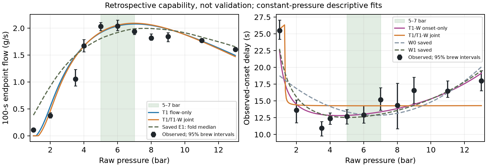

# PRESSURE-PEAK: consolidated findings

**Capability, not validation. PHYSICAL_VALIDATION=NOT_ESTABLISHED.** This note consolidates existing results; it adds no analysis.

## The observation

Across 56 brews, flow peaks near 6 bar of measured line pressure. Above 9 bar, the measured decline is −0.0655 g/s per bar, with a wholly negative 95% interval of [−0.0880, −0.0403].[^observation] Stopping and restarting raises flow from 1.82 to 3.23–4.31 g/s; the cause remains unexplained.[^restart]

## What was ruled out

Strictly local, instantaneous compaction cannot produce the downturn: raising pressure adds non-negative permeability contributions to the flow integral, so flow cannot decrease.[^local] Tested swelling left the peak at too high a pressure. Trapped air reduced low-pressure error but made the decline too steep, and its flow and timing fits disagreed. Neither was a sufficient stand-alone explanation in the tested framework; other forms were not ruled out.[^mechanisms]

## Wetting

Observed first drip is fastest near 3.5 bar and generally gets slower above about 4 bar. The solver's simple Darcy wetting gives overlapping observed and simulated ranges at 1–2 bar, but its paired median first drip is 15.6 s too early at 13 bar. Both use time since stable pressure; observed onset also includes transport and detection lag.[^wetting]

## The best current explanation

C0's strongest working lead combines a threshold around 1 bar with whole-bed compaction on a pressure scale around 5–6 bar. It reduces low-pressure overprediction; its flow-only fit met or nearly met every scored criterion.[^c0] The joint constant-pressure peak remains at 7.00 bar against the observed continuous estimate of 6.1 bar: roughly a 1-bar offset. Its onset curve is nearly flat. The shape limitation is structural: the same exponential compaction law ties the flow peak and onset minimum to the same pressure, although the observations place them apart.[^shape]

[^attribution]

## The CFD demonstration

The E1 mechanism was reproduced in the fluid-flow solver. At nominal constant pressures, after accounting for wetting delay, its largest endpoint difference from Python is about 2.4×10⁻⁵ g/s; its peak remains at 7.714 bar.[^cfd] The solver added the wetting front, geometry and measured pressure histories, exposing the first-drip mismatch; it did not remove the misplaced peak.[^cfd]

## Limits

This is one rig and one coffee protocol, fitted and assessed retrospectively. Run order and dates are unavailable, so drift cannot be tested. Good retrospective capability is not independent validation or proof of a physical cause.[^limits]

## Open questions

- Could separate pressure scales describe wetting and flowing-bed compaction?
- What causes the restart jump?
- Should the owner pursue that distinction or write up the present findings?

The programme is paused for that choice. No new mechanism stage is authorized.

Data: Waszkiewicz et al. (2025), CC-BY-4.0. Figure: reused C0 analysis of those data.[^attribution]

[^observation]: [PRESSURE_PEAK_STAGE_A/SUMMARY.md:5](PRESSURE_PEAK_STAGE_A/SUMMARY.md#L5); line-pressure convention in [PRESSURE_PEAK_STAGE_B0/SUMMARY.md:11](PRESSURE_PEAK_STAGE_B0/SUMMARY.md#L11).
[^restart]: [PRESSURE_PEAK_STAGE_A/SUMMARY.md:26](PRESSURE_PEAK_STAGE_A/SUMMARY.md#L26).
[^local]: [PRESSURE_PEAK_STAGE_A/SUMMARY.md:9](PRESSURE_PEAK_STAGE_A/SUMMARY.md#L9).
[^mechanisms]: [PRESSURE_PEAK_STAGE_B0C/SUMMARY.md:45–62](PRESSURE_PEAK_STAGE_B0C/SUMMARY.md#L45-L62); [PRESSURE_PEAK_STAGE_B0D/SUMMARY.md:30–47](PRESSURE_PEAK_STAGE_B0D/SUMMARY.md#L30-L47). These are failures of the tested forms, not general impossibility proofs.
[^wetting]: [PRESSURE_PEAK_STAGE_B0C/SUMMARY.md:3–12](PRESSURE_PEAK_STAGE_B0C/SUMMARY.md#L3-L12); EWP [docs/demonstrations/E1_CAPABILITY/SUMMARY.md:23](https://github.com/trbrewer/espresso-whole-pull/blob/569f3579ffa5ad607e05ec11b405a4771cd3f130/docs/demonstrations/E1_CAPABILITY/SUMMARY.md#L23) and [FIRST_DRIP_BY_PRESSURE.csv:12](https://github.com/trbrewer/espresso-whole-pull/blob/569f3579ffa5ad607e05ec11b405a4771cd3f130/docs/demonstrations/E1_CAPABILITY/FIRST_DRIP_BY_PRESSURE.csv#L12), rounded paired median.
[^c0]: [PRESSURE_PEAK_STAGE_C0/SUMMARY.md:18–34](PRESSURE_PEAK_STAGE_C0/SUMMARY.md#L18-L34). The approximate threshold and compaction scale describe the flow-only and joint fits.
[^shape]: [PRESSURE_PEAK_STAGE_C0/SUMMARY.md:34–42](PRESSURE_PEAK_STAGE_C0/SUMMARY.md#L34-L42).
[^cfd]: EWP [docs/demonstrations/E1_CAPABILITY/SUMMARY.md:6–23](https://github.com/trbrewer/espresso-whole-pull/blob/569f3579ffa5ad607e05ec11b405a4771cd3f130/docs/demonstrations/E1_CAPABILITY/SUMMARY.md#L6-L23).
[^limits]: [docs/cards/waszkiewicz2025.md:54](../cards/waszkiewicz2025.md#L54); [PRESSURE_PEAK_STAGE_A/SUMMARY.md:7](PRESSURE_PEAK_STAGE_A/SUMMARY.md#L7); [PRESSURE_PEAK_STAGE_C0/SUMMARY.md:3](PRESSURE_PEAK_STAGE_C0/SUMMARY.md#L3).
[^attribution]: [PRESSURE_PEAK_STAGE_A/SUMMARY.md:28](PRESSURE_PEAK_STAGE_A/SUMMARY.md#L28); [PRESSURE_PEAK_STAGE_C0/SUMMARY.md:32](PRESSURE_PEAK_STAGE_C0/SUMMARY.md#L32). Figure reused from that C0 result, with no changes.
