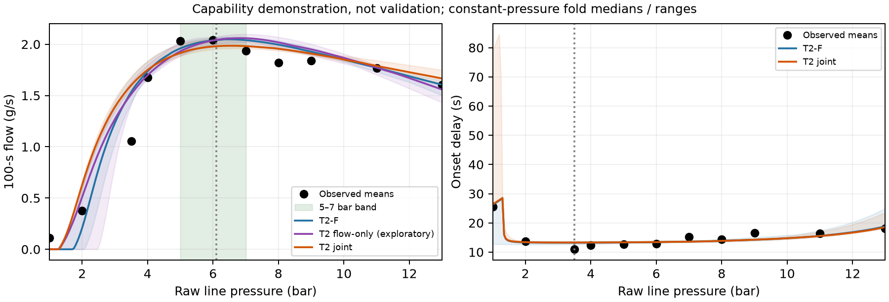

# PRESSURE-PEAK Stage C1 (T2)

**capability demonstration, not validation; PHYSICAL_VALIDATION=NOT_ESTABLISHED; TARGET_EXPOSED.**

56 brews; 11 condition-held-out folds; raw line pressure; unchanged B0c trace mask/weights, stable clock, Mc and 100-s observer. Owner-set bounds, starts and grading bands unchanged; no overall PASS.

| Fit | Accuracy | Peak | Slope | Trends | Onset | Low bias |
|---|---|---|---|---|---|---|
| T2-F | NEAR | MEETS | MEETS | NEAR | NEAR | MEETS |
| T2 flow-only | NEAR | MEETS | NEAR | NEAR | NOT_SCORED | MEETS |
| T2 joint | NEAR | MEETS | MEETS | NEAR | MISSES | NEAR |

T2-F is primary (3 + 2n); flow-only is EXPLORATORY (4); joint has 6 fitted parameters. T2-L is an ungraded, no-refit sensitivity.

| Fit | Pd [95%], bar | Pstar [95%], bar | P0 [95%], bar |
|---|---|---|---|
| T2-F | 1.924 [1.840, 3.938] | 20.389 [11.670, 27.992] | 1.732 [1.222, 1.901] |
| T2 flow-only | 3.606 [2.403, 5.937] | 13.129 [9.591, 17.344] | 1.299 [1.078, 1.522] |
| T2 joint | 1.946 [1.860, 2.534] | 27.093 [19.292, 28.895] | 1.294 [1.270, 1.615] |
| T2 onset-only | 1.924 [1.840, 3.938] | — | 1.294 [0.564, 1.296] |

Independent onset-only versus flow-only consistency: Pd **MEETS** (gap 0.000 bar); P0 **MEETS** (gap 0.000 bar). Pstar is reported, not graded.

| Fit | Flow peak; analytic | Onset minimum; analytic | Endpoint / trace / onset RMSE | Slope ≥9 bar [95%] | Low bias |
|---|---|---|---|---|---|
| T2-F | 6.45 [6.25, 6.95]; 6.44 [6.24, 6.97] | 3.20 [2.35, 3.25]; 3.22 [2.37, 3.24] | 0.193 / 0.287 / 3.681 | -0.0740 [-0.1371, -0.0343] | +0.043 |
| T2 flow-only | 6.85 [5.95, 7.05]; 6.85 [5.94, 7.03] | —; — | 0.207 / 0.293 / — | -0.1367 [-0.1576, -0.1064] | +0.025 |
| T2 joint | 6.55 [6.25, 6.80]; 6.56 [6.25, 6.79] | 3.25 [3.05, 3.75]; 3.24 [3.05, 3.76] | 0.183 / 0.279 / 6.578 | -0.0386 [-0.1405, -0.0287] | +0.189 |

Extrema: 0.05-bar grid, 1–13 bar, fold median [range], not confidence intervals; analytic turning points P0+Pd (onset) and P0+Pd·ln(1+Pstar/Pd) (capacity) exclude mass memory and are shown alongside the continuous extrema. T2-F's onset uses its separate onset-only P0. Observed flow peak: 6.1 [5.9, 6.3] bar; onset minimum: 3.5 bar. Flow errors/bias are g/s, onset error is s, slope is g/s/bar.

Onset identity versus saved C0 T1-W: max |Δ| Pd_bar=2.93863, P0_bar=1.08523, b_s_bar=11.3406, t0_s=6.82289; different-optimum folds: DESCRIPTIVE_ALL, HYD-LOCO-2.0, HYD-LOCO-3.5, HYD-LOCO-4.0, HYD-LOCO-5.0, HYD-LOCO-6.0, HYD-LOCO-7.0, HYD-LOCO-8.0, HYD-LOCO-9.0, HYD-LOCO-11.0, HYD-LOCO-13.0. No bounds/starts were changed to force agreement.

Onset-only Pd bound hits: point folds none; 2 bootstrap fold fits (HYD-LOCO-13.0). T2-F retains every such Pd. Other point bound hits: {"T2 onset-only": {"HYD-LOCO-1.0": ["P0_bar"]}}; all refit bound hits and per-fold Pd/source fits are in RESULT_TABLE.csv.

Observed-peak window sensitivity (1,000 whole-brew resamples; ungraded): 4-8 bar → 6.125 [5.918, 6.305] bar; 5-8 bar → 5.303 [5.000, 6.099] bar; 4-9 bar → 6.531 [6.186, 6.828] bar; 3.5-9 bar → 6.770 [6.623, 6.926] bar.

Restart (ungraded): P_r=8.38963 bar, `measurements_brew_restarting/brew_restarting.txt`, lines 774–827, `p2/100`. Last-5-s mass slopes give 1.833 → 3.203–4.306 g/s versus quoted 1.82 → 3.23–4.31 (differences +0.013, -0.027/-0.004 g/s). C0 and T2-F provide no matched-pressure pause gain; T2-L retains maximum-pressure compaction. Continued delivery can raise flow in all three. T2 contains no relaxation state and itself predicts no pause benefit. Hypothetical T2-F full relaxation permits exp(P_r/Pstar)=1.509 [1.349, 2.052]× (full-cohort fit, 95% interval) versus observed 1.747–2.349×; this relaxation is absent from T2-F. Off-state ~3-bar line pressure is not puck pressure.
Flow source: `m` versus `t/1000`; restart-window source lines 951–1004, 1129–1182, 1319–1372, 1509–1562, 1736–1789.

Full relaxation of the whole-bed factor bounds the restart jump at exp(P_r/Pstar). With P_r = 8.389625 bar, matching the low end of the observed ratio (1.747450) requires Pstar <= 15.030932 bar, and matching the high end (2.349328) requires Pstar <= 9.822430 bar. If the T2-F Pstar interval lies wholly above the low-end limit, relaxation of the whole-bed term cannot account for the restart rise within T2; if it overlaps, it is not excluded. Ungraded; one qualitative record.
Applied to T2-F's 95% Pstar interval: not excluded by this upper-bound check.

Saved comparators (endpoint / trace RMSE, g/s; replay rtol=1e-12): T1 flow-only 0.193/0.280; T1/T1-W joint 0.193/0.278; E1 0.242/0.329; F1 0.211/0.366; B1 0.286/0.437. T2-L endpoint/trace 0.188/0.288 g/s (ungraded).

200/200 paired whole-brew refits repeat all folds, Mc and onset-only Pd; seed 20261105. Parameter intervals use full-cohort fits; grades use held-out predictions. Accuracy: B0c 1,000 paired condition-then-brew resamples, ±0.25 g/s. Joint scales: 0.437 g/s and 4.534 s. Runtime 7.18 min cumulative wall; 1.59 refit CPU h; two-hour cap retained. [Full results, bounds, source identities and diagnostics](RESULT_TABLE.csv). Waszkiewicz et al. (2025), [Zenodo 18046315](https://doi.org/10.5281/zenodo.18046315), CC-BY-4.0. EWP E1 demonstration reviewed read-only; no solver or source-data changes.

**Recommendation:** Owner: review the T2-F capability grades, separate-scale consistency and restart limitation before selecting any further work.
